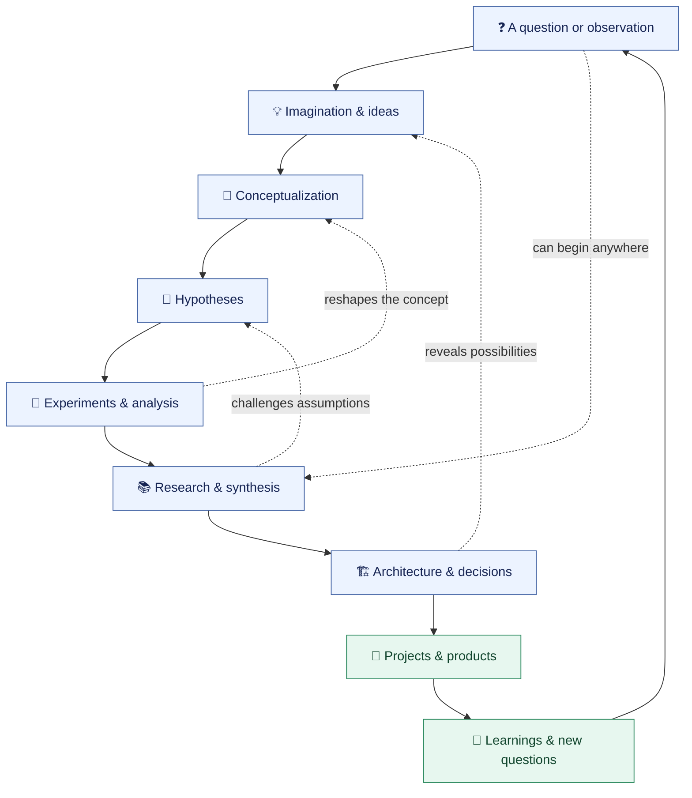
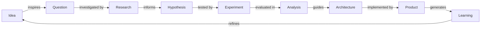
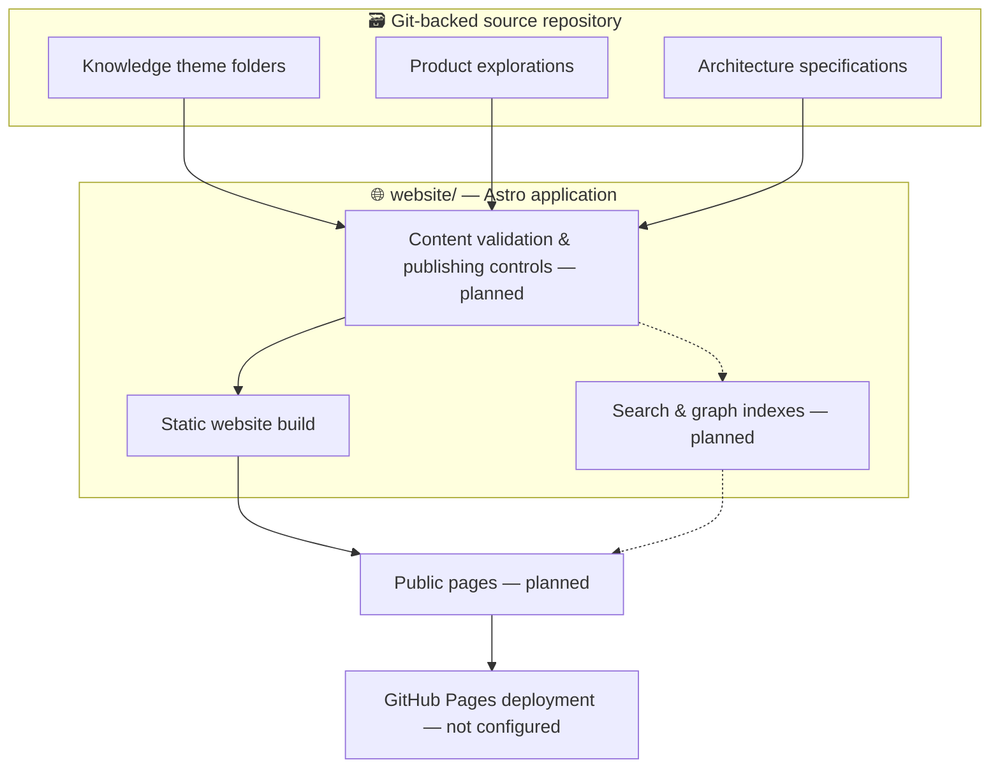
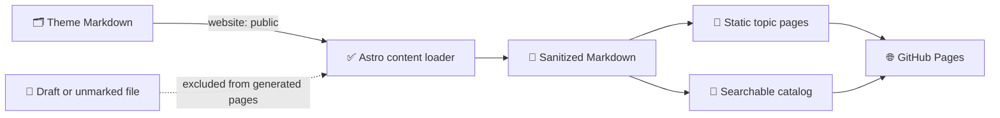
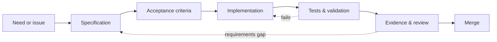

<div align="center">

# 🧭 VICHARA

### विचार · *Where Curiosity Becomes Creation*

**V**ision · **I**magination · **C**onceptualization · **H**ypothesis · **A**nalysis · **R**esearch · **A**rchitecture

**A living atlas of questions, ideas, evidence, experiments, systems, and everything learned along the way.**

[**Explore the Repository**](#️-explore-the-knowledge-atlas) · [**Discover the Philosophy**](#-the-philosophy) · [**See the Roadmap**](#️-the-road-ahead) · [**Develop Locally**](#-getting-started) · [**Contribute**](#-contributing--collaboration)

<sub>🌱 Local-first &nbsp;·&nbsp; 🗃️ Git-backed &nbsp;·&nbsp; 🧠 Inquiry-driven &nbsp;·&nbsp; 🏗️ Architecture-minded &nbsp;·&nbsp; 🌐 Open-web oriented</sub>

</div>

---

> [!IMPORTANT]
> **VICHARA is an evolving project.** The repository already organizes knowledge by theme and contains an Astro website bootstrap. The richer publishing engine, structured relationships, search, graph exploration, and GitHub Pages deployment are **planned**, not yet implemented. See [Current status](#-current-project-status) for the precise boundary.

## ✨ Why VICHARA exists

An idea rarely arrives as a polished project.

It begins as a question scribbled in a notebook. An unexpected connection during research. A diagram on a whiteboard. A hypothesis worth testing. A technology comparison. A failed experiment that changes our understanding. An architecture that eventually becomes a useful tool.

Most repositories capture **the final artifact**. Most blogs capture **the polished explanation**. Most note-taking systems capture **fragments**.

**VICHARA is being built to preserve the journey as well as the destination.**

| What often gets lost | What VICHARA aims to preserve |
|:--|:--|
| 💭 An idea that never became a project | The idea, its context, and why it mattered |
| ❓ Questions buried in scattered notes | Questions linked to investigations and answers |
| 🧪 Experiments with inconclusive outcomes | Hypotheses, methods, observations, and limitations |
| ⚖️ Architecture decisions without rationale | Alternatives, trade-offs, evidence, and decisions |
| 🕸️ Related concepts spread across many documents | Discoverable connections between concepts and projects |
| 📚 Research separated from implementation | Research that leads to designs, artifacts, and lessons |
| 🔄 A project whose understanding keeps changing | The evolution of thinking, visible in Git history |

**The goal is not to build a vault of static pages. It is to cultivate an evolving, navigable ecosystem of knowledge.**

## 🪷 The philosophy

*Vicāra* (विचार) is a Sanskrit word associated with thought, consideration, examination, and inquiry. Here it becomes a simple principle:

> **Think openly. Investigate rigorously. Connect generously. Build deliberately. Revise continuously.**

VICHARA's seven letters represent complementary **lenses**, not a waterfall process. A project may begin with architecture. Research may overturn the original vision. A new insight may generate several hypotheses. A surprising result may take us back to imagination.

### The seven lenses

| Lens | Guiding question | What it may contain | Example outputs |
|:--|:--|:--|:--|
| 🧭 **Vision** | *Why should this exist?* | Purpose, problems, aspirations, strategic direction | Vision statements, roadmaps, principles |
| 🌌 **Imagination** | *What could be possible?* | Ideas, inspirations, sketches, divergent thinking | Idea seeds, explorations, creative whiteboards |
| 🧠 **Conceptualization** | *How might it work?* | Mental models, abstractions, relationships, conceptual designs | Concept maps, taxonomies, models |
| 🧪 **Hypothesis** | *What do we believe, and how could we test it?* | Assumptions, predictions, experiments, falsification criteria | Hypothesis records, experiments |
| 🔎 **Analysis** | *What does the evidence suggest?* | Comparisons, evaluations, interpretations, limitations | Trade-off matrices, analysis notes |
| 📚 **Research** | *What is already known, and what remains uncertain?* | Sources, literature, investigation, synthesis | Research briefs, surveys, evidence trails |
| 🏗️ **Architecture** | *How do we translate understanding into a system?* | Design decisions, interfaces, constraints, diagrams | System designs, ADRs, implementation specifications |

### A nonlinear journey from curiosity to creation



> [!NOTE]
> This diagram describes the **knowledge philosophy**, not an implemented workflow engine. Content is free to move between, or belong to, several lenses.

## 🗺️ Explore the knowledge atlas

The repository is organized around **knowledge themes at the root**. The separate [`website/`](./website/) directory contains the Astro presentation application. This division helps keep the source material portable instead of coupling it tightly to any one website framework.

| Space | Its purpose | Explore |
|:--|:--|:--|
| 🚀 **Products** | Product investigations, plans, supporting research, and associated artifacts | [`products/`](./products/) |
| 💡 **Ideas** | Early thoughts, questions, opportunities, and possible directions | [`ideas/`](./ideas/) |
| 🧭 **Vision** | The purpose, direction, principles, and future of VICHARA | [`vision/`](./vision/) |
| 🏗️ **Architectures** | System designs, architecture decisions, implementation specifications | [`architectures/`](./architectures/) |
| 🧠 **Conceptualization** | Concept models, definitions, structures, and relationships | [`conceptualization/`](./conceptualization/) |
| 🧪 **Hypothesis** | Testable assumptions, predictions, and proposed experiments | [`hypothesis/`](./hypothesis/) |
| 🔎 **Analysis** | Comparisons, critiques, evaluations, and interpretations | [`analysis/`](./analysis/) |
| 📚 **Research** | Investigations, source-grounded notes, evidence, and synthesis | [`research/`](./research/) |
| 🌐 **Website** | The Astro app and its presentation, build, and hosting configuration | [`website/`](./website/) |

### 🌟 First exploration: Pensieve

**[Explore Pensieve →](./products/pensieve/)**

Pensieve is the repository's first product topic. It serves as a starting point for organizing ideas, research, and product-specific work within the VICHARA knowledge atlas.

> [!TIP]
> **Follow a thread rather than reading front to back.** Start with a product, inspect its questions and related research, explore its underlying concepts, then see how those choices inform architecture and future work. VICHARA is intended to make these journeys increasingly easy to navigate.

## 🧬 The knowledge model we're building toward

VICHARA should eventually distinguish **what a record is**, **where it belongs**, **what its publication status is**, and **how it relates to other records**.

A question is not the same thing as a hypothesis. A source is not a conclusion. An architecture decision is not an implementation. Preserving these differences creates stronger research, clearer explanations, and a more trustworthy archive.



**Planned knowledge capabilities** include typed content records, validated metadata, stable identifiers, cross-reference checks, publication visibility controls, and a generated relationship graph. These are **design targets**, not claims about the present implementation.

### Guiding information principles

1. **Content is the source of truth.** Keep core knowledge in readable, version-controlled files.
2. **Connections carry meaning.** Describe *why* records are related, not merely that they share a tag.
3. **Evidence and interpretation stay distinguishable.** Record sources, assumptions, uncertainty, and limitations.
4. **History matters.** Prefer evolving records and traceable decisions over silently overwriting context.
5. **Publishing is explicit.** Public output should be the result of a deliberate, validated publication step.
6. **The interface remains replaceable.** Knowledge should outlive any individual framework, UI, or hosting provider.

## 🏛️ Repository and website architecture



### Technical direction

| Concern | Direction | Why |
|:--|:--|:--|
| Source of truth | Git + portable text formats | Reviewable, versioned, and tool-independent |
| Website | Astro | Static-first rendering with selective interactivity |
| Structured metadata | Schema validation in the build pipeline | Consistency and safer publication |
| Diagrams | Mermaid and SVG | Reviewable architectural visuals |
| Search | Static indexing, e.g. Pagefind | Discoverability without a continuously running backend |
| Knowledge graph | Build-generated relationship data | Explore cross-document connections |
| Quality | Type checks, linting, tests, build checks | Evidence before publishing |
| Deployment | GitHub Actions → GitHub Pages | Static hosting once configured |

This is the **intended technical direction**. The currently implemented website is a bootstrap Astro application; not every capability in this table exists yet.

## 🚦 Current project status

**VICHARA is in its foundation phase.** The repository's editorial structure exists, and the Astro application is bootstrapped. The next task is to turn the knowledge organization into a validated, publication-safe experience.

| Area | Current state | Next milestone |
|:--|:--|:--|
| 🗂️ Knowledge organization | Theme-based folders are in place | Document consistent content conventions |
| 🚀 First product exploration | Pensieve is present as the first topic | Connect product material to its research and architecture |
| 🌐 Website | Astro site renders explicitly approved Markdown documents with theme navigation and search | Expand content through reviewed `website: public` frontmatter |
| 🔐 Publication boundary | Website pages require explicit per-document opt-in; repo itself is public | Keep unpublished drafts out of Pages output |
| 🔎 Discovery | Static document catalog and client-side title/topic/description search are available | Add richer indexes and relationship navigation |
| 🕸️ Knowledge graph | **Planned** | Generate and validate typed relationships |
| 📐 Platform specifications | Expected at `architectures/vichara/specs/`; may need restoration | Restore and review spec pack before implementation |
| 🚀 Hosting | Production deployment workflow publishes from `main` after Pages is enabled in repository settings | Merge an approved change into `main` to publish |

> [!WARNING]
> **The repository is public.** The website only renders Markdown explicitly opted in with `website: public`, but this does not make other Git-tracked files private. Never commit secrets, credentials, personal information, or confidential drafts here.

## 🌐 What the website will be

The website is the reader-friendly front door to the knowledge themes: an
editorial home page, a searchable atlas, readable Markdown articles, and
navigation from one topic to another. Markdown remains canonical in Git; the
static site is generated from files that explicitly opt in to website
publication.



The initial experience includes theme landing pages, per-document reading
pages, contextual navigation, table of contents, Mermaid diagrams, and a
small client-side catalog search. It does not yet include the planned
knowledge graph, full-text search engine, comments, authoring UI, or runtime
backend.

## 🛤️ The road ahead

VICHARA will evolve through **specification-driven, evidence-based increments** rather than a one-time redesign.


| Horizon | Experience we're aiming for | Completion means |
|:--|:--|:--|
| **Foundation** | A reliable, documented codebase | Checks are repeatable and specs are accessible |
| **Publishing core** | Structured content safely rendered as pages | Invalid links/metadata fail; unpublished content stays out of public artifacts |
| **Discovery MVP** | People can browse, filter, and search | Real content is findable and navigable |
| **Public launch** | A polished GitHub Pages knowledge atlas | Automated build, checks, and deployment are verified |
| **Connected knowledge** | Browse relationships between research, questions, and projects | Graph data is validated and usable |
| **Creative exploration** | Richer canvases, visual pathways, and connected views | Visuals link back to portable source content |

The later stages represent product direction, **not commitments about an existing feature set or release date**.

## 🧑‍💻 Getting started

### Prerequisites

- **Node.js 22.22+**
- **npm**
- A local checkout of this repository

### Run the website locally

```bash
# From the repository root
cd website

# Install the locked dependency tree
npm ci

# Start Astro's local development server
npm run dev
```

The local dev server address is displayed by Astro when it starts. You can
build or preview from any branch; a merge into `main` is **not** required for
local development or branch validation.

### How publishing works

| Where you are | What happens |
|---|---|
| Local checkout, any branch | `npm run dev` serves the site; `npm run build` creates `website/dist/` |
| Feature branch push or pull request | CI runs checks and builds the site; it does not publish production |
| Push or merge to `main` | GitHub Actions builds and deploys the site to GitHub Pages |

The expected project-site URL is
[`https://neo-pragnya.github.io/VICHARA/`](https://neo-pragnya.github.io/VICHARA/),
once GitHub Pages is enabled for the repository and the first deployment
succeeds. Until then, the branch build is a test artifact, not a live site.

To add a Markdown document to the website, include this frontmatter and commit
it under one of the root theme folders:

```yaml
---
website: public
title: A reader-friendly title
description: A short summary for the document catalog.
status: Reviewed reference
---
```

Documents default to `website: draft` when the field is omitted, and are
excluded from generated pages. This is a publication switch, **not** a privacy
control: all files in this public GitHub repository remain publicly readable.

### Check your changes

Run the project's existing verification commands from `website/`:

```bash
npm run check
npm run lint
npm test
npm run build
```

These commands are documented in the current repository README. If a command fails, inspect its error and the corresponding scripts in `website/package.json`; do not assume the project passes these gates until they have been executed in your checkout.

### Orient yourself in the codebase

```text
vichara/
├── products/             # Product-focused explorations
├── ideas/                # Emerging thoughts and opportunities
├── vision/               # Purpose and direction
├── architectures/        # Systems, ADRs, implementation specs
├── conceptualization/    # Concept models and abstractions
├── hypothesis/           # Assumptions and testable propositions
├── analysis/             # Comparisons and evaluations
├── research/             # Investigations and evidence
├── website/              # Astro application
├── AGENTS.md             # Coding-assistant working contract
└── README.md             # You are here
```

This tree illustrates the current **repository organization described by the project**; it is not a complete inventory of every nested file.

## 🧩 Specification-driven development

VICHARA is intended to be developed by humans and coding assistants working against explicit contracts. Design decisions should remain inspectable; implementations should be testable; changes should leave evidence.



**Expected contribution sequence:** define the behavior → update the contract → implement the smallest useful slice → test edge cases → review source and publication implications → document the result.

The platform specifications are expected under `architectures/vichara/specs/`.
**That pack may need to be restored**, so contributors should verify the files
actually exist before treating them as the implementation authority. The root
[`AGENTS.md`](./AGENTS.md) documents the coding-assistant contract.

### Architectural guardrails

- Keep knowledge themes at the repository root; avoid unexplained generic top-level folders.
- Keep presentation, rendering, and deployment code under `website/`.
- Prefer text-based, interoperable source formats for knowledge and diagrams.
- Treat inbound content as untrusted when building links, embeds, or rendered HTML.
- Prevent draft/private content from appearing in public pages, feeds, search indexes, graph exports, source maps, or build artifacts.
- Make CI checks and publication policies explicit before enabling deployment.
- Require demonstrable tests for new content schemas, filtering behavior, and reference resolution.

## 🤝 Contributing & collaboration

VICHARA welcomes the **spirit of inquiry**: curiosity, constructive disagreement, experiments, useful documentation, and transparent reasoning.

Useful contributions may include:

| Contribution | What makes it valuable |
|:--|:--|
| 💡 An idea or question | A clear problem, motivation, and promising avenues to explore |
| 📚 A research note | Traceable sources, caveats, and open questions |
| 🧪 An experiment | A testable claim, method, result, and limitations |
| ⚖️ A comparative analysis | Explicit evaluation criteria and balanced trade-offs |
| 🏗️ An architecture | Constraints, alternatives, interfaces, and decisions |
| 🧑‍💻 A website enhancement | Small scoped changes, tests, and accessibility considerations |
| 🧭 A better connection | A meaningful relationship between existing bodies of knowledge |

**Before contributing**, read [`AGENTS.md`](./AGENTS.md), identify the appropriate knowledge theme, inspect nearby material for conventions, and run the checks relevant to your change. Contribution workflows and review rules may evolve as the repository matures.

## 🔭 What VICHARA is — and is not

| VICHARA aims to be… | It does not need to be… |
|:--|:--|
| A living account of inquiry | A feed of only finished success stories |
| An evidence-aware research atlas | A place where every speculation is treated as fact |
| A flexible conceptual workspace | A mandatory seven-step pipeline |
| A Git-native, portable knowledge system | A database-dependent application from day one |
| A bridge between learning and building | Merely a polished portfolio or marketing site |
| A foundation for future interactive experiences | A claim that those experiences are already available |

## ❓ Frequently asked questions

<details>
<summary><strong>Is VICHARA a blog, wiki, or project management tool?</strong></summary>

It draws inspiration from each, but the goal is different: connect **questions, thinking, evidence, decisions, and outputs** within a navigable knowledge ecosystem. The current repository is a thematic content collection with an Astro website bootstrap.
</details>

<details>
<summary><strong>Must every topic follow all seven VICHARA lenses?</strong></summary>

No. The lenses describe useful ways of thinking, not required stages. An architecture may precede research, and research may generate new ideas. The model should support partial, branching, and revisited journeys.
</details>

<details>
<summary><strong>Can I read and edit the knowledge without the website?</strong></summary>

That is a core design principle. Knowledge is intended to remain readable as repository files, with Git providing history and review. The Astro site is the publishing and exploration layer, not the sole place where knowledge exists.
</details>

<details>
<summary><strong>Is the public website live?</strong></summary>

Not based on the current repository status documented here. GitHub Pages deployment is not configured. A live URL should only be advertised once deployment has been implemented and verified.
</details>

<details>
<summary><strong>Can I safely put private notes in the repository?</strong></summary>

Do not rely on the website to hide private content until the publication pipeline is implemented and independently tested. Repository access controls and publishing safeguards are separate concerns; secrets and sensitive data should not be committed.
</details>

<details>
<summary><strong>Where should a coding assistant start?</strong></summary>

Start with the root [`AGENTS.md`](./AGENTS.md), inspect the actual repository structure, and restore or locate the architecture specification pack before implementing new features. Work from explicit acceptance criteria and verify each increment.
</details>

---

<div align="center">

### 🌱 Every discovery begins with a question.

**Every question can open a new architecture of understanding.**

*VICHARA — Vision · Imagination · Conceptualization · Hypothesis · Analysis · Research · Architecture*

[↑ Back to the top](#-vichara)

</div>
