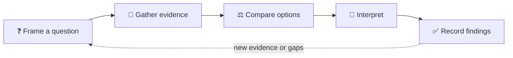

# 🔎 Analysis

Analysis is where we compare, inspect, and interpret ideas, systems, and
evidence. Make the reasoning visible: show what is known, what is assumed, and
how the conclusion follows.

## 🧰 What belongs here?

| Include | Make explicit |
|---|---|
| Comparisons and trade-off studies | Criteria and constraints |
| Data or evidence interpretation | Sources and collection limits |
| Options assessments | Assumptions and uncertainty |
| Findings that inform a decision | Recommendation and rationale |

## 🔄 A useful analysis loop

## ✍️ Keep the reasoning auditable

- Link source material; distinguish observations from interpretation.
- Record criteria before drawing comparisons.
- Call out missing evidence instead of filling gaps with guesses.
- Link decisions to the architecture, product, or hypothesis they affect.
