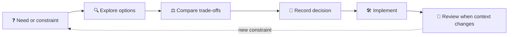

# 🏗️ Architectures

Architecture describes how a system is shaped, why important boundaries
exist, and which trade-offs guide implementation. Keep decision records close
to the system they govern, and make each consequential choice traceable.

## 🗂️ What's here?

| Location | Purpose |
|---|---|
| [`decisions/`](./decisions/) | Accepted architecture decision records (ADRs) |
| `vichara/specs/` | Intended home for VICHARA's platform specification pack; currently absent from this worktree |

## 🧭 From question to decision

## 📝 Writing an ADR

Capture the context, the decision, alternatives considered, and consequences.
Prefer small, numbered, immutable records over silently rewriting the history
of a significant architectural choice.
