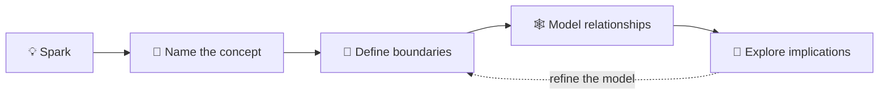

# 🧠 Conceptualization

Turn a promising spark into a clear concept: name it, define its boundaries,
connect it to related ideas, and show what it might make possible.

## 🧩 From spark to model

| Stage | Try asking |
|---|---|
| 💡 Notice | What caught my attention? |
| 🧭 Clarify | What do I mean by this concept? |
| 🧱 Model | What are its parts and boundaries? |
| 🕸️ Connect | What does it relate to or depend on? |
| 🌱 Develop | What could be tested, researched, or built next? |

## ✍️ Make concepts useful

- Define unfamiliar terms in plain language.
- Separate the concept from examples of it.
- Add diagrams when relationships are easier to see than to describe.
- Link related hypotheses, analyses, research, and products.
