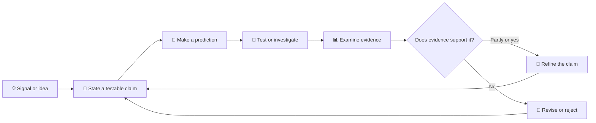

# 🧪 Hypothesis

A hypothesis is a claim we can examine—not a conclusion dressed up as a
question. State what you expect to happen, under which conditions, and what
evidence could change your mind.

## 🧾 A hypothesis at a glance

| Part | Prompt |
|---|---|
| Claim | What do I think is true? |
| Rationale | Why might it be true? |
| Prediction | What should we observe if it is true? |
| Test | How could we check? |
| Revision rule | What result would make me revise the claim? |

## 🔗 Keep claims honest

- Mark assumptions and confidence; do not imply proof where there is none.
- Link evidence and methods so another person can evaluate them.
- Record results that contradict the expectation, not just confirming results.
