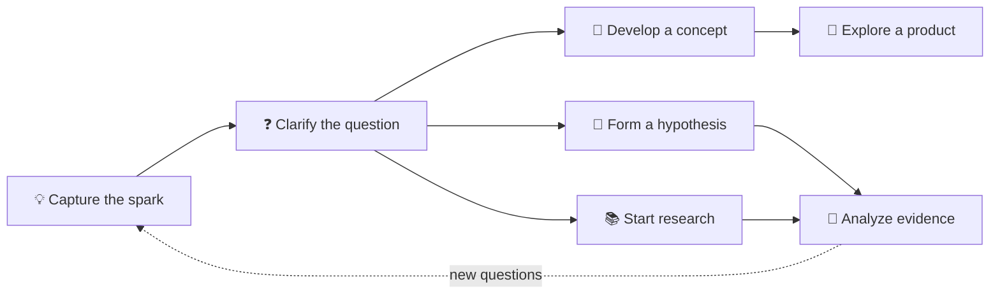

# 💡 Ideas

Ideas are welcome here before they are polished. Capture the question, spark,
or possibility while it is fresh; later, decide whether it wants to become a
concept, hypothesis, research thread, or product.

## 🧭 Find the next useful step

| If the idea needs… | Explore… |
|---|---|
| Clearer meaning or structure | [`conceptualization/`](../conceptualization/) |
| A claim that can be checked | [`hypothesis/`](../hypothesis/) |
| Evidence or context | [`research/`](../research/) |
| A possible user-facing outcome | [`products/`](../products/) |

## ✍️ Capture lightly

- Give the idea a descriptive title.
- Note what prompted it and what remains uncertain.
- Use a topic subfolder only when a cluster of related material emerges.
- Keep personal or sensitive notes out of this public repository.
