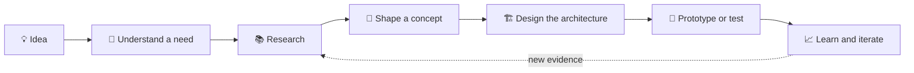

# 🚀 Products

Products are places where ideas meet people, needs, constraints, and
implementation. Keep each product's story together—from problem framing and
research through architecture, experiments, and publishable entries.

## 🗂️ Product workspace

| Material | Use it for |
|---|---|
| `README.md` | Product overview, status, and links |
| `research/` | Evidence, source notes, and discovery |
| `drafts/` | Clearly marked, unpublished writing |
| `entries/` | Schema-valid VICHARA entries, once content validation exists |
| `assets/` | Approved, product-specific diagrams or supporting files as needed |

Start with [Pensieve](./pensieve/), the first product exploration.

## 🧭 Keep product folders navigable

Use lowercase, kebab-case names. Add subfolders only when they solve a real
organization need, and label planning drafts clearly so they are not mistaken
for verified product behavior or approved publication.
