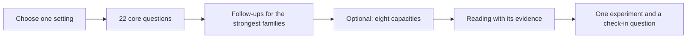
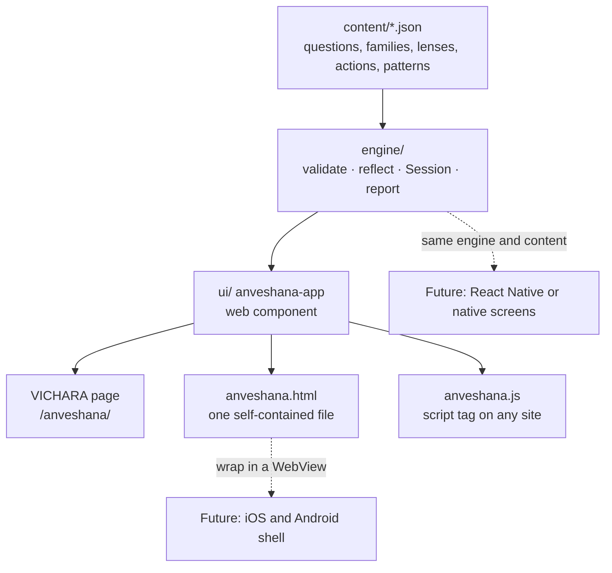

# 🧭 Anveshana

**Status:** 🟢 Pilot build. The app runs; the questions and rules are an
editorial first draft and have not been validated as a psychological measure.

Anveshana (*anveṣaṇa*, अन्वेषण: seeking, investigating) is a reflection tool.
It asks short questions about one setting in a person's life, then shows which
protective responses stood out, what each may protect, where it can hold
growth back, and one small experiment to try. An optional second part reads
eight capacities through the chakras.

**[Open Anveshana →](../../../anveshana/)** · **[Single-file version →](../../../anveshana/anveshana.html)**

## 🪷 What a sitting looks like

| Step | What happens |
|---|---|
| Choose a setting | Work or study, home or family, a group, or another recent setting. Answers cover the last four weeks. |
| 22 core questions | Two for each of the eleven response families: Fight, Flight, Freeze, Flop, Fawn, Flag, Forearm, Filter, Flock, Float and Fathom. Any question can be skipped, and "No opportunity" is a valid answer. |
| Up to six follow-ups | For the strongest families only: what the response gave the person, and what it cost. "Nothing I want to change" is accepted as a complete answer. |
| Eight capacities (optional) | Kula Sahasrāra, Mūlādhāra, Svādhiṣṭhāna, Maṇipūra, Anāhata, Viśuddhi, Ajñā and Akula Sahasrāra. Both crowns can be kept private. Chakra language can be switched off for everyday wording. |
| The reading | Up to three families, each with the answers that led to it, what it may protect, where growth gets harder, what gives more choice, related atlas patterns and two experiments. Each suggestion can be kept, marked as partly right or dismissed. |



## 🔎 How a reading is reached

The rules are deliberately simple so every suggestion can be explained.

- A family is **shown** when both of its questions were answered, at least one
  answer was *Often* or *Almost every time*, and the other was at least
  *Sometimes*.
- A family goes under **Worth a question** when only one answer was usable, or
  when one answer was high and the other low.
- At most three families are shown. Equal scores are shown together.
- Skipped questions and *No opportunity* count as no evidence either way.
- Capacities come only from direct answers: *Available* reads as Active,
  *Sometimes available* as Mixed, *Hard to access* as Constrained. Anything
  unsure, skipped or private stays Unspecified.

The reading always says what it could not see: thin coverage, skipped
follow-ups, and families with no usable answers.

## 🔐 Privacy

Answers are held in the page's memory and nowhere else. The app does not use
browser storage, cookies, analytics or any network call after the page has
loaded, and answers never appear in the URL. Reloading or closing the page
clears the sitting. A person can download a plain-text copy, which is created
on their device. The build fails if the shipped bundle contains a storage or
network call. See [ADR-003](../../architectures/decisions/003-anveshana-on-device-reflection.md).

## ⚠️ What it is not

Anveshana is a self-reflection aid for adults. It does not diagnose, measure
trauma severity or measure energy. The chakra reading is a contemplative lens
on a person's own answers. Percentiles, clinical cut-offs and broader
audiences would each need separate validation and review.

## 🏗️ How it is built

Three layers, each usable without the one above it. All of it lives in
`website/src/anveshana/`.

| Layer | Folder | What it holds | Depends on |
|---|---|---|---|
| Content | `content/` | JSON files: families, core items, lenses, actions, patterns, scales and rule thresholds, with a content version and a rules version | Nothing |
| Engine | `engine/` | Pure TypeScript: bundle validation, the reading rules, a `Session` that orders the questions, and a plain-text export | Content types only. No DOM, storage, network or clock |
| Interface | `ui/` | `<anveshana-app>`, a web component that renders the session's current step | Engine and content |



## 🌐 Putting it on another website

Every build writes two portable files to `website/dist/anveshana/`.

**One file.** `anveshana.html` contains the page, styles, questions and logic
with no other requests. Upload it to any host, or open it from disk.

**A script tag.** Host `anveshana.js` and add:

```html
<script type="module" src="/path/to/anveshana.js"></script>
<anveshana-app></anveshana-app>
```

The component keeps its styles in a shadow root, so the host site's CSS does
not affect it. Optional attributes: `theme="light"` or `theme="dark"` to fix
the colour scheme, and `chakra-terms="off"` to start in everyday wording.
Colours and fonts can be changed with CSS custom properties such as
`--anv-accent`, `--anv-bg`, `--anv-surface` and `--anv-font-display`. The
element fires `anveshana:complete` and `anveshana:cleared`; neither carries
answer data.

## 📱 Path to a mobile app

| Route | Effort | What is reused |
|---|---|---|
| Install from the browser | Add a web manifest and an offline shell to the existing page | Everything |
| Store app in a WebView shell (for example Capacitor) | Point the shell at `anveshana.html`; add icons and store listings | Everything |
| Native screens (for example React Native) | Write screens that render `Session.step()` and call `answer`, `skip` and `back` | Content and engine unchanged; only the interface is rewritten |

The engine returns each step as plain data and the reading as a plain object,
and the same test fixtures apply on every platform. Saved history or accounts
would be a new decision with its own privacy review.

## ✏️ Changing the content

Edit the JSON in `website/src/anveshana/content/`, then run the checks from
`website/`:

```bash
npm test        # validates every id and runs the rule fixtures
npm run build   # also writes anveshana.html and anveshana.js
```

Bump `contentVersion` in `meta.json` when wording changes and `rulesVersion`
when thresholds or mappings change. Every reading shows both.

## 🧪 Before a wider pilot

- Ask a few readers to explain each question in their own words, and split any
  prompt that people read in two ways.
- Have the wording reviewed for clinical, spiritual and accessibility concerns.
- Test with a screen reader on a phone.
- Collect feedback separately from the app, and never ask for completed
  questionnaires.

## 📚 Sources

The questions, families and capacity lenses are drawn from the Protection
Atlas (the Eleven Fs of Protection and the eight-chakra matrix) developed in
the Prana Shakthi Yoga and BioSemiotics work. The two crowns follow
[Chakra Prāṇa Sādhana](https://publish.obsidian.md/chitta-pragnya/Energy+Science/Energy+Bodywork/Prana+Shakthi+Yoga/Pranamaya+-+Energetic/Chakra+Prana+Sadhana).
