# 🧠 Designing Full-Stack Instrumentation for an AI Chat Application

> **From a click on a ShadCN button → to a user question → retrieval → generation → citations → feedback → product analytics → distributed traces.**

Most teams start observability for an AI application with questions such as:

- How many questions were asked?
    
- How many users visited?
    
- How many answers failed?
    
- What is our average latency?
    

Those are useful questions.

But they barely scratch the surface.

Imagine a user arrives at **Pensieve**, opens a chat, asks:

> _“How do I submit a new servicing request?”_

Pensieve retrieves three relevant pages, generates an answer, renders two citations and a form link.

The user:

1. reads the answer,
    
2. opens the second citation,
    
3. returns,
    
4. copies a command from the answer,
    
5. clicks 👍,
    
6. asks a follow-up question,
    
7. eventually opens the form.
    

Was that one interaction?

From the user's perspective, yes.

From the instrumentation perspective, it may involve:

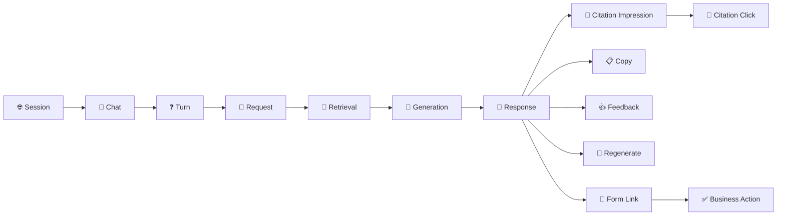

And underneath those product interactions there may be dozens of technical operations:

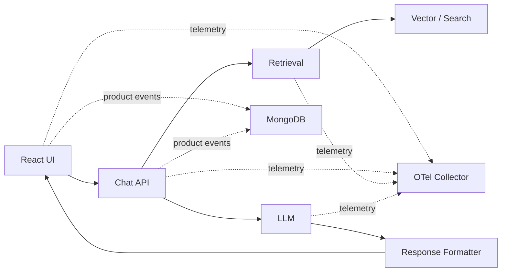

The challenge therefore is not simply:

> **“How do we track clicks?”**

The real problem is:

> **How do we create a coherent event and identity model that allows Product, Frontend, Backend, ML, AI, Data and Platform teams to reconstruct what happened without every team inventing its own telemetry language?**

That is the problem **Pensieve Instrumentation** solves.

---

# 🌟 1. Pensieve as a Case Study

Pensieve is an AI question-answering application.

A user can:

|Capability|Example|
|---|---|
|💬 Ask questions|“What documents do I need?”|
|🔄 Continue conversations|Ask follow-up questions|
|📚 Receive grounded answers|RAG-generated answers|
|🔗 Open citations|Documentation links|
|📝 Open forms|Application/request forms|
|👍 Like answers|Positive feedback|
|👎 Dislike answers|Negative feedback|
|📋 Copy responses|Copy answer or command|
|🔄 Regenerate|Generate another answer|
|⏹ Stop generation|Cancel streaming|
|➕ Submit missing questions|Suggest new content|
|🔗 Follow recommended links|Product journey|
|🌐 Return later|Retention|
|🧭 Start another chat|Multi-chat behavior|

This creates several completely different observability questions.

### 👩‍💼 Product Owner

> Are people actually getting value from Pensieve?

### 🎨 Frontend Engineer

> Did users see the citation component before we say that they ignored it?

### ⚙️ Backend Engineer

> Which service caused this request to take 11 seconds?

### 🤖 AI Engineer

> Was the poor answer caused by retrieval, reranking, prompting or generation?

### 📊 Data Analyst

> What percentage of first-time users who ask one question return within seven days?

### 🏗️ Platform Engineer

> Are telemetry pipelines themselves dropping events?

Pensieve therefore needs **multiple telemetry planes sharing one correlation model**.

---
# 🧭 2. Observability Is Not the Same as Product Analytics

One of the most important architectural decisions is separating these concepts.

OpenTelemetry is excellent for generating and correlating **traces, metrics and logs**. The OpenTelemetry Collector then provides vendor-neutral receiving, processing and exporting, including batching and retry behavior.

But consider this event:

```
response.liked
```

Should that disappear because your production environment samples only 10% of traces?

Absolutely not.

Similarly:

```
citation.clicked
```

is primarily a **business/product fact**, not merely a debugging artifact.

This leads us to the Pensieve dual-plane architecture.

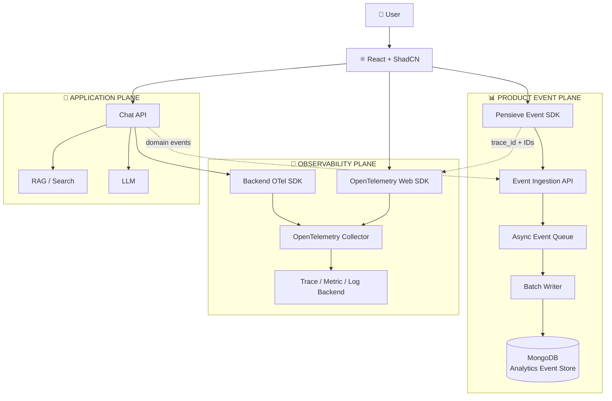

The crucial point is:

> **Both planes share the same identifiers.**

Therefore Product can discover:

> Response `resp_5827` received a dislike.

Engineering can then discover:

> Response `resp_5827` belonged to trace `9be...`.

AI engineering can discover:

> Retrieval returned poorly ranked documents.

Suddenly telemetry becomes **investigative infrastructure**, rather than dashboards.

---

# 🪪 3. Start With Identity, Not Events

This is probably the single most important section of the architecture.

If the identifiers are wrong, no amount of instrumentation added later will save the analytics model.

For Pensieve I would use the following hierarchy.

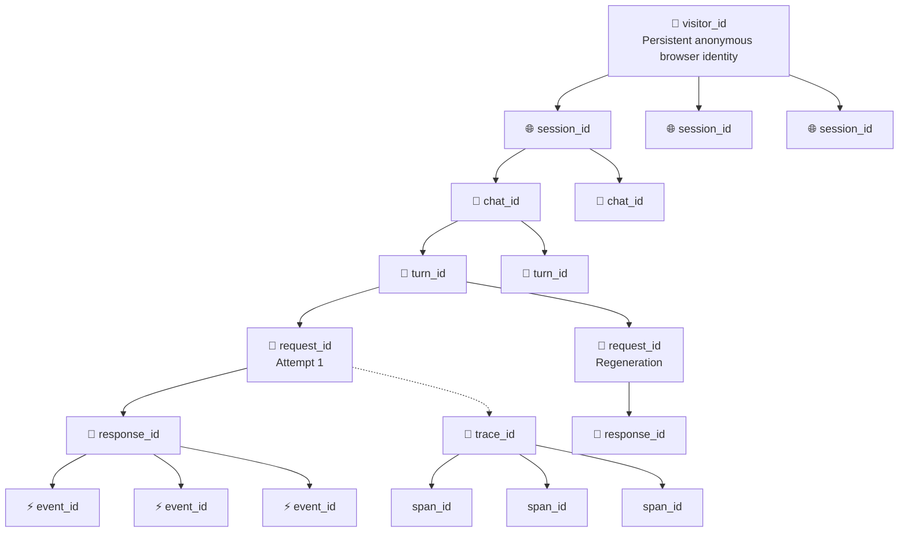

## ID Contract

| Identifier    | Scope                  | Changes when             | Example purpose           |
| ------------- | ---------------------- | ------------------------ | ------------------------- |
| `visitor_id`  | Browser/user identity  | Browser storage cleared  | Returning user analytics  |
| `user_id`     | Authenticated identity | Usually stable           | Cross-device identity     |
| `session_id`  | Visit/session          | New browsing session     | Session analytics         |
| `tab_id`      | Browser tab            | New tab                  | UI concurrency debugging  |
| `chat_id`     | Conversation           | New chat                 | Conversation analytics    |
| `turn_id`     | Logical user question  | New user question        | Groups regenerations      |
| `message_id`  | Individual message     | Every persisted message  | Chat reconstruction       |
| `request_id`  | Generation attempt     | Every request/regenerate | API correlation           |
| `response_id` | Generated answer       | Every answer             | Feedback attribution      |
| `event_id`    | Telemetry event        | Every event              | Deduplication             |
| `trace_id`    | Distributed trace      | Every traced operation   | Engineering observability |
| `span_id`     | Trace operation        | Every span               | Component latency         |

---

# 🔥 4. Why `turn_id` Matters

Suppose the user asks:

> “What is the eligibility requirement?”

Pensieve generates answer A.

The user presses **Regenerate**.

Pensieve generates answer B.

These are not two questions.

They represent:

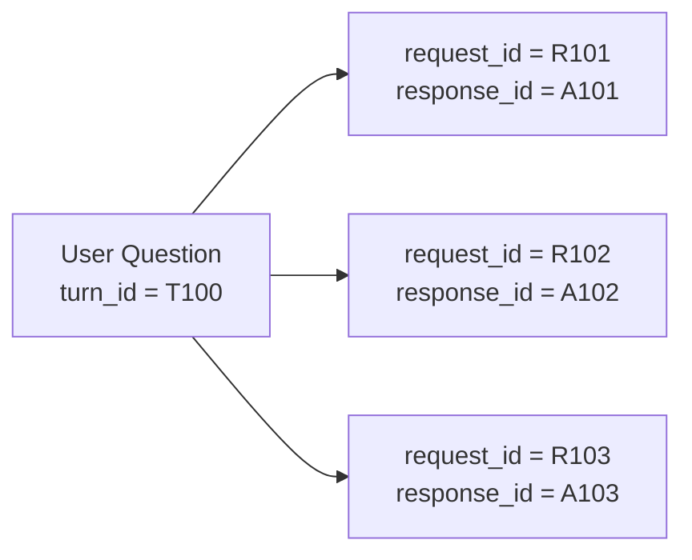

Without `turn_id`, analytics might incorrectly report:

```
3 questions asked
```

when in reality:

```
1 question
3 generation attempts
```

That difference affects:

- question volume,
    
- user engagement,
    
- model quality,
    
- regeneration rate,
    
- token cost,
    
- request load,
    
- answer satisfaction.
    

---

# 🌐 5. Session Identity Needs Another Identity Above It

If every browser session receives a new `session_id`, how do we calculate:

```
Returning Users
D7 Retention
Sessions per User
MAU
User Stickiness
```

We cannot.

Therefore Pensieve needs:

```
visitor_id
    ↓
session_id
```

For anonymous users, `visitor_id` can be a pseudonymous identifier persisted in first-party browser storage.

For authenticated users:

```
visitor_id + user_id
```

can be retained independently.

OpenTelemetry itself now defines developing client-session semantic conventions including `session.id`, `session.previous_id`, `session.start` and `session.end`.

### A useful browser policy

```
localStorage
    visitor_id

sessionStorage
    session_id

runtime
    tab_id
```

If Pensieve specifically defines **every newly opened tab/window as a new analytics session**, generate `session_id` at application bootstrap rather than trying to infer conventional 30-minute analytics sessions.

Alternatively use:

```
visitor
   └── session
        └── tab
```

if you eventually want multiple tabs grouped into a single browsing session.

---

# ⚡ 6. What Exactly Is an Event?

An event should represent a **meaningful occurrence**.

OpenTelemetry's event guidance makes an important distinction:

- something having a meaningful duration → **span**
    
- a point-in-time occurrence/state change → **event**
    
- an operation-wide characteristic → **span attribute**
    

Consider:

```
response.generate
```

It has duration.

Use a span.

But:

```
response.like_clicked
```

occurs at a moment.

Use an event.

---

# 🧱 7. The Pensieve Event Envelope

Every product event should conform to a consistent envelope.

```
{
  "event_id": "0199f58e-...",
  "event_name": "response.liked",
  "event_version": 1,

  "event_time": "2026-10-04T22:15:31.442Z",
  "received_at": "2026-10-04T22:15:31.517Z",

  "actor": {
    "visitor_id": "vis_...",
    "user_id": null
  },

  "context": {
    "session_id": "ses_...",
    "tab_id": "tab_...",
    "chat_id": "chat_...",
    "turn_id": "turn_...",
    "request_id": "req_...",
    "response_id": "resp_..."
  },

  "trace": {
    "trace_id": "...",
    "span_id": "..."
  },

  "application": {
    "version": "2.4.1",
    "environment": "production"
  },

  "page": {
    "route": "/chat",
    "referrer": "/home"
  },

  "component": {
    "id": "answer-feedback",
    "type": "button"
  },

  "properties": {
    "feedback": "positive"
  }
}
```

---

# 🏷️ 8. Event Naming

Use names such as:

```
session.started
chat.created
question.submitted
response.completed
response.liked
citation.clicked
form.submitted
```

Do **not** create:

```
response_liked_resp_123
citation_clicked_document_782
button_clicked_blue_submit
```

Dynamic values belong in attributes.

OpenTelemetry similarly recommends event names remain stable and low-cardinality, with dynamic values represented as event attributes.

---

# 🧩 9. Do Not Instrument Every React Component

This is another common mistake.

Imagine automatically instrumenting every:

```
<Card>
<Button>
<Dialog>
<Popover>
<Tooltip>
<Separator>
<Avatar>
```

in ShadCN.

You quickly generate millions of events that nobody can interpret.

Instead distinguish:

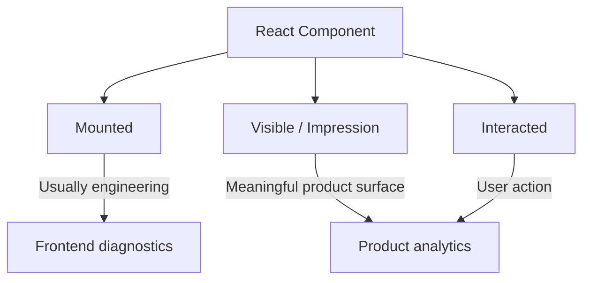

For product analytics, **visible is more important than mounted**.

A citation component may technically mount below the fold.

That does not mean the user actually saw it.

For impressions use:

```
IntersectionObserver
```

rather than React mount alone.

---

# 🧾 10. Pensieve Event Taxonomy

## Application + Session Events

|Event|When emitted|Important attributes|Why|
|---|---|---|---|
|`app.loaded`|Application boot|version, route|Application usage|
|`session.started`|Session initialization|visitor_id, previous_session_id|Session analysis|
|`session.ended`|Best-effort termination|duration|Session metrics|
|`page.viewed`|Route becomes active|route|Navigation|
|`page.exited`|Page leaves|active_duration|Dwell analysis|
|`component.impression`|Meaningful component becomes visible|component_id|Exposure denominator|
|`component.clicked`|Meaningful UI action|component_id, action|UX analysis|
|`navigation.clicked`|Navigation interaction|source, target|Journey analysis|
|`outbound_link.clicked`|External navigation|destination_type|Conversion|

---

# 💬 11. Chat Events

|Event|Meaning|
|---|---|
|`chat.created`|New conversation created|
|`chat.opened`|Conversation entered|
|`chat.renamed`|Conversation renamed|
|`chat.deleted`|Conversation removed|
|`chat.closed`|Conversation abandoned/closed|
|`question.typed`|Optional intent event|
|`question.submitted`|User sends question|
|`question.accepted`|Backend accepts request|
|`question.rejected`|Validation/rate limit etc.|
|`question.edited`|Existing question modified|
|`followup.submitted`|Follow-up question|
|`suggested_question.impression`|Suggested question displayed|
|`suggested_question.clicked`|Suggested question selected|

---

# 🤖 12. Response Events

|Event|Meaning|Product signal|
|---|---|---|
|`response.started`|Generation starts|System responsiveness|
|`response.first_token`|First token reaches UI|TTFT|
|`response.completed`|Generation succeeds|Completion|
|`response.rendered`|UI completes rendering|End-to-end UX|
|`response.failed`|Generation fails|Reliability|
|`response.cancelled`|User stops generation|UX/latency|
|`response.liked`|👍|Satisfaction|
|`response.disliked`|👎|Dissatisfaction|
|`response.copied`|Copy clicked|Utility|
|`response.regenerated`|Regenerate requested|Possible quality failure|
|`response.shared`|Share action|High value|
|`response.expanded`|Expansion/read-more|Consumption|
|`response.feedback_opened`|Detailed feedback shown|Feedback funnel|
|`response.feedback_submitted`|Detailed feedback|Quality signal|

---

# 🔗 13. Citation Events

For grounded systems, citations deserve their own instrumentation model.

|Event|What it tells us|
|---|---|
|`citation.impression`|Citation actually appeared|
|`citation.clicked`|User explored evidence|
|`citation.opened`|Destination loaded|
|`citation.returned`|User returned to Pensieve|
|`citation.failed`|Broken/dead link|
|`citation.copied`|Source copied|
|`citation.feedback_submitted`|Citation quality feedback|

Important attributes could include:

```
citation_id
document_id
document_type
rank
retrieval_score
reranker_score
position
domain
response_id
```

Now we can answer:

> Are users more likely to click citation #1 than citation #4?

or:

> Do documents retrieved at ranks 4–6 ever drive downstream actions?

That is enormously valuable feedback for the RAG system.

---

# 📝 14. Form and Action Events

For Pensieve, URLs and forms may represent the closest thing to **BOFU conversion**.

Instrument:

|Event|Example|
|---|---|
|`form_link.impression`|“Submit request” shown|
|`form_link.clicked`|Link clicked|
|`form.opened`|Form actually loads|
|`form.started`|First interaction|
|`form.validation_failed`|Validation error|
|`form.submitted`|Submission|
|`form.success`|Backend confirms|
|`form.failed`|Submission error|
|`new_question_form.opened`|Content-gap workflow|
|`new_question_form.submitted`|Missing question submitted|

This lets Product distinguish:

```
ANSWER SHOWN
```

from:

```
ANSWER CAUSED ACTION
```

---

# 🔎 15. RAG-Specific Events and Spans

Some interactions belong primarily on the backend.

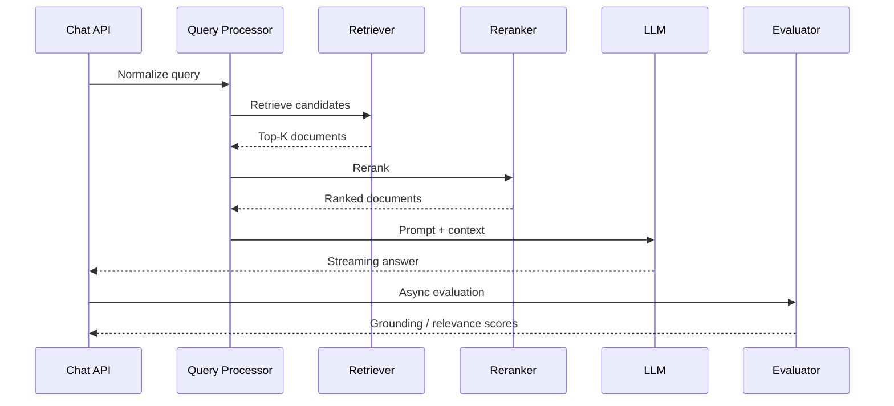

Recommended spans:

```
chat.request
query.rewrite
retrieval.search
retrieval.rerank
context.build
prompt.render
llm.generate
response.format
response.stream
evaluation.faithfulness
evaluation.relevance
```

Possible attributes:

```
retrieval.top_k
retrieval.returned_count
retrieval.index_version
reranker.model
prompt.version
model.name
model.version
context.token_count
input.token_count
output.token_count
finish_reason
```

OpenTelemetry's GenAI semantic conventions already cover concepts such as conversation identifiers, provider, model responses, retrieval documents and GenAI evaluation attributes. They also explicitly warn that input/output messages and retrieval queries may contain sensitive information.

---

# 🏗️ 16. Full Pensieve Architecture

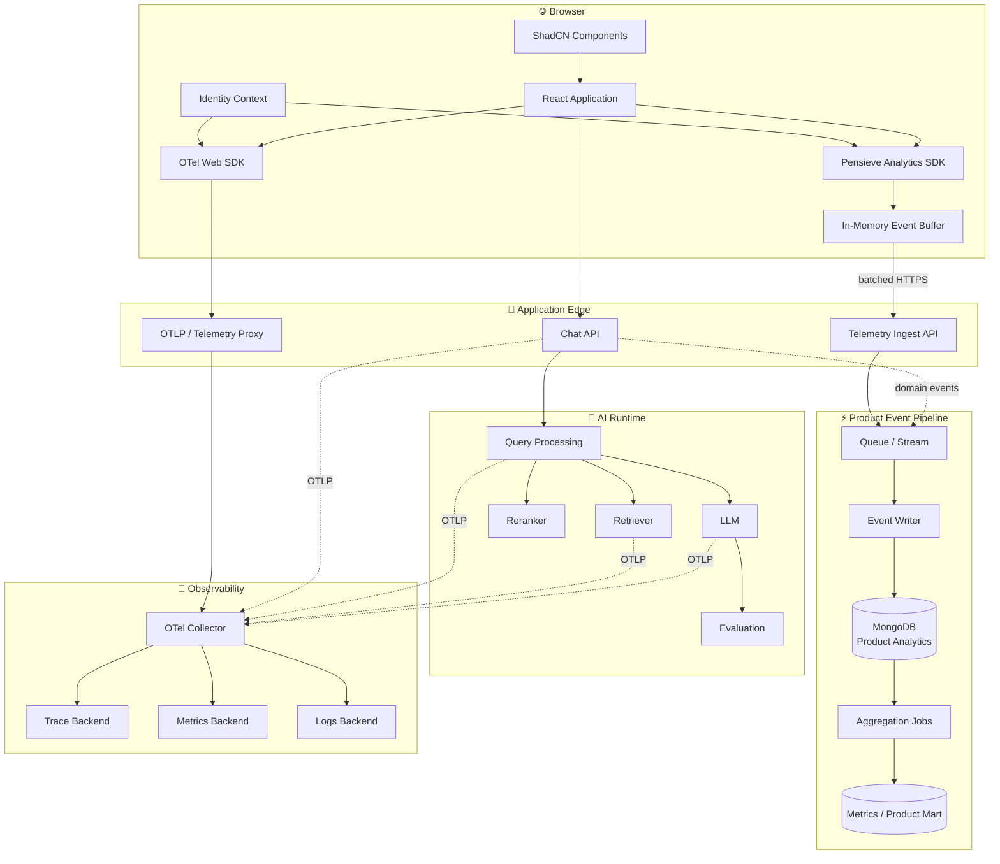

---

# 🔄 17. What Happens When Someone Asks a Question?

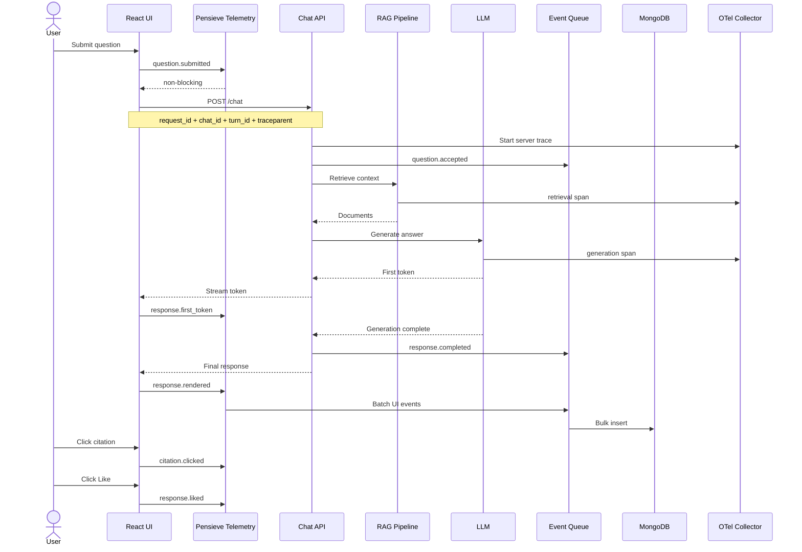

Notice something important:

**The telemetry path never blocks the answer path.**

---

# 🚫 18. Never Let Analytics Block Chat

This is one of the key engineering rules for Pensieve.

Bad:

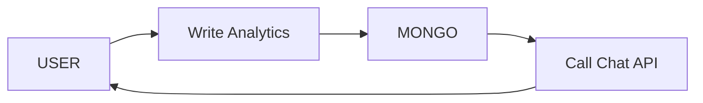

Good:

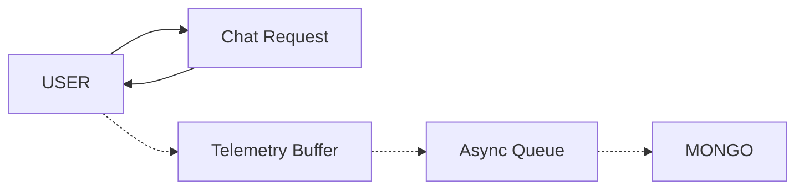

The user experience must not depend upon analytics persistence.

---

# 🪶 19. Browser-Side Batching

Do not make an HTTP request for every event.

A single answer could create:

```
citation.impression x 5
response.rendered
citation.clicked
response.copied
response.liked
```

Instead:

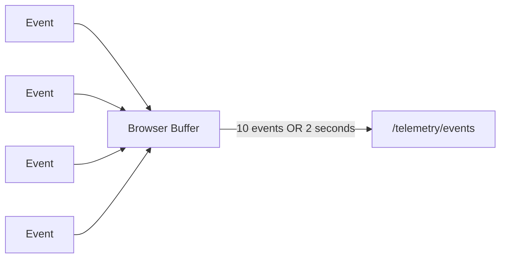

A sensible browser policy might be:

```
Flush if:
    batch >= 10–25 events
OR
    2–5 seconds elapsed
OR
    visibility becomes hidden
OR
    page is exiting
```

Use:

```
fetch(..., { keepalive: true })
```

and where appropriate:

```
navigator.sendBeacon()
```

during page termination.

For truly important unsent events, IndexedDB can provide a small browser-side durable spool.

---

# 📦 20. JavaScript Packages

## Browser

|Capability|Package / API|
|---|---|
|OTel API|`@opentelemetry/api`|
|Browser tracing|`@opentelemetry/sdk-trace-web`|
|OTLP HTTP exporter|`@opentelemetry/exporter-trace-otlp-http`|
|Registration|`@opentelemetry/instrumentation`|
|Page loading|`@opentelemetry/instrumentation-document-load`|
|Fetch|`@opentelemetry/instrumentation-fetch`|
|XHR|`@opentelemetry/instrumentation-xml-http-request`|
|User interaction|`@opentelemetry/instrumentation-user-interaction`|
|Async context|`@opentelemetry/context-zone` where appropriate|
|Schema validation|`zod`|
|Identifiers|`uuid` or ULID implementation|
|Durable browser queue|IndexedDB / lightweight IDB wrapper|

OpenTelemetry's current browser documentation specifically includes document-load, XHR and user-interaction instrumentation. Browser instrumentation is still described as experimental/mostly unspecified, even though JavaScript traces and metrics themselves are stable.

That is another reason Pensieve should maintain a thin **domain telemetry SDK** above OTel.

---

# ⚙️ 21. Backend Packages

For Node.js:

|Need|Typical option|
|---|---|
|OTel SDK|`@opentelemetry/sdk-node`|
|Auto instrumentation|`@opentelemetry/auto-instrumentations-node`|
|HTTP instrumentation|`@opentelemetry/instrumentation-http`|
|Express|`@opentelemetry/instrumentation-express`|
|MongoDB instrumentation|`@opentelemetry/instrumentation-mongodb`|
|Mongo access|`mongodb`|
|Validation|`zod`|
|Structured logging|`pino`|
|Redis queue|`bullmq` / Redis Streams|
|Kafka|`kafkajs`|
|AWS queue|AWS SQS client|
|NATS|NATS/JetStream client|

OpenTelemetry provides Node and Web meta-packages, although its documentation notes that selecting individual instrumentations can reduce dependency footprint if you already know exactly what you need.

---

# ⚛️ 22. Instrumenting ShadCN Without Polluting the Components

Instead of modifying every ShadCN primitive, build semantic wrappers.

For example:

```
<TrackedButton
  telemetryId="answer-like"
  event="response.liked"
  context={{
    chatId,
    turnId,
    responseId
  }}
>
  <ThumbsUp />
</TrackedButton>
```

Internally:

```
function TrackedButton({
  telemetryId,
  event,
  context,
  children,
  ...props
}) {
  const telemetry = useTelemetry();

  return (
    <Button
      {...props}
      data-telemetry-id={telemetryId}
      onClick={(e) => {
        telemetry.emit(event, {
          component_id: telemetryId,
          ...context
        });

        props.onClick?.(e);
      }}
    >
      {children}
    </Button>
  );
}
```

The UI remains:

```
presentation
+
behavior
+
semantic telemetry
```

without hard-coding MongoDB or OpenTelemetry everywhere.

---

# 🧠 23. Create a Pensieve Telemetry Context

Conceptually:

```
type TelemetryContext = {
  visitorId: string;
  sessionId: string;
  tabId: string;

  chatId?: string;
  turnId?: string;
  requestId?: string;
  responseId?: string;

  traceId?: string;
};
```

Then components should not repeatedly discover these identifiers.

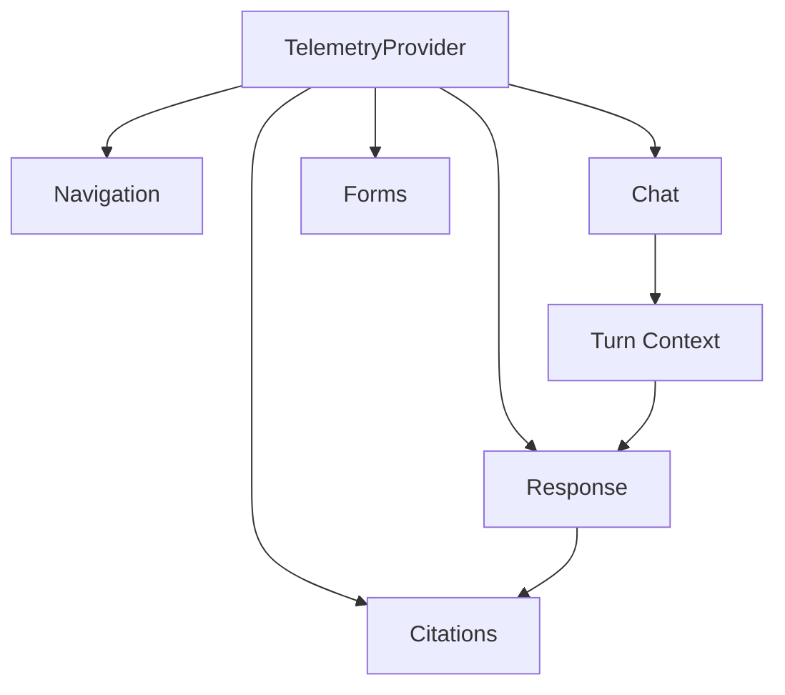

This gives us hierarchical context propagation resembling distributed tracing itself.

---

# 📊 24. MongoDB Event Model

I would avoid creating one collection per event type.

Prefer one append-oriented event collection:

```
analytics_events
```

Example:

```
{
  "_id": "...",
  "event_id": "...",
  "event_name": "citation.clicked",
  "event_version": 1,

  "event_time": "...",
  "received_at": "...",

  "visitor_id": "...",
  "session_id": "...",
  "chat_id": "...",
  "turn_id": "...",
  "request_id": "...",
  "response_id": "...",

  "trace_id": "...",

  "component_id": "answer-citation",

  "properties": {
    "citation_id": "...",
    "document_id": "...",
    "rank": 2
  }
}
```

---

# 🗂️ 25. Recommended Collections

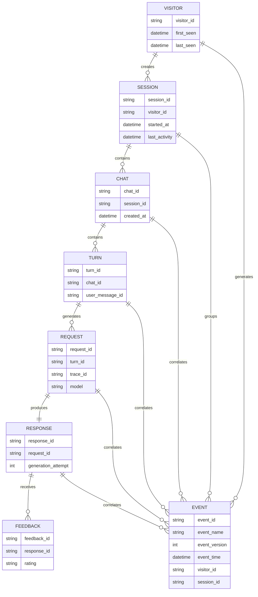

Conceptually I would have:

|Collection|Role|
|---|---|
|`analytics_events`|Immutable product event ledger|
|`sessions`|Session summaries|
|`chats`|Conversation metadata|
|`messages`|User/assistant messages|
|`feedback`|Rich feedback|
|`daily_product_metrics`|Precomputed dashboards|
|`user_activity_daily`|Retention/stickiness computation|
|`experiments`|Experiment assignments|
|`content_gap_requests`|New-question workflow|

Do not duplicate everything unnecessarily.

`analytics_events` should remain the reconstructable behavioral ledger.

---

# 🗃️ 26. MongoDB Indexes

Likely high-value indexes include:

```
{ event_id: 1 }                 // unique
{ event_name: 1, event_time: -1 }
{ visitor_id: 1, event_time: -1 }
{ session_id: 1, event_time: 1 }
{ chat_id: 1, event_time: 1 }
{ response_id: 1, event_time: 1 }
{ trace_id: 1 }
```

For old low-value telemetry, TTL policies can automatically expire documents; MongoDB explicitly identifies machine-generated events, logs and session-like data as common TTL use cases.

A useful strategy might be:

```
Raw high-volume interaction telemetry     → 90–180 days
Conversation/product facts                → longer
Daily aggregate metrics                   → long term
Technical raw traces                      → shorter
```

---

# ⏱️ 27. Should We Use MongoDB Time-Series Collections?

Maybe—but selectively.

MongoDB time-series collections are optimized for high-volume time-oriented measurements and can reduce storage and I/O requirements.

They are excellent for:

```
latency measurements
collector health
token usage
hourly counters
system metrics
```

But for a behavioral ledger where we want:

```
unique event_id
rich variable properties
deduplication
occasional updates
```

a regular collection is often easier.

Therefore:

```
analytics_events             regular collection
service_metrics              time-series collection
daily_product_metrics        regular/materialized collection
```

is a reasonable design.

---

# 🚚 28. Queue Architecture

There are several maturity levels.

|Pattern|Complexity|Durability|Recommended when|
|---|---|---|---|
|Browser → Mongo|❌ Unsafe|—|Never|
|Browser → API → Mongo|Low|Medium|Tiny MVP|
|Browser → API → memory buffer → Mongo|Low|Medium|Early Pensieve|
|Browser → API → Redis Stream → worker → Mongo|Medium|High|Growing production|
|Browser → API → Kafka → Mongo|High|Very high|Large event volume|
|OTel Collector → Kafka → Mongo|High|Very high|Unified enterprise telemetry|

---

# 🪄 29. The Practical Starting Architecture

For Pensieve I would initially choose:

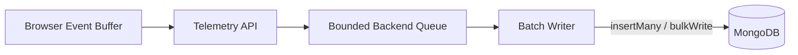

MongoDB's Node driver supports `insertMany()` and `bulkWrite()`, and bulk operations can reduce network round trips.

Flush perhaps:

```
100–500 events
OR
100–500 ms
```

depending upon volume.

---

# 🏭 30. When Pensieve Gets Bigger

Then evolve to:

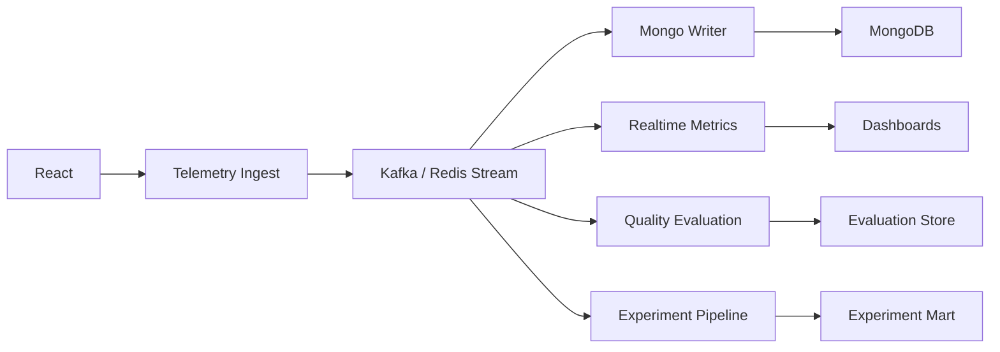

This is where an event bus becomes strategically useful:

**one event → multiple consumers.**

---

# 🔌 31. OpenTelemetry Collector + MongoDB

There is an important current ecosystem nuance.

As of 2026, the standard OpenTelemetry Collector contrib distribution does **not** provide a native MongoDB exporter for arbitrary traces/logs/metrics; a proposed MongoDB exporter remained an outstanding/unsupported capability rather than a standard path.

Therefore I would not design:

```
OTel Collector → MongoDB
```

as though it were a turnkey standard exporter.

A scalable route is instead:

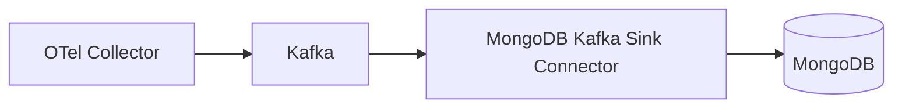

The official MongoDB Kafka Connector supports consuming Kafka topics as a sink and persisting them into MongoDB.

But unless Pensieve already operates Kafka, introducing Kafka **only to move telemetry into Mongo** may be needless complexity.

For most implementations:

```
Product events → MongoDB

OTel signals → observability backend
```

is cleaner.

---

# 🔭 32. What Should OpenTelemetry Capture?

## Traces

```
browser interaction
   ↓
POST /chat
   ↓
authentication
   ↓
query rewrite
   ↓
retrieval
   ↓
reranking
   ↓
context construction
   ↓
LLM
   ↓
stream
   ↓
response persistence
```

## Metrics

Examples:

```
chat_requests_total
chat_failures_total
retrieval_duration
llm_duration
time_to_first_token
response_duration
tokens_input
tokens_output
retrieval_document_count
event_queue_depth
event_drop_count
mongo_write_duration
```

## Logs

Examples:

```
generation timeout
retrieval exception
malformed citation
queue overflow
Mongo write failure
```

---

# ⚠️ 33. Never Put User IDs Into Metric Labels

Imagine:

```
chat_requests_total{
   visitor_id="..."
}
```

That creates enormous cardinality.

Instead:

```
Metrics
    → environment
    → service
    → model
    → endpoint
    → result

Events / traces
    → request_id
    → session_id
    → response_id
```

Keep **business identifiers in queryable event records**, not dimensions of continuously aggregated infrastructure metrics.

---

# 🧵 34. Trace Propagation

Browser requests should propagate:

```
traceparent
tracestate
```

so the trace can cross:

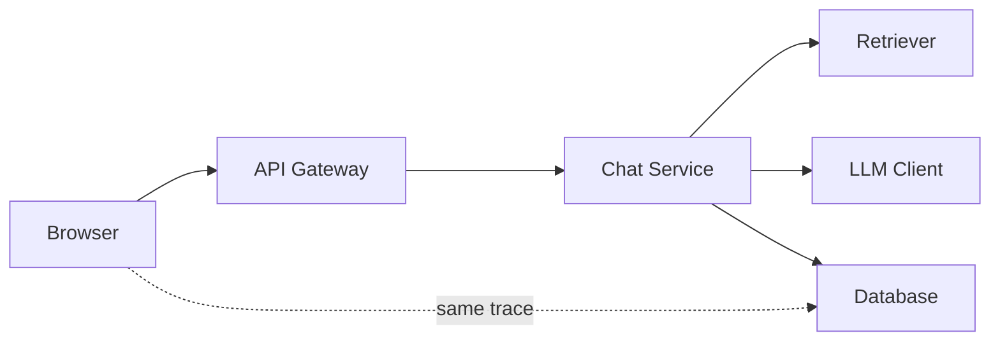

OpenTelemetry recommends connecting client telemetry to backend traces through propagated trace context.

But:

> **trace_id does not replace request_id.**

A business request identifier must remain meaningful regardless of telemetry sampling or tracing implementation.

---

# 📡 35. Do Not Expose the Collector Carelessly

Browser-based OTLP has several constraints.

Browsers cannot use the normal gRPC exporter directly; OTLP/HTTP is used, and CSP/CORS configuration matters. OpenTelemetry also cautions against simply exposing a Collector directly to the public Internet and recommends placing an appropriate proxy/front door in front of it.

Prefer:

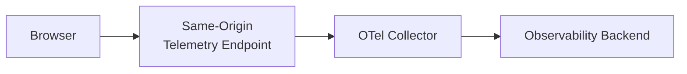

instead of:

```
Browser
   ↓
public unauthenticated collector
```

---

# 🛡️ 36. Privacy by Design

AI telemetry is unusually dangerous because it is tempting to log:

```
prompt
conversation
retrieved document
generated answer
user information
```

everywhere.

Do not.

Create explicit telemetry levels.

|Data|Default|
|---|---|
|IDs|✅|
|Timing|✅|
|Model name|✅|
|Retrieval counts|✅|
|Rank/score|✅|
|Page identifier|✅|
|Raw user question|❌/controlled|
|Raw answer|❌/controlled|
|Raw retrieved document|❌|
|PII|❌|
|Authentication token|❌❌|
|Form content|❌|

The OpenTelemetry GenAI conventions specifically warn that prompt/message/retrieval content can contain sensitive or personally identifiable information.

---

# 📉 37. Sampling: Analytics and Tracing Need Different Policies

Suppose Pensieve gets:

```
10,000,000 traces/day
```

We may sample technical traces.

For example:

```
normal requests           5–10%
errors                    100%
slow traces               100%
evaluation failures       100%
```

The JS SDK supports ratio-based trace sampling.

But do **not** apply trace sampling blindly to:

```
question.submitted
response.completed
response.liked
response.disliked
citation.clicked
form.submitted
```

Those are product facts.

---

# 📐 38. Now We Can Calculate Product Metrics

Once this foundation exists, Pensieve becomes analytically powerful.

---

# 🔻 39. TOFU → MOFU → BOFU for an AI Assistant

Traditional marketing terminology can be adapted into an AI product journey.

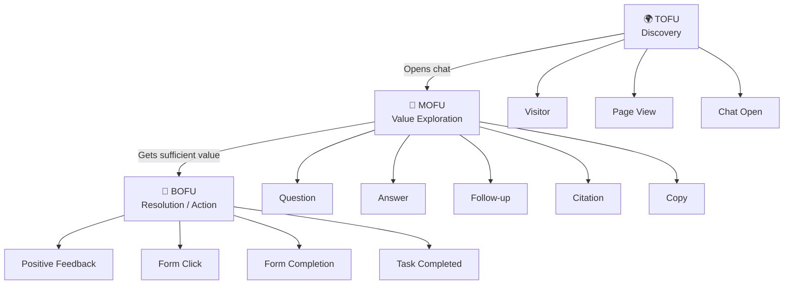

---

# 🌍 40. TOFU Metrics — Discovery & Activation

TOFU tells us whether users are **discovering Pencieve and crossing the first threshold into actual usage**.

|📊 Metric|🧮 Calculation|🎯 What It Measures|🔎 Interpretation|
|---|---|---|---|
|**Unique Visitors**|`COUNT(DISTINCT visitor_id)`|Number of distinct people/browsers reaching Pencieve|Top-level reach|
|**Sessions**|`COUNT(DISTINCT session_id)`|Number of browsing/application sessions|How frequently Pencieve is being opened|
|**Chat Start Rate**|`Visitors Creating Chat ÷ Visitors`|Visitors progressing from arrival → conversation|Measures initial product curiosity|
|**Question Activation Rate**|`Visitors Submitting Question ÷ Visitors`|Visitors reaching the core product action|Better activation signal than page views|
|**Questions per Activated User**|`Questions Submitted ÷ Activated Visitors`|Depth after activation|Distinguishes trial from exploration|
|**Time to First Question**|`first_question_at - session_started_at`|Friction before first meaningful action|Lower generally indicates clearer UX|
|**Bounce Without Question Rate**|`Sessions Without Question ÷ Sessions`|Visitors who leave before trying the assistant|Useful for homepage/onboarding diagnosis|

The important transition is:

```mermaid
flowchart LR

VISIT["🌍 Visitor"]
--> CHAT["💬 Opens Chat"]
--> QUESTION["❓ Submits Question"]
--> ACTIVATED["✅ Activated User"]
```

---

# 🧠 41. MOFU Metrics — Engagement & Value Exploration

MOFU asks whether the user begins receiving enough value to **continue interacting with the system**.

|📊 Metric|🧮 Calculation|🎯 Product Meaning|⚠️ Things to Watch|
|---|---|---|---|
|**Answer Success Rate**|`response.completed ÷ question.submitted`|Can Pencieve successfully answer requests?|Separate user cancellation from technical failure|
|**Follow-Up Rate**|`Chats With 2+ Turns ÷ Chats With Completed Response`|Did the answer encourage continued exploration?|High rate may indicate value **or** insufficient first answers|
|**Copy Rate**|`Distinct Responses Copied ÷ Completed Responses`|Was the answer useful enough to reuse?|Particularly valuable for commands, links, procedures|
|**Citation CTR**|`Citation Clicks ÷ Citation Impressions`|Do users inspect evidence?|Use **impressions**, not generated citations|
|**Citation Response Engagement**|`Responses With Citation Click ÷ Responses With Citation Impression`|Fraction of answers whose evidence was explored|Removes distortion from answers containing many citations|
|**Average Turns per Chat**|`Turns ÷ Chats`|Conversation depth|Segment by successful vs dissatisfied chats|
|**Meaningful Follow-Up Rate**|`Meaningful Follow-Ups ÷ Completed Answers`|Continuation that advances the task|Better than counting generic follow-ups|
|**Session Depth**|`Total Product Actions ÷ Sessions`|Overall interaction richness|Can include questions, copies, citations, forms|

---

# 🎯 42. BOFU Metrics — Resolution & Business Action

For Pencieve, BOFU is not necessarily a purchase.

It is the moment where **an AI answer enables the user to complete the task they originally came for**.

|📊 Metric|🧮 Calculation|🎯 Meaning|Example|
|---|---|---|---|
|**Action Link CTR**|`form_link.clicked ÷ form_link.impression`|Does the answer successfully drive the intended next step?|User opens servicing form|
|**Form Start Rate**|`form.started ÷ form.opened`|Did users begin acting after opening the form?|First field interaction|
|**Form Completion Rate**|`form.success ÷ form.opened`|End-to-end conversion|Form successfully submitted|
|**Started Form Completion**|`form.success ÷ form.started`|Measures form quality independently of link quality|Detects abandonment|
|**Answer-to-Action Conversion**|`Sessions With Successful Action ÷ Sessions With Completed Answer`|Did answers actually lead to task completion?|Strong outcome metric|
|**Question-to-Resolution Rate**|`Resolved Questions ÷ Submitted Questions`|Overall effectiveness of Pencieve|Requires a resolution definition|
|**Assisted Conversion Rate**|`Conversions With Prior Pencieve Interaction ÷ All Conversions`|How much business activity Pencieve influences|Useful when forms exist outside chat|

---

# 👍 43. Feedback & Answer Quality Metrics

One important distinction is that **rating participation** and **rating sentiment** are different metrics.

|📊 Metric|🧮 Calculation|🎯 What It Tells Us|
|---|---|---|
|**Positive Rating Rate**|`Likes ÷ (Likes + Dislikes)`|Satisfaction among users who explicitly rated|
|**Negative Rating Rate**|`Dislikes ÷ (Likes + Dislikes)`|Dissatisfaction among users who explicitly rated|
|**Like Coverage**|`Likes ÷ Completed Responses`|Percentage of all answers receiving positive explicit feedback|
|**Dislike Coverage**|`Dislikes ÷ Completed Responses`|Percentage of all answers receiving explicit negative feedback|
|**Feedback Participation**|`(Likes + Dislikes) ÷ Completed Responses`|How often users bother giving feedback|
|**Detailed Feedback Rate**|`feedback.submitted ÷ feedback.opened`|Completion of deeper feedback workflow|
|**Quality Signal Rate**|`Responses With Any Quality Signal ÷ Responses Completed`|Overall observability of answer usefulness|

### Why the denominator matters

For example:

|Calculation|Interpretation|
|---|---|
|`Likes ÷ All Responses`|How frequently any answer generates a Like|
|`Likes ÷ (Likes + Dislikes)`|Sentiment among people who deliberately rated|
|`(Likes + Dislikes) ÷ All Responses`|Feedback participation|

These are **three different questions** and should not be mixed.

---

# 🔄 44. Regeneration Metrics

Regeneration is particularly interesting because it can be both a **quality failure signal and a legitimate exploration behavior**.

|📊 Metric|🧮 Calculation|🎯 Meaning|
|---|---|---|
|**Regeneration Rate**|`Turns With Regeneration ÷ Completed Turns`|Percentage of questions for which users requested another answer|
|**Average Generations per Turn**|`Generation Attempts ÷ Turns`|Number of attempts required per logical question|
|**Multi-Regeneration Rate**|`Turns With 2+ Regenerations ÷ Turns`|Stronger dissatisfaction/exploration signal|
|**Post-Regeneration Like Rate**|`Regenerated Responses Liked ÷ Regenerated Responses Rated`|Whether regeneration improved satisfaction|
|**Regeneration Recovery Rate**|`Regenerated Turns Ending Positive ÷ Regenerated Turns`|Ability to recover from a poor first answer|

Possible causes:

|🔎 Cause|Example Signal|
|---|---|
|Poor retrieval|Low retrieval scores|
|Weak prompt|Many regenerations across topics|
|Wrong model|High failures concentrated by model|
|Answer too long|Regeneration + short follow-up|
|Answer too short|User asks for more detail|
|Hallucination|Dislike + citation exploration|
|User exploration|Multiple generations but positive engagement|

---

# 📋 45. Copy & Reuse Metrics

For knowledge assistants, copy behavior can be a stronger signal than explicit Likes.

|📊 Metric|Formula|Meaning|
|---|---|---|
|**Copy Rate**|`Distinct Responses Copied ÷ Completed Responses`|Answers useful enough to reuse|
|**Copy per Session**|`Copy Events ÷ Sessions`|Frequency of reusable content|
|**Command Copy Rate**|`Command Copies ÷ Command Impressions`|Utility of generated commands|
|**Link Copy Rate**|`Copied Links ÷ Link Impressions`|Whether surfaced resources are reusable|
|**Copy-to-Action Conversion**|`Actions After Copy ÷ Responses Copied`|Whether copied information led to actual work|

---

# 🔗 46. Citation & Grounding Metrics

Citation analytics give Pencieve something traditional chat analytics cannot provide:

> visibility into whether users actually **trust and inspect the evidence** behind an answer.

|📊 Metric|Formula|Meaning|
|---|---|---|
|**Citation Coverage**|`Responses With Citation ÷ Completed Responses`|Percentage of responses that provide evidence|
|**Citation CTR**|`Citation Clicks ÷ Citation Impressions`|Interaction with individual citations|
|**Citation Response Engagement**|`Responses With Citation Click ÷ Responses With Citation Impression`|Percentage of answers where at least one source was explored|
|**Citation Rank-1 CTR**|`Rank-1 Clicks ÷ Rank-1 Impressions`|Usefulness of first-ranked source|
|**Citation Rank-N CTR**|`Rank-N Clicks ÷ Rank-N Impressions`|Value of lower-ranked documents|
|**Citation Failure Rate**|`citation.failed ÷ citation.clicked`|Broken or inaccessible sources|
|**Citation-to-Action Rate**|`Actions After Citation Click ÷ Citation Click Sessions`|Whether evidence exploration contributes to task completion|

Track rank independently:

|Retrieval Position|Impressions|Clicks|CTR|Downstream Conversion|
|---|---|---|---|---|
|Rank 1|—|—|—|—|
|Rank 2|—|—|—|—|
|Rank 3|—|—|—|—|
|Rank 4–5|—|—|—|—|
|Rank 6+|—|—|—|—|

This can directly influence future **retrieval and reranking optimization**.

---

# 📅 47. Retention Metrics

`visitor_id` now becomes essential because sessions alone cannot determine whether somebody returned.

|📊 Metric|Formula|Interpretation|
|---|---|---|
|**D1 Retention**|`Day-0 New Users Active on Day 1 ÷ Day-0 New Users`|Immediate repeat value|
|**D7 Retention**|`Day-0 New Users Active on Day 7 ÷ Day-0 New Users`|Short-term habit/usefulness|
|**D14 Retention**|`Day-0 New Users Active on Day 14 ÷ Day-0 New Users`|Medium-term adoption|
|**D30 Retention**|`Day-0 New Users Active on Day 30 ÷ Day-0 New Users`|Sustained utility|
|**Returning User Rate**|`Visitors With Previous Session ÷ Active Visitors`|Portion of traffic already familiar with Pencieve|
|**Repeat Successful User Rate**|`Returning Users With Successful Answer ÷ Returning Users`|Whether repeat use remains valuable|

### Cohort View

|Acquisition Cohort|D1|D7|D14|D30|
|---|---|---|---|---|
|Week 1|38%|26%|21%|17%|
|Week 2|41%|29%|23%|—|
|Week 3|45%|32%|—|—|

Cohorts allow us to ask:

> **Is the product becoming more useful for newly acquired users over time?**

---

# 🧲 48. Stickiness Metrics

For knowledge assistants, daily use is not always the ideal benchmark.

A user might legitimately need Pencieve only twice a week.

|📊 Metric|Formula|Best For|
|---|---|---|
|**DAU / MAU**|`Daily Active Users ÷ Monthly Active Users`|Products expected to become daily habits|
|**WAU / MAU**|`Weekly Active Users ÷ Monthly Active Users`|Enterprise/workflow assistants|
|**Active Days / User**|`Total Active User Days ÷ MAU`|Actual frequency distribution|
|**Sessions / Active User**|`Sessions ÷ Active Users`|Repeated usage intensity|
|**Chats / Active User**|`Chats ÷ Active Users`|Conversation activity|
|**Turns / Active User**|`Turns ÷ Active Users`|Depth of AI interaction|

For an enterprise application, **WAU/MAU may tell us considerably more than DAU/MAU**.

---

# 🔁 49. Returning-User Metrics

Returning users deserve their own analysis because retention alone can obscure depth.

|Metric|Calculation|
|---|---|
|Returning User Rate|`Visitors With Previous Session ÷ Active Visitors`|
|Sessions per Visitor|`Sessions ÷ Visitors`|
|Chats per Visitor|`Chats ÷ Visitors`|
|Turns per Visitor|`Turns ÷ Visitors`|
|Active Days per Visitor|`Distinct User-Day Pairs ÷ Visitors`|
|Returning User Success Rate|`Returning Visitors With Value Event ÷ Returning Visitors`|
|New → Returning Conversion|`New Visitors Who Return ÷ New Visitors`|

---

# 💬 50. Engagement Metrics

|📊 Metric|🧮 Formula|🎯 Why It Matters|
|---|---|---|
|Questions / Session|`Questions ÷ Sessions`|Usage depth|
|Turns / Chat|`Turns ÷ Chats`|Conversation depth|
|Chats / Session|`Chats ÷ Sessions`|Breadth of usage|
|Responses Copied|`Copied Responses ÷ Completed Responses`|Practical usefulness|
|Citation Engagement|`Citation Clicks ÷ Citation Impressions`|Trust/evidence usage|
|Follow-Up Rate|`Multi-Turn Chats ÷ Answer Chats`|Continued exploration|
|Average Active Session|`Active Time ÷ Sessions`|Engagement duration|
|Meaningful Session Rate|`Meaningful Sessions ÷ Answer Sessions`|Sessions providing real value|
|Value Events / Session|`Value Events ÷ Sessions`|Density of useful interactions|
|Successful Turns / Session|`Successful Turns ÷ Sessions`|Outcome-oriented engagement|

---

# 🧠 51. Defining a Meaningful Session

Simple page views inflate engagement.

Instead Pencieve can define:

|Requirement|Logic|
|---|---|
|Base requirement|`response.completed = true`|
|Value Signal A|`followup.submitted`|
|Value Signal B|`response.liked`|
|Value Signal C|`response.copied`|
|Value Signal D|`citation.clicked`|
|Value Signal E|`form_link.clicked`|
|Value Signal F|`task.completed`|

Therefore:

> **Meaningful Session = Completed Answer + At Least One Value Signal**

And:

|Metric|Formula|
|---|---|
|**Meaningful Session Rate**|`Meaningful Sessions ÷ Answer Sessions`|
|**Strong Meaningful Session Rate**|`Sessions With 2+ Value Signals ÷ Answer Sessions`|
|**Task-Oriented Session Rate**|`Sessions With Downstream Action ÷ Answer Sessions`|

This becomes much more useful than measuring raw session duration alone.

---

# ⭐ 52. Pencieve North-Star Metric

## **Weekly Successful Answer Users — WSAU**

A user qualifies when:

|Requirement|Rule|
|---|---|
|Active during week|`visitor_id` or `user_id` has qualifying activity|
|Received useful output|At least one `response.completed`|
|Produced value signal|At least one qualifying downstream event|

### Possible Value Signals

|Signal|Strength|
|---|---|
|👍 Like|Medium|
|📋 Copy|Strong|
|🔗 Citation Click|Medium|
|💬 Meaningful Follow-Up|Medium|
|📝 Target Action|Very Strong|
|✅ Task Completion|Strongest|

Then WSAU becomes the outcome of several upstream systems:

|Layer|Example Drivers|
|---|---|
|Acquisition|New visitors|
|Activation|Question submissions|
|Reliability|Successful answers|
|Quality|Likes / low regeneration|
|Engagement|Follow-ups / copies|
|Trust|Citation interactions|
|Action|Form/process completion|
|Retention|User comes back|

Instead of optimizing:

> **How many questions did Pencieve answer?**

we optimize:

> **How many people successfully accomplished something using Pencieve this week?**

---

# ⚡ 53. Performance Metrics

Streaming AI systems require more than a single response-time number.

|⚡ Metric|🧮 Calculation|🎯 What the User Experiences|
|---|---|---|
|**Request Acceptance**|`accepted_at - submitted_at`|Delay before backend begins processing|
|**Retrieval Time**|`retrieval_end - retrieval_start`|Search/RAG latency|
|**Reranking Time**|`rerank_end - rerank_start`|Ranking latency|
|**Prompt Construction Time**|`prompt_ready - retrieval_end`|Context-building overhead|
|**TTFT**|`first_token_at - request_started_at`|Perceived responsiveness|
|**Generation Time**|`generation_completed - generation_started`|LLM generation latency|
|**Streaming Duration**|`last_token - first_token`|Time user spends watching response stream|
|**Render Lag**|`response_rendered - response_received`|Frontend rendering overhead|
|**End-to-End Latency**|`response_rendered - question_submitted`|Complete user experience|
|**Queue Delay**|`worker_started - queued_at`|Backend pressure|

For every important latency measure report:

|Percentile|Purpose|
|---|---|
|`p50`|Typical user|
|`p75`|Slightly slower experience|
|`p90`|Tail beginning|
|`p95`|Reliability/SLO indicator|
|`p99`|Worst real-world experiences|

Averages alone hide tail pain.

---

# 🧮 54. AI Cost Metrics

Once token, model, request and outcome telemetry share the same identifiers, economics become measurable.

|💵 Metric|Formula|Meaning|
|---|---|---|
|**Generation Cost**|`Input Token Cost + Output Token Cost`|Cost of individual generation|
|**Cost per Answer**|`Total Generation Cost ÷ Completed Answers`|Basic unit economics|
|**Cost per Successful Answer**|`Total Generation Cost ÷ Successful Answers`|Cost adjusted for quality|
|**Cost per Active User**|`AI Cost ÷ Active Users`|User economics|
|**Cost per Meaningful Session**|`AI Cost ÷ Meaningful Sessions`|Value-normalized cost|
|**Cost per Task Completion**|`Total AI Infrastructure Cost ÷ Successful Business Actions`|Strongest business efficiency measure|
|**Regeneration Waste**|`Regeneration Cost ÷ Total Generation Cost`|Cost caused by repeated generations|
|**Unused Answer Cost**|`Cost of Answers With No Value Signal ÷ Total AI Cost`|Potential low-value inference spend|

The question changes from:

> “Which model has the best benchmark score?”

to:

> **Which architecture produces the greatest number of successful outcomes per dollar?**

---

# 🔬 55. Product Evaluation Framework

Pencieve can be evaluated across interconnected product layers.

|Dimension|Core Question|Primary Metrics|Engineering Signals|
|---|---|---|---|
|🌍 **Adoption**|Are people trying Pencieve?|MAU, activation, chat-start rate|App load reliability|
|💬 **Engagement**|Are users exploring?|Turns, chats, follow-ups, copies|Frontend interaction telemetry|
|🤖 **Answer Quality**|Are answers useful?|Likes, dislikes, regeneration|Model/prompt/version|
|🔗 **Trust / Grounding**|Do users trust the answer?|Citation CTR, grounding quality|Retrieval/reranking telemetry|
|🎯 **Resolution**|Did Pencieve solve the task?|Meaningful sessions, action completion|Business workflow events|
|⚙️ **Reliability**|Does it consistently work?|Completion rate, error rate|Traces, logs, p95/p99|
|⚡ **Performance**|Is it fast enough?|TTFT, E2E latency|Span timings|
|💵 **Efficiency**|Is value economical?|Cost/answer, cost/action|Tokens, infrastructure|
|🔁 **Retention**|Do people return?|D7/D30, returning rate|Visitor identity|
|🧲 **Stickiness**|Is usage habitual?|WAU/MAU, active days|Session history|

---

# 🔍 56. Product Analytics + Trace Analytics

This is where Pencieve's instrumentation architecture becomes especially powerful.

|Investigation Step|Identifier / Signal|Team|
|---|---|---|
|User dislikes answer|`response.disliked`|Product|
|Identify answer|`response_id`|Product/Data|
|Identify generation attempt|`request_id`|Backend/AI|
|Find distributed execution|`trace_id`|Engineering|
|Inspect retrieval|`retrieval span`|Search/RAG|
|Inspect reranking|`reranking span`|RAG|
|Inspect generation|`LLM span`|AI|
|Inspect persistence|DB spans|Backend|
|Compare outcome|Feedback + trace|Cross-functional|

Example investigation:

|Signal|Observation|
|---|---|
|Retriever latency|`220 ms`|
|Retriever top score|`0.43`|
|Reranker|**Skipped**|
|LLM latency|`1.8 s`|
|LLM execution|Healthy|
|User outcome|👎 Dislike|
|Likely root cause|Poor retrieval|

The important discovery becomes:

> **The LLM didn't fail. Retrieval did.**

Without correlation IDs, those two worlds would never meet.

---

# 📏 57. Instrumentation Quality Metrics

Instrumentation itself is production infrastructure and must therefore also be observable.

|📡 Metric|Calculation / Signal|Purpose|
|---|---|---|
|Events Generated|Count at instrumentation SDK|Ground truth at source|
|Events Sent|Browser → backend count|Transport health|
|Events Accepted|Ingestion API accepted count|API health|
|Events Rejected|Schema/validation failures|Contract health|
|Events Dropped|Queue/browser drops|Data loss|
|Queue Depth|Current pending events|Backpressure|
|Batch Size|Events / telemetry request|Efficiency|
|Flush Duration|Send completion - flush start|SDK performance|
|Mongo Write Duration|DB persistence latency|Storage performance|
|Mongo Write Failures|Failed batches|Persistence health|
|Duplicate Event Rate|Duplicate `event_id` ÷ received|Retry/idempotency quality|
|Schema Error Rate|Invalid events ÷ received|Contract drift|

### Event Delivery Rate

|Metric|Formula|
|---|---|
|**Event Delivery Rate**|`Events Persisted ÷ Events Generated`|
|**Event Drop Rate**|`Events Dropped ÷ Events Generated`|
|**Ingestion Success Rate**|`Events Accepted ÷ Events Sent`|

Otherwise a dashboard decline could mean either:

|Scenario|Interpretation|
|---|---|
|Users stopped interacting|Product problem|
|Instrumentation stopped emitting|Frontend problem|
|Ingest endpoint failed|Platform problem|
|Queue overflowed|Capacity problem|
|Mongo stopped persisting|Storage problem|

Those are completely different situations.

---

# 🧯 58. Queue Backpressure & Event Priority

Not every telemetry event deserves the same durability.

|Tier|Priority|Examples|Drop Policy|Persistence Strategy|
|---|---|---|---|---|
|🔴 **Tier 1**|Critical|`question.submitted`, `response.completed`, `response.failed`, `response.liked`, `response.disliked`, `form.success`|Never intentionally drop|Retry + durable queue|
|🟠 **Tier 2**|Important|`citation.clicked`, `response.copied`, `response.regenerated`|Drop only under severe failure|Queue + retries|
|🟡 **Tier 3**|Behavioral|`component.impression`, scroll depth|May sample|Best effort|
|⚪ **Tier 4**|Diagnostic|hover, transient UI telemetry|Freely sample/drop|Memory buffer|

Queue policy:

|Queue State|Action|
|---|---|
|Healthy|Accept all events|
|Moderate pressure|Increase batch size|
|High pressure|Sample low-priority events|
|Near capacity|Reject/drop Tier 3–4|
|Severe pressure|Preserve Tier 1–2 only|
|Storage unavailable|Persist critical events for retry|

---

# 🧪 59. Event Schema Versioning

Schemas will evolve.

Treat event definitions as contracts.

|Field|Example|Purpose|
|---|---|---|
|`event_name`|`response.liked`|Stable semantic event|
|`event_version`|`2`|Schema compatibility|
|`event_id`|ULID/UUID|Deduplication|
|`event_time`|UTC timestamp|Original occurrence|
|`received_at`|UTC timestamp|Pipeline delay analysis|
|`properties`|Event-specific payload|Flexible context|

Example evolution:

|Version|Properties|
|---|---|
|`response.liked v1`|`response_id`|
|`response.liked v2`|`response_id`, `feedback_source`, `response_age_ms`|
|`response.liked v3`|Additional context later|

The rule is:

> **Never silently redefine the meaning of an existing event.**

---

# 🧪 60. Instrumentation Testing Matrix

Analytics code should be tested with the same discipline as application code.

|Test|Expected Result|
|---|---|
|User clicks 👍 once|Exactly one `response.liked`|
|Like event emitted|`response_id` present|
|Like event emitted|`chat_id` present|
|Like event emitted|`session_id` present|
|User regenerates|Same `turn_id`, new `request_id`|
|New browser session|New `session_id`|
|Returning browser|Same `visitor_id`|
|Citation becomes visible|One valid impression|
|Citation remains visible|No duplicate impression storm|
|Telemetry retries|Same `event_id` preserved|
|Backend receives duplicate|Deduplicated safely|
|Event schema changes|Contract test fails until updated|
|Telemetry backend fails|Chat continues working|

---

# 🚧 61. Instrumentation Anti-Patterns

|❌ Anti-Pattern|🚨 Why It Fails|✅ Better Design|
|---|---|---|
|Track every click|Creates enormous noise|Track semantic interactions|
|Dynamic event names|Impossible aggregation|Stable names + attributes|
|Only `session_id`|Cannot measure retention|Add persistent `visitor_id`|
|Only `user_id`|Anonymous journeys vanish|Maintain anonymous identity|
|`request_id` as conversation ID|Regeneration breaks analytics|Separate turn/request IDs|
|`trace_id` as business ID|Sampling breaks identity|Keep domain IDs independent|
|Mongo write before chat response|Adds user latency|Asynchronous event path|
|Mongo credentials in browser|Major security risk|Telemetry API|
|Log every prompt|Privacy/storage risk|Metadata by default|
|Sample conversion events|Corrupts product metrics|Preserve business-critical events|
|Mounted = impression|Inflates exposure|IntersectionObserver|
|Average latency only|Tail latency hidden|p50/p95/p99|
|No schema version|Dashboards silently break|Explicit event versions|
|Infinite queue|Memory failure|Bounded queues|
|No telemetry-health metrics|Data loss looks like usage decline|Instrument instrumentation|

---

# 🪜 62. Pencieve Implementation Roadmap

Rather than introducing hundreds of events immediately, build the system layer-by-layer.

|Phase|Focus|Implement|Outcome|
|---|---|---|---|
|**1️⃣ Identity**|Correlation model|`visitor_id`, `session_id`, `chat_id`, `turn_id`, `request_id`, `response_id`, `event_id`, `trace_id`|Every interaction becomes reconstructable|
|**2️⃣ Core Journey**|Essential behavioral events|Session, chat, question, answer, feedback, citation, form|Basic product analytics|
|**3️⃣ Distributed Tracing**|Technical execution|Browser, API, retrieval, reranker, LLM, Mongo|Root-cause analysis|
|**4️⃣ AI Quality**|Model/RAG evaluation|Retrieval scores, grounding, model/prompt version, tokens|Explain answer quality|
|**5️⃣ Product Metrics**|Product intelligence|TOFU, MOFU, BOFU, retention, stickiness|Product dashboards|
|**6️⃣ Optimization**|Continuous improvement|Experiments, feature flags, cohorts, anomaly detection|Closed-loop optimization|

### Phase 2 — Minimum Recommended Events

|Domain|Initial Events|
|---|---|
|Session|`session.started`|
|Conversation|`chat.created`|
|User|`question.submitted`|
|Generation|`response.started`|
|Performance|`response.first_token`|
|Success|`response.completed`|
|Failure|`response.failed`|
|Feedback|`response.liked`, `response.disliked`|
|Utility|`response.copied`|
|Quality|`response.regenerated`|
|Grounding|`citation.impression`, `citation.clicked`|
|Action|`form_link.clicked`|

---

# 🏁 63. The Pencieve Mental Model

Pencieve's instrumentation system can ultimately be understood through seven layers.

|Layer|Purpose|Fundamental Question|
|---|---|---|
|**1️⃣ Identity**|Correlation|Who/session/conversation is this?|
|**2️⃣ Interaction**|Behavioral capture|What did the user do?|
|**3️⃣ Product Semantics**|Meaning|Why does this event matter?|
|**4️⃣ Distributed Trace**|Technical execution|How did the system perform it?|
|**5️⃣ Event Pipeline**|Movement and storage|How does telemetry travel safely?|
|**6️⃣ Analytics**|Pattern discovery|What is happening at scale?|
|**7️⃣ Product Decisions**|Improvement|What should we change?|

And the identifier hierarchy answers complementary questions:

|Entity|Question It Answers|
|---|---|
|👤 **Visitor**|Who came back?|
|🌐 **Session**|How often are they using Pencieve?|
|💬 **Chat**|What workflow/conversation occurred?|
|🔁 **Turn**|What logical question did they ask?|
|📨 **Request**|How many generation attempts occurred?|
|🤖 **Response**|Which answer was produced?|
|⚡ **Event**|What did the user do afterward?|
|🔭 **Trace**|Why did the system behave that way?|

---

# 🌌 64. From Telemetry to Product Memory

The final outcome is not simply a larger analytics dashboard.

|Without Instrumentation|With Pencieve Instrumentation|
|---|---|
|“We answered 100,000 questions.”|“72% produced successful answers.”|
|“Users generated many chats.”|“31% produced meaningful follow-up exploration.”|
|“RAG seems to work.”|“Citation engagement increased after retrieval improvements.”|
|“Prompt v7 seems better.”|“Regeneration declined after Prompt v7.”|
|“Latency is 2.4 seconds.”|“p95 TTFT degraded only for one model.”|
|“People click citations.”|“Citation users retain significantly better.”|
|“Some answers get dislikes.”|“Three documentation pages produce disproportionate negative feedback.”|
|“New users are growing.”|“Users receiving value in Session 1 are much more likely to return.”|
|“We recommend forms.”|“Several forms receive impressions but almost no completions.”|
|“The model made bad answers.”|“Retrieval—not generation—caused most negative responses.”|

The loop becomes:

```mermaid
flowchart LR

OBSERVE["👀 Observe"]
--> UNDERSTAND["🧠 Understand"]
--> EVALUATE["📊 Evaluate"]
--> IMPROVE["🛠 Improve"]
--> MEASURE["📈 Measure Again"]
--> OBSERVE
```

This is the larger vision of **Pencieve**:

> **Instrumentation becomes the product's memory of how humans interact with intelligence.**

Pencieve remembers not merely what it answered.

It remembers whether the answer was:

|👁 Seen|🔎 Explored|🔗 Trusted|📋 Used|👍 Valued|🔄 Rejected|🎯 Acted Upon|
|---|---|---|---|---|---|---|

And that is what transforms instrumentation from a collection of frontend events into the **nervous system of an intelligent product**.

  ---
# 🧰 65. Tool Selection: Do We Really Need to Build All of This Ourselves?

Up to this point, we have designed:

- the event taxonomy,
    
- identity hierarchy,
    
- OpenTelemetry correlation model,
    
- MongoDB event store,
    
- product metrics,
    
- funnels,
    
- feedback signals,
    
- RAG instrumentation,
    
- and telemetry pipelines.
    

The next obvious question becomes:

> **Do we really need to build every instrumentation capability ourselves?**

Fortunately, no.

The JavaScript ecosystem already contains several libraries capable of giving us a familiar analytics interface such as:

```
analytics.page(...)
analytics.track(...)
analytics.identify(...)
analytics.reset(...)
```

very similar conceptually to:

```
Google Analytics
Segment
Snowplow
Mixpanel
Amplitude
```

But there is an important architectural decision.

We don't necessarily want Pencieve's React components to know that we use:

```
Snowplow
PostHog
MongoDB
ClickHouse
OpenTelemetry
Jitsu
```

Instead, we want:

```mermaid
flowchart LR

UI["⚛️ React / ShadCN"]

SDK["🧠 Pencieve Telemetry SDK"]

UI --> SDK

SDK --> PRODUCT["📊 Product Events"]
SDK --> OTEL["🔭 OpenTelemetry"]
SDK --> EXP["🧪 Experiments"]

PRODUCT --> API["Event API"]

API --> STORE["Event Store"]

OTEL --> COL["OTel Collector"]

EXP --> FLAGS["Feature Flags / Experiments"]
```

The UI understands only one interface:

```
telemetry.track("response.liked", {...})
```

Everything behind that interface can change.

This turns telemetry into an **architectural capability**, rather than a vendor dependency.

---

# 🧱 66. There Are Actually Several Different Tooling Problems

One of the reasons analytics implementations become confusing is that teams compare tools that solve completely different problems.

Snowplow, OpenTelemetry, PostHog, MongoDB and ClickHouse are not interchangeable.

They occupy different layers.

|Layer|Problem|Example Tools|
|---|---|---|
|🎨 **UI Instrumentation**|How do components generate events?|`analytics`, Snowplow Browser Tracker, PostHog JS, Umami|
|🧾 **Event Contract**|What should an event look like?|JSON Schema, Zod, Ajv|
|📚 **Schema Registry**|Where are event contracts versioned?|Apicurio Registry, Iglu concepts|
|🚪 **Collection**|Where do browser events go?|Custom API, Jitsu, RudderStack|
|🚌 **Transport**|How are events buffered/distributed?|Redis Streams, Kafka/Redpanda|
|🗃️ **Raw Storage**|Where is complete event history kept?|MongoDB, ClickHouse|
|⚡ **Analytics Engine**|Where do funnels/cohorts run quickly?|MongoDB aggregates, ClickHouse|
|🔭 **Engineering Observability**|Where do traces/metrics go?|OpenTelemetry|
|📊 **Product Analytics UI**|How do PMs explore behavior?|PostHog, Matomo, Umami|
|🎥 **Session Replay**|What exactly did the user experience?|OpenReplay|
|🧪 **Experimentation**|Did Variant B improve outcomes?|GrowthBook|
|🏗️ **Transformation**|How are analytical marts created?|Mongo aggregation jobs, dbt|
|⏰ **Orchestration**|When are derived datasets rebuilt?|Airflow, Dagster, cron|

The mistake would be trying to find:

> **one product that does all thirteen perfectly.**

Instead Pencieve should construct a **composable analytics stack**.

---

# 🥇 67. Open-Source JavaScript Instrumentation Options

The first requirement is deceptively simple:

> Can we instrument our existing React + ShadCN UI similarly to Google Analytics without paying a vendor license?

Yes.

There are several options.

|Tool|JS Event API|Custom Events|Identify User|Self-Host|License Situation|Automatic Capture|Pencieve Fit|
|---|---|---|---|---|---|---|---|
|`**analytics**` by David Wells|✅|✅|✅|N/A — library|MIT|Limited / plugins|⭐⭐⭐⭐⭐|
|**Jitsu JS**|✅|✅|✅|✅|MIT|Some|⭐⭐⭐⭐|
|**Snowplow Browser Tracker**|✅|✅|✅|Tracker yes|BSD-3-Clause tracker|Strong|⭐⭐⭐⭐|
|**RudderStack JS SDK**|✅|✅|✅|Pipeline possible|SDK MIT; server ELv2|Some|⭐⭐⭐⭐|
|**PostHog JS**|✅|✅|✅|Available but unsupported|Mixed/open-source stack|Excellent|⭐⭐⭐⭐|
|**Umami**|✅|✅|✅|✅|MIT|Page tracking + attributes|⭐⭐⭐|
|**Matomo**|✅|✅|✅|✅|GPLv3|Strong|⭐⭐⭐|
|**Plausible CE**|✅|✅|Privacy-oriented|✅|CE AGPLv3; tracker MIT|Web focused|⭐⭐|
|**OpenTelemetry JS**|Different model|Events/spans|Context-based|✅|Apache ecosystem|Technical instrumentation|⭐⭐⭐⭐⭐ for observability|

A particularly interesting lightweight option is the `analytics` npm package. It exposes `track`, `page`, `identify`, plugin lifecycle hooks, offline behavior and provider plugins while explicitly supporting **your own backend**. The package is MIT licensed.

This is unusually well aligned with Pencieve because we don't actually need another analytics vendor.

We need a **clean frontend abstraction**.

---

# 🧠 68. My Preferred Pencieve Architecture

Instead of:

```mermaid
flowchart LR

BUTTON["Button"]
--> POSTHOG["PostHog"]

BUTTON --> OTEL["OTel"]

BUTTON --> MONGO["Mongo"]

BUTTON --> GA["GA"]

BUTTON --> LOG["Logger"]
```

which creates vendor-specific instrumentation everywhere, build:

```mermaid
flowchart LR

COMP["ShadCN Component"]

COMP --> SDK["Pencieve Telemetry SDK"]

SDK --> VALIDATE["Schema Validation"]

VALIDATE --> BUFFER["Event Buffer"]

BUFFER --> API["Pencieve Event API"]

API --> QUEUE["Queue"]

QUEUE --> MONGO["MongoDB Raw Events"]

SDK -. technical telemetry .-> OTEL["OpenTelemetry"]

MONGO --> MARTS["Product Marts"]

MARTS --> DASH["Dashboards"]
```

The frontend sees:

```
telemetry.track(...)
telemetry.page(...)
telemetry.identify(...)
telemetry.impression(...)
telemetry.error(...)
```

not:

```
posthog.capture(...)
snowplow(...)
rudderanalytics.track(...)
mongo.insert(...)
```

This gives us:

|Benefit|Why It Matters|
|---|---|
|🔓 Vendor independence|Change backend without rewriting UI|
|📐 Standard schemas|Every team speaks same event language|
|🧪 Easy testing|Mock one telemetry interface|
|🔭 OTel correlation|Inject trace context centrally|
|🛡️ Privacy|Redaction in one place|
|📦 Batching|Centralized buffering|
|🔁 Retries|SDK controls reliability|
|🧪 Experiment context|Automatically enrich events|
|🏷️ Versioning|Event schema versions centrally managed|

---

# 📦 69. Using the `analytics` Library as the Pencieve Frontend Kernel

One attractive option is:

```
npm install analytics
```

The library already gives us:

```
analytics.track()
analytics.page()
analytics.identify()
analytics.reset()
```

and a plugin system.

It is specifically designed to work with either third-party analytics services **or your own backend**.

Therefore Pencieve could create a custom plugin:

```
const pencievePlugin = {
  name: "pencieve",

  track: ({ payload }) => {
    eventBuffer.enqueue(
      buildPencieveEvent(
        payload.event,
        payload.properties
      )
    );
  },

  page: ({ payload }) => {
    eventBuffer.enqueue(
      buildPencieveEvent(
        "page.viewed",
        payload
      )
    );
  },

  identify: ({ payload }) => {
    identityManager.identify(
      payload.userId
    );
  }
};
```

Then initialize:

```
import Analytics from "analytics";

export const analytics = Analytics({
  app: "pencieve",
  version: APP_VERSION,

  plugins: [
    pencievePlugin
  ]
});
```

React code remains extremely small:

```
analytics.track(
  "response.liked",
  {
    response_id: responseId
  }
);
```

But our plugin can expand this into the complete standard envelope:

```
{
  "event_name": "response.liked",
  "event_version": 1,

  "event_id": "evt_...",
  "event_time": "...",

  "visitor_id": "...",
  "session_id": "...",
  "tab_id": "...",

  "chat_id": "...",
  "turn_id": "...",
  "request_id": "...",
  "response_id": "...",

  "trace_id": "...",

  "application_version": "...",

  "properties": {}
}
```

That is exactly the separation we want.

---
# 🧬 70. Keep a Pencieve API Above the Analytics Library

I would go one step further.

Do not even expose the generic library directly to the application.

Instead create:

```
pencieve.track()
```

which internally calls whichever library we choose.

```mermaid
flowchart TB

APP["Application"]

SDK["Pencieve SDK"]

ANALYTICS["analytics library"]

PLUGIN["Pencieve Plugin"]

API["Event API"]

APP --> SDK
SDK --> ANALYTICS
ANALYTICS --> PLUGIN
PLUGIN --> API
```

For example:

```
export interface PencieveTelemetry {

  track<T>(
    event: EventName,
    properties?: T
  ): void;

  page(
    page: PageContext
  ): void;

  identify(
    userId: string
  ): void;

  impression(
    component: ComponentContext
  ): void;
}
```

Then:

```
telemetry.track(
  "citation.clicked",
  {
    citation_id,
    document_id,
    rank
  }
);
```

This prevents even the `analytics` package from becoming part of our domain API.

That distinction becomes very valuable five years later.

---
# 🧾 71. Schema Validation: Recreating the Best Part of Iglu

The strongest concept from Snowplow/Iglu was never merely event collection.

It was this:

> **Events are contracts.**

Snowplow's schema model associates events with self-describing JSON schemas and validates them against those schemas before they become trusted behavioral data. Iglu acts as the registry containing those schemas.

For Pencieve we can reproduce the same philosophy using completely independent technologies.

```mermaid
flowchart LR

EVENT["Event"]

SCHEMA["JSON Schema"]

VALID["Validator"]

EVENT --> VALID
SCHEMA --> VALID

VALID -->|"Valid"| PIPE["Event Pipeline"]
VALID -->|"Invalid"| DLQ["Dead Letter / Reject"]
```

A schema could look like:

```
{
  "$id": "pencieve/response-liked/1-0-0",

  "type": "object",

  "required": [
    "event_id",
    "event_name",
    "session_id",
    "response_id"
  ],

  "properties": {

    "event_name": {
      "const": "response.liked"
    },

    "response_id": {
      "type": "string"
    },

    "feedback_source": {
      "enum": [
        "inline",
        "feedback_dialog"
      ]
    }
  },

  "additionalProperties": false
}
```

---

# 📚 72. Do We Still Need Iglu?

Conceptually: **yes**.

Technically: **not necessarily**.

There is an important 2026 licensing nuance.

Snowplow's JavaScript tracker remains BSD-3-Clause licensed, and Snowplow trackers continue to have permissive open-source licenses. However, newer core pipeline applications and current Iglu Server releases moved under Snowplow's Limited Use License. Snowplow's own licensing documentation distinguishes the tracker SDKs from the newer pipeline apps.

Therefore Pencieve could choose:

### Option A — Git-Based JSON Schema Registry

```
/events
    /response.liked
        /1-0-0.json

    /response.disliked
        /1-0-0.json

    /citation.clicked
        /1-0-0.json
```

Validation:

```
Ajv
+
JSON Schema
+
Git
+
CI validation
```

This is probably sufficient initially.

### Option B — Apicurio Registry

If we want a true schema registry, **Apicurio Registry** is a compelling modern alternative.

It supports:

- JSON Schema,
    
- Avro,
    
- Protobuf,
    
- AsyncAPI,
    
- OpenAPI,
    
- compatibility rules,
    
- artifact versioning,
    
- schema evolution,
    
- REST APIs,
    

and is Apache-2.0 licensed.

That gives Pencieve:

```
flowchart LR

DEV["Developer"]

REG["Apicurio Registry"]

CI["CI/CD"]

APP["Pencieve"]

COL["Collector"]

DEV --> REG
REG --> CI

REG --> APP
REG --> COL
```

For a larger organization, this is probably the closest architectural replacement for the **Iglu experience** while remaining on a permissive open-source base.

---

# 🛡️ 73. Zod vs Ajv vs Schema Registry

These tools solve slightly different problems.

|Tool|Best Use|Browser Friendly|JSON Schema Native|Central Registry|Recommendation|
|---|---|---|---|---|---|
|**Zod**|Developer-facing TypeScript validation|✅|❌ primarily TS schemas|❌|Excellent frontend DX|
|**Ajv**|Runtime JSON Schema validation|✅|✅|❌|Excellent collector validation|
|**JSON Schema files**|Contract definition|✅|✅|Via Git|Essential|
|**Apicurio Registry**|Enterprise schema lifecycle|Via client/API|✅|✅|Add when scale justifies it|
|**Iglu**|Snowplow schema ecosystem|✅ conceptually|✅|✅|Great conceptual model; licensing review required|

A nice Pencieve pattern is:

```mermaid
flowchart LR

TS["TypeScript"]

ZOD["Zod"]

JSON["JSON Schema"]

REG["Registry"]

AJV["Ajv"]

TS --> ZOD
ZOD --> JSON
JSON --> REG
REG --> AJV
AJV --> INGEST["Ingestion API"]
```

Or simply maintain JSON Schema as the canonical definition and generate types.

The important thing is not which validation library wins.

The important thing is:

> **event contracts stop being tribal knowledge.**

---

# 🛣️ 74. Jitsu: An Interesting Open-Source Segment-Style Alternative

Jitsu deserves particular attention for Pencieve.

Its API follows the familiar Analytics.js model:

```
jitsu.page()
jitsu.identify()
jitsu.track()
jitsu.group()
```

and the JavaScript SDK is available as:

```
@jitsu/js
```

Jitsu's API is explicitly based on Analytics.js conventions.

More importantly, Jitsu's current open-source architecture is MIT licensed and self-hostable. Its architecture uses:

```
Go ingestion
        ↓
Kafka / Redpanda
        ↓
TypeScript routing
        ↓
Warehouse bulk loader

with

ClickHouse → live events / metrics
MongoDB   → profiles
Postgres  → configuration
```

according to its current repository documentation.

That architecture is itself educational for Pencieve.

```mermaid
flowchart LR

JS["Browser SDK"]

INGEST["Event Ingest"]

STREAM["Kafka / Redpanda"]

ROUTER["Router"]

CH["ClickHouse"]

PROFILE["Mongo Profiles"]

WAREHOUSE["Warehouse"]

JS --> INGEST --> STREAM --> ROUTER

ROUTER --> CH
ROUTER --> PROFILE
ROUTER --> WAREHOUSE
```

Jitsu becomes attractive if Pencieve eventually needs:

- multiple destinations,
    
- warehouse delivery,
    
- event transformations,
    
- reusable ingestion infrastructure,
    
- Kafka/Redpanda,
    
- and analytics beyond MongoDB.
    

For a single application, however, this may be more infrastructure than necessary.

---

# 🪶 75. RudderStack

RudderStack provides an excellent SDK experience.

Its JavaScript SDK supports familiar analytics semantics and is MIT licensed.

It can act as a routing layer:

```mermaid
flowchart LR

APP["Pencieve"]

R["RudderStack"]

GA["GA"]
WH["Warehouse"]
PH["PostHog"]
CUSTOM["Custom Destination"]

APP --> R

R --> GA
R --> WH
R --> PH
R --> CUSTOM
```

Its current server licensing deserves attention, however.

The `rudder-server` repository currently uses **Elastic License 2.0**, which permits internal use but includes restrictions such as offering the software as a hosted/managed service.

Therefore:

|Requirement|RudderStack|
|---|---|
|No per-event SaaS bill|✅ if self-operated|
|Open JS SDK|✅ MIT|
|Fully permissive server license|❌ ELv2|
|Strong event routing|✅|
|Destination ecosystem|✅|
|Good Pencieve option|✅, with license review|

For a corporate internal application this may still be perfectly acceptable.

But it is not the same thing as an MIT or Apache-2 stack.

---

# 🦔 76. PostHog

PostHog provides perhaps the richest **product analytics** experience among these tools.

It supports:

- custom events,
    
- autocapture,
    
- pageviews,
    
- identity,
    
- funnels,
    
- paths,
    
- retention,
    
- cohorts,
    
- experimentation,
    
- session replay.
    

Its frontend autocapture can automatically detect interactions with elements including buttons, links, forms and standard form controls.

That sounds perfect.

But there is an important distinction:

> PostHog can be a useful **analytics consumer**, but I would hesitate to make PostHog's event format the Pencieve domain contract.

Why?

Because Pencieve has richer requirements:

```
session_id
chat_id
turn_id
request_id
response_id
trace_id
retrieval metadata
citation rank
model information
experiment context
```

Keep those contracts independent.

Also, PostHog currently documents self-hosting as available but **officially unsupported**, with a free Docker Compose deployment rather than a supported production offering.

So PostHog is excellent for:

```
exploration
funnels
retention
product dashboards
experimentation
```

but it does not need to own the canonical event model.

---

# 🍵 77. Umami, Matomo and Plausible

These tools are attractive when the requirement is closer to:

> **“Give me an open-source Google Analytics replacement.”**

rather than:

> **“Build a deeply instrumented agentic product telemetry platform.”**

## Umami

Umami is MIT licensed and supports:

```
umami.track(...)
umami.identify(...)
```

as well as declarative HTML attributes:

```
<button
  data-umami-event="response-like"
>
```

Custom event properties are also supported.

This makes Umami excellent for simple website analytics.

## Matomo

Matomo remains a mature self-hostable analytics platform under GPLv3 and offers both JavaScript event tracking and Tag Manager-based instrumentation.

It is especially useful for organizations wanting a traditional analytics experience.

## Plausible

Plausible Community Edition is self-hostable and AGPLv3 licensed; its browser tracker is separately MIT licensed. It focuses strongly on privacy-oriented web analytics, goals and conversions.

### Fit Comparison

|Tool|Website Analytics|Deep Product Events|AI/RAG Context|Schema Governance|Pencieve Recommendation|
|---|---|---|---|---|---|
|Umami|⭐⭐⭐⭐⭐|⭐⭐⭐|⭐|⭐|Supplementary|
|Matomo|⭐⭐⭐⭐⭐|⭐⭐⭐|⭐|⭐|Supplementary|
|Plausible|⭐⭐⭐⭐⭐|⭐⭐|⭐|⭐|Marketing site|
|PostHog|⭐⭐⭐⭐|⭐⭐⭐⭐⭐|⭐⭐⭐|⭐⭐⭐|Strong analytics layer|
|Jitsu|⭐⭐⭐|⭐⭐⭐⭐|⭐⭐⭐⭐|⭐⭐⭐|Strong pipeline layer|
|Custom Pencieve SDK|⭐⭐⭐|⭐⭐⭐⭐⭐|⭐⭐⭐⭐⭐|⭐⭐⭐⭐⭐|Canonical layer|

---

# 🎥 78. Session Replay Is a Different Signal

Sometimes:

```
response.disliked
```

tells us **what** happened.

But not **why**.

Suppose we see:

```
citation.clicked
citation.failed
response.disliked
```

Was the answer wrong?

Or was the citation link obscured by a UI overlay?

That is where session replay becomes valuable.

**OpenReplay** is an open-source self-hosted experience platform providing:

- session replay,
    
- technical debugging context,
    
- product analytics,
    
- co-browsing,
    
- privacy masking.
    

Most of its codebase is AGPLv3 with some MIT and enterprise-licensed areas.

Pencieve could therefore correlate:

```
session_id
        ↓
product events
        ↓
trace
        ↓
session replay
```

giving us four perspectives:

|Lens|Tells Us|
|---|---|
|Product Event|What user did|
|Trace|What backend did|
|AI Evaluation|Whether answer was good|
|Session Replay|What user actually saw|

That becomes extremely powerful during debugging.

---

# 🧪 79. Experimentation: GrowthBook

Once Pencieve has reliable instrumentation, the natural next stage is experimentation.

Examples:

```
Does showing citations inline increase trust?

Does a shorter answer reduce regeneration?

Does Model B improve successful answer rate?

Does suggested follow-up UI increase engagement?

Does streaming improve perceived latency?
```

GrowthBook provides open-source experimentation and feature flagging capabilities; much of the project is MIT licensed, while enterprise components use a separate commercial license.

Add experiment context to every Pencieve event:

```
{
  "experiment": {
    "id": "citation-layout-v2",
    "variant": "B"
  }
}
```

Then calculate:

[  
Lift =  
Metric_B - Metric_A  
]

for metrics such as:

```
Positive Rating Rate
Citation CTR
Regeneration Rate
Meaningful Session Rate
Answer-to-Action Conversion
```

---

# 🎯 80. Autocapture vs Semantic Instrumentation

One of the largest architecture choices is:

> Should Pencieve automatically capture every button click?

Tools such as PostHog make that easy.

But **easy capture does not automatically create useful analytics**.

Consider:

```
<button>
  👍
</button>
```

Autocapture may produce:

```
button_clicked
```

But Pencieve needs:

```
response.liked
```

with:

```
response_id
turn_id
request_id
chat_id
model_version
prompt_version
experiment_variant
```

These are not equivalent.

---

# 🧠 81. The Three Levels of Instrumentation

I would use three instrumentation levels.

|Level|Capture Strategy|Examples|Purpose|
|---|---|---|---|
|**L1 — Technical**|Automatic|component errors, fetch, route load|Engineering|
|**L2 — Interaction**|Semi-automatic|component impression, generic click|UX discovery|
|**L3 — Semantic**|Explicit|response.liked, citation.clicked|Product truth|

```mermaid
flowchart TD

AUTO["Automatic"]

SEMIAUTO["Semi-Automatic"]

SEMANTIC["Semantic"]

AUTO --> TECH["Technical Observability"]
SEMIAUTO --> UX["UX Analytics"]
SEMANTIC --> PRODUCT["Product Metrics"]
```

For Pencieve:

> **L3 semantic events are authoritative.**

Autocapture is supplementary.

---

# ⚛️ 82. Instrumenting ShadCN Components Cleanly

We do not want this:

```
<Button
  onClick={() => {
    posthog.capture(...);
    snowplow(...);
    fetch("/events", ...);
    likeResponse();
  }}
>
```

Instead build reusable telemetry-aware primitives.

---

## `TrackedButton`

```
<TrackedButton
  telemetry={{
    event: "response.liked",

    properties: {
      response_id: responseId
    }
  }}

  onClick={likeResponse}
>
  <ThumbsUp />
</TrackedButton>
```

Internally:

```
function TrackedButton({
  telemetry,
  onClick,
  ...props
}) {

  const { track } =
    usePencieveTelemetry();

  return (
    <Button
      {...props}

      onClick={(event) => {

        track(
          telemetry.event,
          telemetry.properties
        );

        onClick?.(event);
      }}
    />
  );
}
```

---

# 🧩 83. Instrumentation Can Also Be Declarative

Another pattern is:

```
<Button

  data-telemetry-event="response.liked"

  data-response-id={responseId}

>
```

A delegated event listener at the application root can listen for:

```
click
submit
change
```

and inspect:

```
data-telemetry-event
```

This resembles the declarative approach offered by tools such as Umami, which can track custom element events through `data-*` attributes.

---

# ⚖️ 84. Wrapper vs Hook vs Data Attribute

|Pattern|Best For|Strength|Weakness|
|---|---|---|---|
|`<TrackedButton>`|Important semantic actions|Strong typing|Extra wrapper|
|`useTelemetry()`|Complex workflows|Maximum flexibility|Developer discipline|
|`data-telemetry-*`|Simple clicks|Very low code|Weaker typing|
|Autocapture|Discovery|Zero instrumentation|Semantic ambiguity|

Use all four selectively.

My preference:

```
Business-critical event
        → explicit hook/wrapper

Generic UI action
        → data attribute

Diagnostic discovery
        → autocapture

Technical operation
        → OpenTelemetry
```

---

# 🧬 85. Automatically Attach Context

Developers should not repeatedly write:

```
telemetry.track(
  "response.liked",
  {
    visitor_id,
    session_id,
    chat_id,
    turn_id,
    request_id,
    response_id,
    application_version,
    route,
    browser,
    trace_id
  }
);
```

That guarantees inconsistency.

Instead:

```
telemetry.track(
  "response.liked",
  {
    feedback_source: "inline"
  }
);
```

The SDK enriches automatically:

```mermaid
flowchart LR

EVENT["response.liked"]

IDENTITY["Identity Context"]

CHAT["Chat Context"]

TRACE["Trace Context"]

APP["App Context"]

EXP["Experiment Context"]

EVENT --> BUILD["Event Builder"]

IDENTITY --> BUILD
CHAT --> BUILD
TRACE --> BUILD
APP --> BUILD
EXP --> BUILD

BUILD --> FINAL["Canonical Pencieve Event"]
```

This dramatically reduces frontend instrumentation burden.

---

# 🪶 86. Browser Performance: Keep the SDK Tiny

Telemetry should not become a new performance problem.

The ideal browser path is:

```mermaid
flowchart LR

CLICK["User Action"]

MEM["Memory Buffer"]

BATCH["Batch"]

HTTP["Single HTTP Request"]

CLICK --> MEM --> BATCH --> HTTP
```

Not:

```mermaid
flowchart LR

CLICK["Click"]

HTTP1["Request"]

HTTP2["Request"]

HTTP3["Request"]

HTTP4["Request"]

CLICK --> HTTP1
CLICK --> HTTP2
CLICK --> HTTP3
CLICK --> HTTP4
```

Recommended design:

|Setting|Suggested Starting Point|
|---|---|
|Memory buffer|10–25 events|
|Time flush|2–5 seconds|
|Max event|Set hard size limit|
|Retry|Exponential backoff|
|Page unload|`sendBeacon` / keepalive|
|Offline|Optional IndexedDB spool|
|Low-priority events|Sampleable|
|Critical events|Durable/retry|

---

# 🚌 87. Collection Layer Selection

Once the browser emits a canonical event, what receives it?

We have several choices.

|Collector|Complexity|Routing|Schema Validation|Best Situation|
|---|---|---|---|---|
|Custom `/api/events`|⭐|Build ourselves|Excellent control|Pencieve initially|
|Jitsu|⭐⭐⭐⭐|Excellent|Transformable|Multi-destination platform|
|RudderStack|⭐⭐⭐⭐|Excellent|Strong governance|Enterprise CDP|
|Snowplow Pipeline|⭐⭐⭐⭐⭐|Excellent|Excellent|Snowplow ecosystem|
|Direct analytics SaaS|⭐|Vendor-defined|Vendor-defined|Simple products|

For Pencieve I would start with:

```
React
 ↓
Pencieve SDK
 ↓
/api/events
 ↓
validation
 ↓
queue
 ↓
Mongo
```

because the requirements are specialized enough that we gain more from simplicity than from adding a full CDP.

---

# ⚡ 88. Now the MongoDB Question Changes

The original design used:

```
analytics_events
```

as an append-only MongoDB collection.

That works very well as an **event ledger**.

But eventually Product asks:

> Show D30 retention by acquisition cohort, split by model version and whether the user's first response received a citation.

MongoDB _can_ calculate this.

But we should not recompute it across 500 million raw events every time someone loads a dashboard.

This is where we separate:

```mermaid
flowchart TD

RAW["Raw Events"]

FACTS["Fact Collections"]

AGG["Aggregates"]

DASH["Dashboard"]

RAW --> FACTS
FACTS --> AGG
AGG --> DASH
```

---

# 🗃️ 89. Build an Analytics Pyramid

I would structure Pencieve data into four layers.

|Layer|Collection Examples|Purpose|
|---|---|---|
|**L0 Raw**|`analytics_events`|Immutable source of truth|
|**L1 Facts**|`session_facts`, `turn_facts`, `response_facts`|Reconstructed business entities|
|**L2 Aggregates**|`daily_product_metrics`, `daily_model_metrics`|Fast dashboards|
|**L3 Cohorts/Marts**|`retention_cohorts`, `funnel_metrics`|Expensive product analytics|

```mermaid
flowchart TB

RAW["L0<br/>Raw Event Ledger"]

FACT["L1<br/>Facts"]

ROLL["L2<br/>Rollups"]

MART["L3<br/>Product Marts"]

RAW --> FACT --> ROLL --> MART
```

This is much more efficient than querying raw events for everything.

---

# 🧱 90. Raw Event Collection

Keep raw events relatively denormalized.

```
{
  "event_id": "...",

  "event_name": "response.liked",

  "event_time": "...",

  "event_date": "2026-10-05",

  "visitor_id": "...",
  "session_id": "...",

  "chat_id": "...",
  "turn_id": "...",
  "request_id": "...",
  "response_id": "...",

  "trace_id": "...",

  "product": {
    "surface": "chat",
    "component": "feedback"
  },

  "properties": {}
}
```

Notice:

```
event_date
```

is stored explicitly.

Why?

Because many analytics queries operate on:

```
day
week
month
```

There is little value repeatedly converting timestamps during enormous aggregation jobs.

---

# 📇 91. Index for the Questions You Actually Ask

MongoDB emphasizes designing indexes around actual query predicates and compound index order; its ESR guidance places equality fields before sort/range fields in common cases.

For Pencieve:

```
db.analytics_events.createIndex({
  event_name: 1,
  event_time: -1
});
```

Useful for:

```
response.liked during date range
```

---

```
db.analytics_events.createIndex({
  visitor_id: 1,
  event_time: 1
});
```

Useful for:

```
user journey
retention
```

---

```
db.analytics_events.createIndex({
  session_id: 1,
  event_time: 1
});
```

Useful for:

```
session reconstruction
```

---

```
db.analytics_events.createIndex({
  response_id: 1,
  event_time: 1
});
```

Useful for:

```
response outcome analysis
```

---

# 🪶 92. Do Not Index Everything

Every index accelerates reads but adds:

- storage,
    
- memory pressure,
    
- write amplification,
    
- maintenance.
    

MongoDB itself notes that indexes improve reads but impose additional write work.

Therefore avoid:

```
50 fields
↓
50 indexes
```

Instead analyze:

```
dashboard queries
operational queries
debug queries
```

and build only the indexes that support them.

Partial indexes can also reduce index size and write overhead when only a subset of documents is relevant.

Example:

```
db.analytics_events.createIndex(
  {
    response_id: 1,
    event_time: -1
  },
  {
    partialFilterExpression: {
      response_id: {
        $exists: true
      }
    }
  }
);
```

---

# 🧠 93. Build Facts Before Metrics

Suppose one turn produces:

```
question.submitted
response.started
response.first_token
response.completed
citation.impression
citation.clicked
response.copied
response.liked
```

Instead of repeatedly scanning those events, construct:

```
{
  "turn_id": "...",

  "visitor_id": "...",
  "session_id": "...",

  "question_time": "...",

  "generation_attempts": 1,

  "completed": true,

  "ttft_ms": 680,

  "response_time_ms": 2480,

  "citation_count": 3,

  "citation_clicked": true,

  "copied": true,

  "liked": true,

  "disliked": false,

  "regenerated": false,

  "successful": true
}
```

Now Product queries:

```
turn_facts
```

rather than:

```
analytics_events
```

for common metrics.

---

# 💬 94. Session Facts

Similarly create:

```
{
  "session_id": "...",

  "visitor_id": "...",

  "started_at": "...",
  "ended_at": "...",

  "chat_count": 2,

  "turn_count": 7,

  "completed_responses": 7,

  "likes": 2,

  "copies": 3,

  "citation_clicks": 4,

  "forms_clicked": 1,

  "meaningful_session": true
}
```

This immediately accelerates:

```
questions/session
meaningful-session-rate
returning sessions
activation
engagement
```

---

# 📅 95. User-Day Facts

Retention computations are especially expensive if executed from raw events repeatedly.

Create:

```
user_activity_daily
```

Example:

```
{
  "visitor_id": "vis_123",

  "date": "2026-10-05",

  "sessions": 3,
  "chats": 4,
  "turns": 12,

  "successful_turns": 9,

  "meaningful_session_count": 2,

  "active": true
}
```

Now DAU becomes:

```
COUNT(user_activity_daily WHERE date = X)
```

instead of:

```
scan millions of analytics_events
group distinct visitor_id
```

That is a major efficiency gain.

---

# 📊 96. Daily Metrics Collection

Another derived collection might be:

```
daily_product_metrics
```

```
{
  "date": "2026-10-05",

  "unique_visitors": 8420,

  "sessions": 11230,

  "questions": 27340,

  "responses_completed": 26872,

  "likes": 5842,

  "dislikes": 941,

  "copies": 6240,

  "citation_impressions": 38120,

  "citation_clicks": 10431,

  "form_clicks": 2489,

  "meaningful_sessions": 6940
}
```

The dashboard now reads perhaps:

```
30 documents
```

instead of:

```
30 million events.
```

---

# ⚡ 97. MongoDB Materialized Views With `$merge`

MongoDB provides a very useful capability here.

Aggregation pipelines ending in:

```
$merge
```

can create **on-demand materialized views** where aggregation results are stored in another collection and updated incrementally when the pipeline runs.

Conceptually:

```mermaid
flowchart LR

EVENTS["analytics_events"]

PIPE["Aggregation Pipeline"]

MERGE["$merge"]

DAILY["daily_product_metrics"]

EVENTS --> PIPE --> MERGE --> DAILY
```

Example:

```
db.analytics_events.aggregate([

  {
    $match: {
      event_time: {
        $gte: start,
        $lt: end
      }
    }
  },

  {
    $group: {

      _id: "$event_date",

      questions: {
        $sum: {
          $cond: [
            { $eq: ["$event_name", "question.submitted"] },
            1,
            0
          ]
        }
      },

      responses: {
        $sum: {
          $cond: [
            { $eq: ["$event_name", "response.completed"] },
            1,
            0
          ]
        }
      }
    }
  },

  {
    $merge: {

      into: "daily_product_metrics",

      on: "_id",

      whenMatched: "replace",

      whenNotMatched: "insert"
    }
  }
]);
```

This is likely one of the most useful MongoDB capabilities for the Pencieve analytics architecture.

---

# ⏰ 98. Do Not Wait Until Nightly for Everything

The original question mentioned nightly jobs.

Nightly jobs are useful—but I would use a **hybrid cadence**.

```mermaid
flowchart LR

RAW["Raw Events"]

FAST["5–15 Minute Incremental"]

NIGHT["Nightly Reconciliation"]

BACK["Weekly Backfill"]

RAW --> FAST
RAW --> NIGHT
RAW --> BACK

FAST --> MART["Metric Collections"]
NIGHT --> MART
BACK --> MART
```

### Tier 1 — Near Real-Time

Every:

```
5–15 minutes
```

update:

```
daily_product_metrics
hourly_metrics
model_health
event_delivery
```

### Tier 2 — Nightly

Recalculate:

```
previous 1–3 days
```

to account for:

```
late events
retries
delayed feedback
form completion
offline telemetry
```

### Tier 3 — Weekly Reconciliation

Rebuild:

```
7–30 days
```

for expensive metrics such as:

```
retention
cohorts
long funnels
content effectiveness
```

This architecture combines freshness with correctness.

---

# 💧 99. Use a Watermark Instead of Rescanning Everything

Do not run:

```
scan entire analytics_events
```

every 10 minutes.

Maintain:

```
analytics_job_watermark
```

Example:

```
{
  "job": "session_facts",

  "last_processed_time":
    "2026-10-05T21:15:00Z"
}
```

The next run processes:

```
21:15 → 21:30
```

possibly with an overlap:

```
21:10 → 21:30
```

to safely capture late events.

Then use idempotent:

```
$merge
```

operations.

---

# 🔄 100. Lambda-Like Analytics Without the Complexity

We can think of Pencieve analytics as having two computation speeds.

```mermaid
flowchart LR

EVENT["Event"]

FAST["⚡ Fast Path"]

SLOW["🌙 Reconciliation Path"]

EVENT --> FAST
EVENT --> SLOW

FAST --> LIVE["Live Metrics"]

SLOW --> CORRECT["Correct Historical Metrics"]
```

The fast path optimizes:

```
freshness
```

The slower path optimizes:

```
correctness
```

Product dashboards primarily use derived collections.

Raw events remain the source of truth.

---

# 🛠️ 101. What Should Schedule These Jobs?

Several options work.

|Tool|Complexity|Open Source|Best For|
|---|---|---|---|
|Linux cron|⭐|✅|Small installation|
|Node scheduler|⭐|✅|Application-adjacent jobs|
|Kubernetes CronJob|⭐⭐|✅|K8s deployment|
|Apache Airflow|⭐⭐⭐⭐|✅|Complex data DAGs|
|Dagster|⭐⭐⭐⭐|✅ / OSS core|Asset-oriented analytics pipelines|
|dbt Core|⭐⭐⭐|✅ Apache-2|SQL transformation environments|

Apache Airflow remains an open-source workflow orchestration platform designed around batch and scheduled workflows, backfills and monitoring.

Dagster supports both cron schedules and event-driven sensors, making it attractive when analytical collections are treated as data assets.

For early Pencieve:

```
Kubernetes CronJobs
```

or:

```
simple scheduled worker
```

is enough.

Do not introduce Airflow just to execute three Mongo aggregation pipelines.

---

# 🗓️ 102. A Practical Pencieve Job Schedule

|Job|Cadence|Input|Output|
|---|---|---|---|
|Event health|5 min|raw events|telemetry health|
|Hourly metrics|15 min|raw events|`hourly_metrics`|
|Session facts|15 min|raw events|`session_facts`|
|Turn facts|15 min|raw events|`turn_facts`|
|Response facts|15 min|raw events|`response_facts`|
|Daily metrics|hourly|facts|`daily_product_metrics`|
|Model metrics|hourly|response facts|`model_metrics`|
|Content metrics|nightly|citations/feedback|`content_quality`|
|D1/D7/D30 cohorts|nightly|user-day facts|`retention_cohorts`|
|Funnel metrics|nightly|facts|`funnel_metrics`|
|Historical correction|nightly|last 3 days|all marts|
|Deep reconciliation|weekly|last 30 days|all marts|

---

# ⏱️ 103. Could MongoDB Time-Series Collections Help?

Yes—but selectively.

MongoDB time-series collections organize measurements into time-oriented buckets and can improve storage efficiency, index size and time-range query performance.

They are attractive for:

```
TTFT
latency
token usage
queue depth
CPU-like telemetry
collector health
hourly system metrics
```

But raw product events have additional requirements:

```
event_id uniqueness
business IDs
variable event payload
event-specific properties
deduplication
rich behavioral queries
```

MongoDB time-series collections also do not support unique indexes.

Therefore my recommendation remains:

|Data|Mongo Type|
|---|---|
|Product event ledger|Regular collection|
|User/session facts|Regular collection|
|Metric measurements|Time-series possible|
|Technical measurements|Time-series excellent|
|Daily analytical aggregates|Regular collection|

---

# 📦 104. Archive Old Raw Events

Not every event needs permanent hot storage.

MongoDB itself identifies archive/computed schema patterns as useful design strategies.

Pencieve could define:

```
0–90 days
    Hot raw events

90–365 days
    Compressed / archived

>365 days
    Object storage

Aggregates
    Long-term
```

The important idea is:

> Keep expensive raw fidelity where investigation needs it; keep compact aggregates much longer.

---

# 🧊 105. At What Point Should We Stop Using MongoDB for Product Analytics?

MongoDB can comfortably support the Pencieve architecture for a considerable period.

But eventually Product might ask:

```
D30 retention
× acquisition channel
× organization
× model version
× prompt version
× user cohort
× citation usage
× experiment variant

across 2 billion events
```

That workload starts looking much less like an operational document database problem and much more like a **columnar analytical database problem**.

That is where ClickHouse becomes interesting.

---

# ⚡ 106. Why ClickHouse Fits Event Analytics So Well

ClickHouse was literally designed around clickstream-style analytical workloads.

Its own engineering material describes product analytics as a natural use case involving massive event streams, temporal analysis, funnels, retention and interactive SQL. ClickHouse's internal product-analytics implementation has processed more than 20 billion events.

Column-oriented systems are powerful for queries like:

```
SELECT
    model_version,
    count(),
    uniq(visitor_id),
    avg(ttft_ms)
FROM events
WHERE event_date >= today() - 30
GROUP BY model_version
```

because the engine reads primarily the columns needed by the query.

MongoDB is excellent at:

```
retrieve session 123
retrieve response 456
retrieve all events for visitor 789
```

ClickHouse excels at:

```
aggregate 800 million events
group by 12 dimensions
```

Different strengths.

---

# 🏗️ 107. A Hybrid MongoDB + ClickHouse Architecture

We do not necessarily need to replace MongoDB.

Use both.

```mermaid
flowchart TB

UI["React"]

SDK["Pencieve SDK"]

API["Event API"]

Q["Queue"]

MONGO["MongoDB<br/>Behavioral Ledger"]

CH["ClickHouse<br/>Analytics Engine"]

SDK --> API --> Q

Q --> MONGO
Q --> CH

MONGO --> DEBUG["Session / Response Investigation"]

CH --> ANALYTICS["Funnels / Cohorts / Dashboards"]
```

Mongo remains:

> **Behavioral system of record**

ClickHouse becomes:

> **High-speed analytical projection**

This is often cleaner than forcing one database to optimize for both workloads.

---

# 🔥 108. ClickHouse Can Pre-Aggregate Too

ClickHouse supports incremental materialized views and specialized aggregation engines for real-time precomputation. Its own documentation demonstrates materialized views updating from inserted source rows.

That means:

```mermaid
flowchart LR

EVENT["Raw Event"]

RAW["ClickHouse Raw"]

MV["Materialized View"]

AGG["Daily Aggregates"]

EVENT --> RAW
RAW --> MV --> AGG
```

Now dashboards can operate on:

```
daily aggregates
```

while analysts can still query:

```
full event history
```

when needed.

---

# 🔻 109. Funnels Are Where ClickHouse Gets Particularly Interesting

Consider the Pencieve funnel:

```
session.started
    ↓
question.submitted
    ↓
response.completed
    ↓
citation.clicked
    ↓
form_link.clicked
    ↓
form.success
```

Product analytics requires evaluating **ordered events within time windows**.

ClickHouse provides functions and patterns such as `windowFunnel`, and ClickHouse's own product analytics example uses this for onboarding funnels.

This can simplify computations that become increasingly complicated inside document-store aggregation pipelines.

---

# 📈 110. Mongo vs ClickHouse for Pencieve

|Capability|MongoDB|ClickHouse|
|---|---|---|
|Individual session lookup|⭐⭐⭐⭐⭐|⭐⭐⭐|
|Response investigation|⭐⭐⭐⭐⭐|⭐⭐⭐|
|Flexible JSON payloads|⭐⭐⭐⭐⭐|⭐⭐⭐⭐|
|Operational integration|⭐⭐⭐⭐⭐|⭐⭐⭐|
|Huge aggregation|⭐⭐⭐|⭐⭐⭐⭐⭐|
|Funnels|⭐⭐⭐|⭐⭐⭐⭐⭐|
|Retention cohorts|⭐⭐⭐|⭐⭐⭐⭐⭐|
|Billions of events|⭐⭐⭐|⭐⭐⭐⭐⭐|
|High-dimensional analytics|⭐⭐⭐|⭐⭐⭐⭐⭐|
|Interactive analyst SQL|⭐⭐|⭐⭐⭐⭐⭐|
|Easy initial implementation|⭐⭐⭐⭐⭐|⭐⭐⭐|

Therefore:

### Early Pencieve

```
Mongo only
```

### Growing Pencieve

```
Mongo
+
precomputed marts
```

### Large Pencieve

```
Mongo
+
ClickHouse
```

---

# 🧪 111. Product Analytics Stack Evolution

```mermaid
flowchart LR

MVP["Stage 1<br/>Mongo"]

ROLLUP["Stage 2<br/>Mongo + Rollups"]

QUEUE["Stage 3<br/>Queue"]

CH["Stage 4<br/>ClickHouse"]

PLATFORM["Stage 5<br/>Analytics Platform"]

MVP --> ROLLUP --> QUEUE --> CH --> PLATFORM
```

Do not begin with Stage 5.

Earn the complexity.

---

# 🏆 112. Final Tool Comparison

|Capability|Recommended Starting Tool|Scale-Up Option|
|---|---|---|
|Frontend event API|`analytics` + Pencieve wrapper|Same|
|Type validation|TypeScript + Zod|Generated types|
|Event schema|JSON Schema|Same|
|Schema validation|Ajv|Same|
|Schema registry|Git|Apicurio Registry|
|UI semantic events|Tracked ShadCN wrappers|Same|
|Generic interactions|`data-telemetry-*`|Selective autocapture|
|Engineering telemetry|OpenTelemetry|Same|
|Event ingestion|Custom API|Jitsu / stream architecture|
|Queue|In-memory / Redis|Kafka/Redpanda|
|Event ledger|MongoDB|MongoDB|
|Product computation|Mongo aggregates|ClickHouse|
|Aggregation jobs|Cron/K8s worker|Dagster/Airflow|
|Product dashboards|Custom|PostHog / BI|
|Session replay|None initially|OpenReplay|
|Experimentation|Event property|GrowthBook|
|Long-term modeling|Mongo jobs|dbt + analytical warehouse|

---

# 🥇 113. What I Would Actually Build for Pencieve

For the current requirements, I would choose:

```mermaid
flowchart TB

subgraph FRONTEND["⚛️ React"]
UI["ShadCN"]
PT["Pencieve Telemetry SDK"]
AN["analytics library"]
ZOD["Zod / Types"]
BUF["Event Buffer"]

UI --> PT
PT --> AN
PT --> ZOD
AN --> BUF
end

BUF --> API["Telemetry API"]

subgraph CONTRACT["📐 Event Governance"]
JSON["JSON Schema"]
AJV["Ajv"]
REG["Git Registry<br/>later Apicurio"]

JSON --> REG
REG --> AJV
end

API --> AJV

AJV --> QUEUE["Async Queue"]

QUEUE --> MONGO["MongoDB<br/>Raw Event Ledger"]

subgraph OBS["🔭 Engineering Observability"]
OTEL["OpenTelemetry"]
COL["OTel Collector"]
end

PT -.-> OTEL --> COL

MONGO --> FACT["Fact Collections"]

FACT --> ROLL["Rollups"]

ROLL --> DASH["Product Dashboards"]

MONGO -. future .-> CH["ClickHouse"]

CH -. future .-> DASH

EXP["GrowthBook<br/>Optional"]

EXP -. variant context .-> PT

REPLAY["OpenReplay<br/>Optional"]

UI -. session replay .-> REPLAY
```

This provides nearly everything we wanted while preserving ownership of the event model.

---

# 🧠 114. Why I Prefer This Over Installing One Analytics Tool Everywhere

Suppose today we choose:

```
PostHog
```

Three years later the organization wants:

```
ClickHouse
```

If React contains:

```
posthog.capture(
  "Response Liked",
  {...}
);
```

throughout 200 components, migration becomes painful.

Instead:

```
pencieve.track(
  "response.liked",
  {...}
);
```

remains unchanged.

Behind it:

```
2026
Pencieve → Mongo

2027
Pencieve → Mongo + PostHog

2028
Pencieve → Kafka + ClickHouse

2029
Pencieve → Whatever comes next
```

The component does not care.

That is the fundamental design principle:

# **Own the event language. Rent or replace the infrastructure.**

---

# 🌌 115. From Instrumentation Library to Behavioral Data Platform

This also changes how we think about instrumentation.

At first:

```
Button
↓
Event
↓
Database
```

Eventually:

```mermaid
flowchart TB

UX["User Experience"]

EVENTS["Behavioral Events"]

AI["AI Execution"]

TRACE["Distributed Traces"]

QUALITY["Evaluations"]

OUTCOME["Business Outcomes"]

EXPERIMENT["Experiments"]

MODEL["Product Intelligence"]

UX --> EVENTS

AI --> TRACE

AI --> QUALITY

EVENTS --> MODEL
TRACE --> MODEL
QUALITY --> MODEL
OUTCOME --> MODEL
EXPERIMENT --> MODEL
```

Pencieve no longer merely knows:

> “The Like button was clicked.”

It understands:

> **A first-time visitor in experiment variant B asked a question, received an answer generated by model M using prompt P, the retriever returned document D at rank 2, the response was delivered with a TTFT of 680 ms, the user opened the second citation, copied the answer, liked it, opened the recommended form, completed the task, and returned three days later.**

That entire statement becomes reconstructable because the event architecture was deliberately designed.

And this is the major lesson behind the Pencieve case study:

> **Instrumentation is not primarily about choosing Google Analytics, Snowplow, PostHog, OpenTelemetry, MongoDB or ClickHouse.**

Those are implementation technologies.

The real architecture is:

```
Identity
    ↓
Semantic Events
    ↓
Schemas
    ↓
Correlation
    ↓
Reliable Collection
    ↓
Behavioral Ledger
    ↓
Analytical Projections
    ↓
Metrics
    ↓
Experiments
    ↓
Product Decisions
```

Choose technologies that preserve that architecture rather than technologies that redefine it.

That is how Pencieve evolves from a chat application with analytics into a **behavioral intelligence platform for an AI product**.

---
# 🗄️ 116. Designing MongoDB as Pencieve's Behavioral Data Platform

We have now established that Pencieve generates several kinds of information:

```
User behavior
Chat lifecycle
Question/response lifecycle
Feedback
Citation usage
Form/action usage
Model execution
RAG execution
Performance
Experiments
Telemetry health
```

The temptation is to put everything into:

```
analytics_events
```

and query that collection forever.

That works initially.

It does **not** remain an efficient analytics architecture indefinitely.

Instead, Pencieve should have several layers:

```mermaid
flowchart TB

L0["🧾 L0 — Raw Event Ledger<br/>What happened?"]

L1["🧱 L1 — Entity / Fact Collections<br/>What happened to this session, turn or response?"]

L2["📊 L2 — Aggregated Metrics<br/>What happened today/hour/week?"]

L3["🧠 L3 — Product Marts<br/>Retention, Funnels, Quality, Cohorts"]

DASH["📈 Product Dashboards"]

L0 --> L1
L1 --> L2
L2 --> L3
L3 --> DASH

L0 -. Investigation .-> DASH
```

The collections therefore serve very different purposes.

| Layer                | Primary Purpose                 | Typical Query                             |
| -------------------- | ------------------------------- | ----------------------------------------- |
| **L0 Raw Events**    | Immutable behavioral history    | “What exactly happened?”                  |
| **L1 Facts**         | Entity-level summary            | “What happened in this session?”          |
| **L2 Aggregates**    | Fast repeated metrics           | “How many users today?”                   |
| **L3 Product Marts** | Expensive analytical constructs | “What is D30 retention by model version?” |

This follows MongoDB's **Computed Pattern**: when derived values are requested repeatedly, precomputing and storing them can be more efficient than recalculating from source documents every time.

---

# 🗂️ 117. Separate Operational Data From Analytical Data

I would logically separate Pencieve into two Mongo databases:

```
pencieve_app

pencieve_analytics
```

They may initially live on the **same MongoDB cluster**.

The logical separation is what matters.

```mermaid
flowchart LR

subgraph APP["🤖 pencieve_app"]

USERS["users"]
CHATS["chats"]
MESSAGES["messages"]
RESPONSES["responses"]
CONTENT["content_assets"]

end

subgraph ANALYTICS["📊 pencieve_analytics"]

EVENTS["analytics_events"]

FACTS["*_facts"]

METRICS["*_metrics"]

COHORTS["cohorts / funnels"]

OPS["job state / DLQ"]

end

APP -. IDs .-> ANALYTICS
```

Why separate them?

Because these workloads are fundamentally different.

|Application Database|Analytics Database|
|---|---|
|Read one chat|Scan millions of events|
|Load response|Aggregate thousands of sessions|
|Save message|Calculate retention|
|Update feedback|Group by model/version|
|Low-latency transactional queries|CPU-heavy aggregations|

Eventually they could even live on separate clusters without changing the application model.

---

# 🧬 118. Conceptual Pencieve ER Model

Although MongoDB is not relational, thinking in terms of entities helps us understand the correlation structure.

```mermaid
erDiagram

VISITOR ||--o{ SESSION : starts
USER o|--o{ VISITOR : identifies

SESSION ||--o{ CHAT : contains
CHAT ||--o{ TURN : contains

TURN ||--o{ REQUEST : generates
REQUEST ||--|| RESPONSE : produces

CHAT ||--o{ MESSAGE : contains

RESPONSE ||--o{ CITATION_REF : contains
CONTENT_ASSET ||--o{ CITATION_REF : references

RESPONSE ||--o{ FEEDBACK : receives

VISITOR ||--o{ ANALYTICS_EVENT : emits
SESSION ||--o{ ANALYTICS_EVENT : correlates
CHAT ||--o{ ANALYTICS_EVENT : correlates
TURN ||--o{ ANALYTICS_EVENT : correlates
REQUEST ||--o{ ANALYTICS_EVENT : correlates
RESPONSE ||--o{ ANALYTICS_EVENT : correlates

VISITOR {
    string visitor_id
    string user_id
    datetime first_seen
    datetime last_seen
}

SESSION {
    string session_id
    string visitor_id
    datetime started_at
    datetime ended_at
}

CHAT {
    string chat_id
    string session_id
    string user_id
    datetime created_at
}

TURN {
    string turn_id
    string chat_id
    string user_message_id
    int ordinal
}

REQUEST {
    string request_id
    string turn_id
    string trace_id
    string model
    string prompt_version
}

RESPONSE {
    string response_id
    string request_id
    datetime completed_at
    int generation_attempt
}

CONTENT_ASSET {
    string asset_id
    string asset_type
    string canonical_url
    string title
}

ANALYTICS_EVENT {
    string event_id
    string event_name
    datetime occurred_at
    datetime received_at
}
```

The relationships are logical.

MongoDB does **not** need foreign-key constraints between all of these documents.

---

# 🧠 119. What Should Be Embedded vs Referenced?

This is where MongoDB differs substantially from SQL.

MongoDB's core modeling guidance is:

> structure data based on how the application accesses it; data accessed together is often best stored together.

For Pencieve:

|Data|Embed or Reference?|Why|
|---|---|---|
|Model metadata in response|**Embed**|Always queried with response|
|Token usage|**Embed**|Bounded|
|Timing information|**Embed**|Bounded|
|Citations for response|**Embed**|Usually small/bounded|
|Citation retrieval scores|**Embed**|Relevant to response|
|Messages in chat|**Separate collection**|Conversation can grow|
|User profile|**Reference**|Shared across sessions/chats|
|Content page metadata|**Reference** `**asset_id**`|Reused across responses|
|Raw analytics events|**Separate append collection**|Very large/high-write|
|Daily metrics|**Separate aggregate collection**|Different access pattern|

This results in something much more natural than a normalized SQL structure.

---

# 💬 120. Operational `responses` Collection

A response could look like:

```
{
  "_id": "resp_01K7...",

  "request_id": "req_01K7...",
  "turn_id": "turn_01K7...",
  "chat_id": "chat_01K7...",
  "session_id": "ses_01K7...",

  "generation_attempt": 1,

  "model": {
    "provider": "example-provider",
    "name": "model-x",
    "version": "2026-10"
  },

  "prompt": {
    "template": "qa-rag",
    "version": "7"
  },

  "retrieval": {
    "strategy": "hybrid",
    "top_k": 8,
    "reranker": "reranker-v3"
  },

  "timings": {
    "retrieval_ms": 142,
    "reranking_ms": 85,
    "ttft_ms": 680,
    "generation_ms": 1930,
    "total_ms": 2480
  },

  "usage": {
    "input_tokens": 3150,
    "output_tokens": 428
  },

  "citations": [
    {
      "citation_id": "cit_01",
      "asset_id": "doc_923",
      "rank": 1,
      "retrieval_score": 0.86,
      "reranker_score": 0.92
    }
  ],

  "created_at": "2026-10-06T14:30:01Z",
  "completed_at": "2026-10-06T14:30:04Z"
}
```

Notice that the AI execution details stay attached to the **response**.

That allows us to investigate:

```
response
 ↓
model
 ↓
prompt
 ↓
retrieval strategy
 ↓
citations
 ↓
timings
```

without repeatedly joining six collections.

---

# 🔗 121. Create a `content_assets` Collection

This becomes particularly useful for Pencieve because citations and forms are important product outcomes.

```
{
  "_id": "asset_12345",

  "asset_type": "documentation",

  "title": "Submitting a Servicing Request",

  "canonical_url": "/servicing/request",

  "category": "servicing",

  "owner": "servicing-team",

  "content_version": "18",

  "active": true,

  "created_at": "...",
  "updated_at": "..."
}
```

Possible asset types:

```
documentation
faq
form
workflow
external_link
policy
guide
tool
```

Now we can calculate:

> Which content produces the most successful answers?

> Which pages appear often but receive low citation engagement?

> Which forms are frequently recommended but rarely completed?

---

# ⚡ 122. The Most Important Collection: `analytics_events`

The raw event ledger should be **append-oriented**.

I would use the Pencieve `event_id` directly as MongoDB `_id`.

```
{
  "_id": "evt_01K7M2N...",

  "event_name": "citation.clicked",
  "event_version": 1,

  "occurred_at": "2026-10-06T14:31:04.128Z",
  "received_at": "2026-10-06T14:31:04.221Z",

  "event_day": "2026-10-06T00:00:00Z",

  "client_sequence": 183,

  "visitor_id": "vis_...",
  "user_id": null,

  "session_id": "ses_...",
  "tab_id": "tab_...",

  "chat_id": "chat_...",
  "turn_id": "turn_...",
  "request_id": "req_...",
  "response_id": "resp_...",

  "trace_id": "4d92...",

  "application": {
    "version": "3.7.1",
    "environment": "production"
  },

  "experiment": {
    "id": "citation-layout-v2",
    "variant": "B"
  },

  "properties": {
    "citation_id": "cit_02",
    "asset_id": "asset_923",
    "rank": 2
  },

  "ingest": {
    "batch_id": "batch_...",
    "sdk_version": "1.3.0"
  }
}
```

Using:

```
_id = event_id
```

provides a very useful property:

# **natural idempotency**

If the frontend retries the same event, MongoDB rejects the duplicate `_id`.

We don't need another deduplication table.

---

# ⏰ 123. Why Keep Both `occurred_at` and `received_at`?

Browser telemetry has clocks.

Browser clocks can be wrong.

Networks can also delay delivery.

Therefore:

|Timestamp|Meaning|
|---|---|
|`occurred_at`|When the client says interaction happened|
|`received_at`|When Pencieve received it|
|`event_day`|Normalized UTC analytical partition|
|`client_sequence`|Ordering within browser/tab|

Example:

```
User clicks Like
14:01:05.120 occurred_at

Network reconnects

Event reaches backend
14:02:41.809 received_at
```

That distinction becomes important for late-event processing.

---

# 🧾 124. Enforce the Envelope Inside MongoDB Too

We already discussed validating events through:

```
TypeScript
↓
Zod
↓
JSON Schema
↓
Ajv
```

But MongoDB itself can also enforce document validation through `$jsonSchema`. MongoDB supports schema validation rules for collection documents.

For example:

```
db.createCollection(
  "analytics_events",
  {
    validator: {
      $jsonSchema: {

        bsonType: "object",

        required: [
          "_id",
          "event_name",
          "event_version",
          "occurred_at",
          "received_at",
          "session_id"
        ],

        properties: {

          _id: {
            bsonType: "string"
          },

          event_name: {
            bsonType: "string"
          },

          event_version: {
            bsonType: "int"
          },

          occurred_at: {
            bsonType: "date"
          },

          received_at: {
            bsonType: "date"
          }
        }
      }
    }
  }
);
```

Think of this as the final safety layer.

```mermaid
flowchart LR

REACT["React"]

ZOD["Zod"]

API["API"]

AJV["Ajv / JSON Schema"]

MONGO["MongoDB Validator"]

REACT --> ZOD --> API --> AJV --> MONGO
```

If bad events somehow bypass the frontend validator, Mongo still protects the collection.

---

# 🧱 125. MongoDB Collection Topology

I would organize the analytics database like this:

|Collection|Layer|Purpose|
|---|---|---|
|`analytics_events`|L0|Immutable event ledger|
|`dead_letter_events`|L0|Invalid/unprocessable events|
|`session_facts`|L1|One document/session|
|`turn_facts`|L1|One document/logical question|
|`response_facts`|L1|One document/generated answer|
|`visitor_day_facts`|L1|One visitor/day|
|`content_day_facts`|L1|One content asset/day|
|`hourly_product_metrics`|L2|Operational dashboards|
|`daily_product_metrics`|L2|Product dashboards|
|`daily_model_metrics`|L2|AI/model performance|
|`daily_content_metrics`|L2|Citation/content effectiveness|
|`telemetry_health_metrics`|L2|Instrumentation health|
|`funnel_metrics`|L3|TOFU/MOFU/BOFU|
|`retention_cohorts`|L3|D1/D7/D30|
|`experiment_metrics`|L3|Variant comparisons|
|`analytics_job_state`|Control|Watermarks|
|`analytics_job_runs`|Control|Job observability|

This is effectively a Mongo-native analytical warehouse.

---

# 🏗️ 126. Full Collection Architecture

```mermaid
flowchart TB

subgraph L0["🧾 L0 — RAW"]
EVENTS["analytics_events"]
DLQ["dead_letter_events"]
end

subgraph L1["🧱 L1 — FACTS"]
SESSION["session_facts"]
TURN["turn_facts"]
RESP["response_facts"]
VDAY["visitor_day_facts"]
CDAY["content_day_facts"]
end

subgraph L2["📊 L2 — ROLLUPS"]
HOURLY["hourly_product_metrics"]
DAILY["daily_product_metrics"]
MODEL["daily_model_metrics"]
CONTENT["daily_content_metrics"]
TELE["telemetry_health_metrics"]
end

subgraph L3["🧠 L3 — MARTS"]
FUNNEL["funnel_metrics"]
RET["retention_cohorts"]
EXP["experiment_metrics"]
end

EVENTS --> SESSION
EVENTS --> TURN
EVENTS --> RESP
EVENTS --> VDAY
EVENTS --> CDAY

SESSION --> DAILY
TURN --> DAILY
RESP --> DAILY
VDAY --> DAILY
CDAY --> CONTENT

RESP --> MODEL

DAILY --> FUNNEL
VDAY --> RET

RESP --> EXP
VDAY --> EXP
```

---

# 💬 127. `session_facts`

Instead of repeatedly finding every event belonging to a session, build one summary document.

```
{
  "_id": "ses_abc123",

  "visitor_id": "vis_123",

  "started_at": "...",
  "last_activity_at": "...",

  "duration_ms": 821000,

  "chat_count": 2,

  "turn_count": 8,

  "questions_submitted": 8,

  "responses_completed": 7,

  "responses_failed": 1,

  "likes": 2,

  "dislikes": 1,

  "copies": 3,

  "regenerations": 1,

  "citation_impressions": 11,

  "citation_clicks": 4,

  "form_impressions": 2,

  "form_clicks": 1,

  "form_successes": 1,

  "meaningful_session": true,

  "activated": true,

  "returned_user": true,

  "updated_at": "..."
}
```

Now this metric:

[  
QuestionsPerSession =  
\frac{Questions}{Sessions}  
]

becomes extremely inexpensive.

---

# 🔁 128. `turn_facts`

Remember:

> one logical question may produce multiple generation attempts.

Therefore we need a turn-level document.

```
{
  "_id": "turn_123",

  "session_id": "ses_123",
  "chat_id": "chat_123",
  "visitor_id": "vis_123",

  "submitted_at": "...",

  "generation_attempts": 2,

  "completed": true,

  "regenerated": true,

  "liked": true,

  "disliked": false,

  "copied": true,

  "citation_clicked": true,

  "form_clicked": false,

  "successful": true,

  "final_response_id": "resp_456"
}
```

This prevents regeneration from inflating:

```
question counts
```

while still allowing us to measure:

```
generation attempt counts
```

---

# 🤖 129. `response_facts`

This becomes one of the most powerful analytical collections.

```
{
  "_id": "resp_456",

  "visitor_id": "vis_123",
  "session_id": "ses_123",
  "chat_id": "chat_123",
  "turn_id": "turn_123",
  "request_id": "req_123",

  "generation_attempt": 2,

  "model": "model-x",
  "model_version": "2026-10",

  "prompt_version": "7",

  "retrieval_strategy": "hybrid",

  "completed": true,
  "failed": false,

  "liked": true,
  "disliked": false,

  "copied": true,

  "regenerated_after": false,

  "citation_count": 4,
  "citation_clicked": true,

  "form_clicked": false,

  "ttft_ms": 681,
  "generation_ms": 1922,
  "total_ms": 2470,

  "input_tokens": 3182,
  "output_tokens": 411,

  "estimated_cost": 0.0174,

  "grounding_score": 0.91,
  "relevance_score": 0.87,

  "successful": true,

  "completed_at": "..."
}
```

A tremendous amount of analytics can now execute against:

```
response_facts
```

instead of raw events.

---

# 👤 130. `visitor_day_facts`

This collection makes DAU, retention and stickiness dramatically easier.

```
{
  "_id": {
    "day": "2026-10-06",
    "visitor_id": "vis_123"
  },

  "first_seen_at": "...",
  "last_seen_at": "...",

  "sessions": 3,
  "chats": 4,
  "turns": 13,

  "completed_responses": 11,

  "likes": 3,
  "copies": 4,

  "citation_clicks": 6,

  "successful_turns": 9,

  "meaningful_sessions": 2,

  "form_successes": 1,

  "active": true
}
```

Now:

```
DAU
```

is essentially:

```
count visitor_day_facts for one day
```

rather than:

```
scan millions of events
+
distinct visitor_id
```

---

# 📚 131. `content_day_facts`

Because Pencieve exposes documentation pages, citations and forms, we should explicitly model **content performance**.

```
{
  "_id": {
    "day": "2026-10-06",
    "asset_id": "asset_923"
  },

  "citation_impressions": 4291,

  "citation_clicks": 1184,

  "responses_containing_asset": 3511,

  "liked_responses": 1842,

  "disliked_responses": 214,

  "form_clicks_after_asset": 391,

  "successful_actions_after_asset": 183,

  "avg_retrieval_rank": 2.31,

  "avg_retrieval_score": 0.81
}
```

This gives content owners visibility into:

> Which documentation is actually helping the AI answer questions?

---

# 🧮 132. Daily Metrics Become Tiny Documents

```
{
  "_id": {
    "day": "2026-10-06",
    "environment": "production"
  },

  "unique_visitors": 18421,

  "new_visitors": 4912,

  "returning_visitors": 13509,

  "sessions": 26721,

  "chats": 21350,

  "turns": 68110,

  "questions": 68110,

  "generation_attempts": 72392,

  "responses_completed": 66782,

  "responses_failed": 1328,

  "likes": 12121,

  "dislikes": 2281,

  "copies": 15322,

  "citation_impressions": 94719,

  "citation_clicks": 24118,

  "form_clicks": 5521,

  "form_successes": 3182,

  "meaningful_sessions": 17842,

  "avg_ttft_ms": 711,

  "p95_ttft_ms": 1382
}
```

Dashboard load:

```
30-day dashboard
```

might now read:

```
30–100 documents
```

rather than tens of millions of raw events.

---

# ⚡ 133. The Pencieve Analytical Pipeline

```mermaid
flowchart LR

BROWSER["⚛️ Browser"]

API["Telemetry API"]

VALIDATE["Schema Validation"]

QUEUE["Async Queue"]

RAW["analytics_events"]

FACTWORK["Fact Builder"]

FACTS["Fact Collections"]

ROLLUP["Aggregation Jobs"]

METRICS["Metric Collections"]

MART["Product Marts"]

DASH["Dashboard API"]

BROWSER --> API
API --> VALIDATE
VALIDATE --> QUEUE
QUEUE --> RAW

RAW --> FACTWORK
FACTWORK --> FACTS

FACTS --> ROLLUP
ROLLUP --> METRICS

METRICS --> MART

MART --> DASH
FACTS --> DASH
```

The crucial idea:

# **Dashboards should almost never query** `**analytics_events**` **directly.**

Raw events are primarily for:

```
debugging
reprocessing
new metric development
forensics
ad-hoc analysis
```

---

# 🧺 134. Batch Inserts at Ingestion

When the browser sends:

```
10–25 events
```

the backend should insert them as a batch.

MongoDB drivers support bulk operations to reduce network calls.

### TypeScript / Node.js

```
const docs = events.map((event) => ({
  _id: event.event_id,

  ...event,

  received_at: new Date(),

  event_day: startOfUtcDay(
    new Date(event.occurred_at)
  )
}));

try {

  await db
    .collection("analytics_events")
    .insertMany(
      docs,
      {
        ordered: false
      }
    );

} catch (error) {

  // Duplicate _id values may represent
  // legitimate retries.

  handleBulkInsertResult(error);
}
```

Why:

```
ordered: false
```

?

If event #3 is a duplicate, we don't necessarily want MongoDB to abandon events:

```
4
5
6
7
...
```

---

# 🐍 135. Python Ingestion Looks Almost Identical

Modern PyMongo provides both synchronous and asynchronous APIs; MongoDB positions the PyMongo Async API as the replacement path for Motor.

```
from pymongo import AsyncMongoClient

client = AsyncMongoClient(MONGO_URI)

db = client["pencieve_analytics"]

events_collection = db["analytics_events"]


async def persist_events(events):

    documents = []

    for event in events:

        documents.append({
            "_id": event["event_id"],
            **event,
            "received_at": utc_now(),
            "event_day": utc_day(
                event["occurred_at"]
            )
        })

    await events_collection.insert_many(
        documents,
        ordered=False
    )
```

The important observation is:

> the architectural model does not depend upon Python or JavaScript.

---

# 🆚 136. JavaScript Backend vs Python Backend

Both are completely valid.

|Requirement|TypeScript / Node|Python|
|---|---|---|
|React/full-stack alignment|⭐⭐⭐⭐⭐|⭐⭐⭐|
|Event ingestion API|⭐⭐⭐⭐⭐|⭐⭐⭐⭐⭐|
|Async event handling|⭐⭐⭐⭐⭐|⭐⭐⭐⭐⭐|
|Mongo driver|⭐⭐⭐⭐⭐|⭐⭐⭐⭐⭐|
|Change Streams|⭐⭐⭐⭐⭐|⭐⭐⭐⭐⭐|
|Aggregation pipelines|⭐⭐⭐⭐⭐|⭐⭐⭐⭐⭐|
|Data science|⭐⭐⭐|⭐⭐⭐⭐⭐|
|ML evaluation|⭐⭐⭐|⭐⭐⭐⭐⭐|
|Pandas/Polars ecosystem|⭐|⭐⭐⭐⭐⭐|
|AI evaluation workflows|⭐⭐⭐⭐|⭐⭐⭐⭐⭐|

My preferred Pencieve split would actually be:

```mermaid
flowchart LR

REACT["React"]

NODE["TypeScript<br/>Ingestion + API"]

MONGO["MongoDB"]

PY["Python<br/>Analytics / AI Evaluation"]

REACT --> NODE --> MONGO

MONGO --> PY
PY --> MONGO
```

### TypeScript

Use for:

```
event ingestion
chat backend
real-time telemetry
change-stream consumers
dashboard APIs
```

### Python

Use for:

```
nightly analytics
cohort computation
AI evaluations
statistical analysis
ML analytics
data quality jobs
```

But if the team wants operational simplicity:

> **Either language can do the entire architecture.**

---

# 🧠 137. Keep Heavy Analytics Inside Mongo When Possible

An important mistake would be:

```
Mongo
 ↓
download 20 million rows
 ↓
Pandas
 ↓
aggregate
```

when MongoDB can execute:

```
$match
$group
$set
$sort
$setWindowFields
$merge
```

server-side.

MongoDB's aggregation framework is explicitly designed as a data-processing pipeline and can filter, group, compute and combine data.

Prefer:

```mermaid
flowchart LR

RAW["Mongo Raw Data"]

PIPE["Mongo Aggregation"]

RESULT["Mongo Facts"]

RAW --> PIPE --> RESULT
```

rather than exporting raw data merely to calculate basic counts.

Python becomes especially useful for computations Mongo is not ideal for:

```
statistical tests
ML evaluations
embedding analysis
model-quality analysis
offline experimentation
```

---

# 🔨 138. Materializing `visitor_day_facts`

For example:

```
const pipeline = [

  {
    $match: {
      occurred_at: {
        $gte: start,
        $lt: end
      }
    }
  },

  {
    $group: {

      _id: {
        day: "$event_day",
        visitor_id: "$visitor_id"
      },

      first_seen_at: {
        $min: "$occurred_at"
      },

      last_seen_at: {
        $max: "$occurred_at"
      },

      questions: {
        $sum: {
          $cond: [
            {
              $eq: [
                "$event_name",
                "question.submitted"
              ]
            },
            1,
            0
          ]
        }
      },

      likes: {
        $sum: {
          $cond: [
            {
              $eq: [
                "$event_name",
                "response.liked"
              ]
            },
            1,
            0
          ]
        }
      },

      citation_clicks: {
        $sum: {
          $cond: [
            {
              $eq: [
                "$event_name",
                "citation.clicked"
              ]
            },
            1,
            0
          ]
        }
      }
    }
  },

  {
    $merge: {

      into: "visitor_day_facts",

      on: "_id",

      whenMatched: "replace",

      whenNotMatched: "insert"
    }
  }
];
```

MongoDB `$merge` can persist aggregation results into another collection and supports incrementally maintained, on-demand materialized-view patterns.

---

# 🐍 139. The Exact Same Pipeline in Python

This is another reason Mongo aggregation is useful.

The transformation itself is essentially language-neutral.

```
pipeline = [

    {
        "$match": {
            "occurred_at": {
                "$gte": start,
                "$lt": end
            }
        }
    },

    {
        "$group": {

            "_id": {
                "day": "$event_day",
                "visitor_id": "$visitor_id"
            },

            "first_seen_at": {
                "$min": "$occurred_at"
            },

            "last_seen_at": {
                "$max": "$occurred_at"
            },

            "questions": {
                "$sum": {
                    "$cond": [
                        {
                            "$eq": [
                                "$event_name",
                                "question.submitted"
                            ]
                        },
                        1,
                        0
                    ]
                }
            }
        }
    },

    {
        "$merge": {
            "into": "visitor_day_facts",
            "on": "_id",
            "whenMatched": "replace",
            "whenNotMatched": "insert"
        }
    }
]

await db["analytics_events"].aggregate(
    pipeline
).to_list()
```

The **business logic remains in Mongo's pipeline**, not in the programming language.

---

# 🔁 140. Do Not Recalculate the Entire Dataset

Suppose Pencieve has accumulated:

```
900 million events
```

A naïve scheduled job does:

```
scan 900 million
every 15 minutes
```

Obviously we do not want that.

Instead maintain:

```
analytics_job_state
```

---

# 💧 141. Analytics Watermarks

Example:

```
{
  "_id": "build_visitor_day_facts",

  "pipeline_version": 4,

  "last_successful_watermark":
    "2026-10-06T14:15:00Z",

  "overlap_minutes": 15,

  "last_started_at":
    "2026-10-06T14:30:00Z",

  "last_completed_at":
    "2026-10-06T14:30:08Z",

  "status": "success"
}
```

Then:

```
Previous watermark:
14:15

Overlap:
15 min

Now:
14:30
```

process:

```
14:00 → 14:30
```

rather than the entire database.

---

# 🕒 142. Why Use an Overlap Window?

Suppose an offline browser sends:

```
13:58 event
```

at:

```
14:07
```

If our job processed only:

```
14:00 → 14:05
```

we might miss it permanently.

Instead process overlapping windows.

```mermaid
flowchart LR

A["13:45"]

B["14:00"]

C["14:15"]

D["14:30"]

A --> B --> C --> D

W1["Run 1<br/>13:45–14:15"]

W2["Run 2<br/>14:00–14:30"]
```

Because the output uses:

```
$merge
```

and deterministic IDs, recalculation remains safe.

---

# 🧾 143. Track Every Pipeline Run

Create:

```
analytics_job_runs
```

```
{
  "_id": "jobrun_01...",

  "job_name": "build_session_facts",

  "pipeline_version": 8,

  "window_start": "...",
  "window_end": "...",

  "started_at": "...",
  "completed_at": "...",

  "source_documents": 314821,

  "output_documents": 18491,

  "duration_ms": 6312,

  "status": "success",

  "trace_id": "..."
}
```

Yes:

```
trace_id
```

should exist here too.

Your analytics pipelines should themselves be instrumented with OpenTelemetry.

---

# 🔭 144. Observe the Analytics System Too

```mermaid
flowchart LR

JOB["Analytics Job"]

OTEL["OpenTelemetry"]

MONGO["MongoDB"]

METRIC["Pipeline Metrics"]

JOB --> OTEL
JOB --> MONGO
JOB --> METRIC
```

Track:

```
analytics.job.duration
analytics.job.input_documents
analytics.job.output_documents
analytics.job.failures
analytics.job.watermark_lag
analytics.job.late_events
analytics.job.reprocessed_events
```

This makes the **analytics architecture observable**, not merely the application.

---

# ⚡ 145. Real-Time vs Scheduled Processing

There are two valid paths.

```mermaid
flowchart TB

RAW["analytics_events"]

STREAM["⚡ Change Stream"]

SCHEDULED["⏰ Scheduled Aggregation"]

FAST["Near-Real-Time Facts"]

CORRECT["Reconciled Facts"]

RAW --> STREAM --> FAST

RAW --> SCHEDULED --> CORRECT
```

I would use both only where necessary.

---

# 🌊 146. MongoDB Change Streams

MongoDB Change Streams allow applications to subscribe to changes in a collection, database or deployment without manually reading the oplog. They can also use aggregation stages to filter change notifications.

For example:

```
const stream =
  db.collection("analytics_events")
    .watch([
      {
        $match: {
          operationType: "insert"
        }
      }
    ]);

for await (const change of stream) {

  await processEvent(
    change.fullDocument
  );
}
```

Now a newly inserted:

```
response.liked
```

could update:

```
response_facts
```

almost immediately.

---

# ⚖️ 147. But Change Streams Should Not Be the Only Analytics Path

Why?

Because streaming systems introduce:

```
resume tokens
restarts
duplicate processing
deployment handling
consumer lag
replay logic
```

A much safer architecture is:

```mermaid
flowchart TB

EVENT["Event"]

STREAM["Change Stream"]

FAST["Fast Metric"]

BATCH["Scheduled Reconciliation"]

TRUTH["Correct Metric"]

EVENT --> STREAM --> FAST

EVENT --> BATCH --> TRUTH

FAST -. corrected by .-> TRUTH
```

The scheduled rebuild becomes the **correctness path**.

The stream becomes the **freshness path**.

---

# ⏰ 148. Recommended Job Cadence

|Pipeline|Frequency|Purpose|
|---|---|---|
|Telemetry health|5 min|Detect instrumentation failures|
|Response facts|5–15 min|Feedback/model quality|
|Turn facts|5–15 min|Regeneration/question analytics|
|Session facts|15 min|Engagement|
|Visitor-day facts|15–30 min|DAU/activity|
|Hourly metrics|15 min|Live dashboards|
|Daily metrics|Hourly|Today's dashboard|
|Content quality|Hourly|Citation/form health|
|Model quality|Hourly|AI monitoring|
|Nightly reconciliation|Daily|Correct late events|
|Retention|Daily|D1/D7/D30|
|Funnel computation|Daily|TOFU/MOFU/BOFU|
|Experiment metrics|Daily|A/B testing|
|30-day backfill|Weekly|Historical correctness|

---

# 🌙 149. Nightly Reconciliation

Each night I would recompute at least:

```
Today
Yesterday
Day before yesterday
```

because some events may arrive late.

```mermaid
flowchart LR

RAW["Raw Events"]

TODAY["Today"]

D1["Yesterday"]

D2["2 Days Ago"]

REBUILD["Rebuild Facts + Metrics"]

RAW --> TODAY
RAW --> D1
RAW --> D2

TODAY --> REBUILD
D1 --> REBUILD
D2 --> REBUILD
```

For long-horizon metrics:

```
D7
D30
retention
cohorts
```

a wider daily/weekly rebuild is appropriate.

---

# 🧠 150. Materialized Views Are the Core Optimization

MongoDB distinguishes normal views from **on-demand materialized views**.

A normal view computes results at query time.

A `$merge`/`$out`-based materialized result is physically stored and therefore can be indexed and queried efficiently.

For Pencieve:

```mermaid
flowchart LR

RAW["analytics_events"]

PIPE["Aggregation"]

MERGE["$merge"]

FACT["session_facts"]

IDX["Indexes"]

DASH["Dashboard"]

RAW --> PIPE --> MERGE --> FACT --> IDX --> DASH
```

That is the foundation of the Mongo analytics architecture.

---

# 📇 151. Index the Raw Event Ledger Carefully

I would begin with something close to:

```
db.analytics_events.createIndex({
  event_name: 1,
  occurred_at: -1
});
```

For event analysis.

---

```
db.analytics_events.createIndex({
  session_id: 1,
  occurred_at: 1
});
```

For session reconstruction.

---

```
db.analytics_events.createIndex({
  visitor_id: 1,
  occurred_at: -1
});
```

For user journeys.

---

```
db.analytics_events.createIndex({
  response_id: 1,
  occurred_at: 1
});
```

For answer investigation.

---

```
db.analytics_events.createIndex({
  event_day: 1,
  event_name: 1
});
```

For scheduled analytics.

MongoDB recommends designing indexes around real query shapes and applies the Equality-Sort-Range principle to compound indexes.

---

# ⚠️ 152. Do Not Create an Index for Every ID

Our event contains:

```
visitor_id
session_id
tab_id
chat_id
turn_id
request_id
response_id
trace_id
asset_id
```

It may be tempting to index all of them.

Don't.

Each index introduces:

```
storage
RAM consumption
write amplification
maintenance
```

MongoDB explicitly notes that excessive indexing harms write-heavy workloads because every insert must update indexes.

Use actual query patterns to decide.

---

# 📊 153. Index the Fact Collections More Aggressively

Facts have far lower write volumes.

Therefore they can support more analytical indexes.

### `response_facts`

```
{
  model: 1,
  completed_at: -1
}
```

```
{
  prompt_version: 1,
  completed_at: -1
}
```

```
{
  successful: 1,
  completed_at: -1
}
```

### `session_facts`

```
{
  visitor_id: 1,
  started_at: -1
}
```

```
{
  meaningful_session: 1,
  started_at: -1
}
```

### `visitor_day_facts`

```
{
  "_id.day": 1
}
```

Fact collections trade a little more storage for dramatically faster product analytics.

---

# 🔬 154. Inspect Whether Those Indexes Are Actually Used

MongoDB exposes index usage statistics through `$indexStats`.

Periodically ask:

```
db.analytics_events.aggregate([
  {
    $indexStats: {}
  }
]);
```

If an expensive index gets almost no traffic:

> remove it.

Analytics architecture should evolve based on actual query patterns.

---

# 🚀 155. Optimize Aggregation Pipelines

MongoDB performs several pipeline optimizations automatically, but our pipeline design still matters.

Important principles include:

```
Filter early
Use indexes on early $match
Avoid unnecessary $lookup
Aggregate before joining
Use fact collections
Limit intermediate result size
```

MongoDB specifically notes that early `$match` stages can use indexes and reduce the documents entering later stages.

Think:

```mermaid
flowchart LR

BAD["500M Events"]

BAD2["Group Everything"]

BAD3["Filter Last"]

BAD --> BAD2 --> BAD3
```

versus:

```mermaid
flowchart LR

GOOD["500M Events"]

FILTER["Filter 1 Day"]

SELECT["Relevant Events"]

GROUP["Group"]

GOOD --> FILTER --> SELECT --> GROUP
```

---

# 🚫 156. Avoid Huge `$lookup` Chains

We intentionally denormalized fields like:

```
model
prompt_version
experiment_variant
application_version
```

into event/fact documents.

Why?

So analytics does not constantly require:

```
event
 JOIN request
 JOIN response
 JOIN model
 JOIN experiment
 JOIN application
```

MongoDB supports `$lookup`, but analytics performs better when frequently queried dimensions are already present.

That is another reason the event envelope should contain **dimension snapshots**.

---

# 📸 157. Snapshot Dimensions at Event Time

Suppose the application changes from:

```
Prompt Version 7
```

to:

```
Prompt Version 8
```

tomorrow.

Historical events must continue saying:

```
prompt_version = 7
```

They must not reference some mutable current configuration document and accidentally become:

```
prompt_version = 8
```

Therefore copy stable analytical dimensions into the event.

|Dimension|Snapshot?|
|---|---|
|App version|✅|
|Model|✅|
|Model version|✅|
|Prompt version|✅|
|Retrieval strategy|✅|
|Experiment variant|✅|
|Environment|✅|
|User display name|❌|
|Current profile properties|Usually ❌|

---

# 🧩 158. Facts Should Be Purpose-Built

Don't create one giant:

```
everything_facts
```

document.

Instead:

```mermaid
flowchart TB

EVENTS["Raw Events"]

SESSION["Session Facts"]

TURN["Turn Facts"]

RESP["Response Facts"]

USERDAY["Visitor-Day Facts"]

CONTENT["Content-Day Facts"]

EVENTS --> SESSION
EVENTS --> TURN
EVENTS --> RESP
EVENTS --> USERDAY
EVENTS --> CONTENT
```

Each fact has a clear grain.

|Fact|Grain|
|---|---|
|`session_facts`|1 session|
|`turn_facts`|1 logical question|
|`response_facts`|1 answer|
|`visitor_day_facts`|1 visitor × day|
|`content_day_facts`|1 asset × day|

This concept of **grain** is extremely important.

---

# 📐 159. Never Mix Grains Accidentally

Imagine calculating:

```
likes
```

from:

```
response_facts
```

and:

```
sessions
```

from the same collection.

That can result in nonsensical denominators.

Instead explicitly document:

|Metric|Source Grain|
|---|---|
|Response Like Rate|Response|
|Regeneration Rate|Turn|
|Questions / Session|Session|
|DAU|Visitor-Day|
|Citation CTR|Citation/Event or Content-Day|
|Retention|Visitor-Day|
|Cost / Successful Answer|Response|

This becomes the analytics contract.

---

# 🎯 160. Metric Lineage

Every dashboard metric should have a lineage.

```mermaid
flowchart LR

EVENT["response.liked"]

RAW["analytics_events"]

FACT["response_facts"]

DAILY["daily_product_metrics"]

DASH["Positive Rating Rate"]

EVENT --> RAW --> FACT --> DAILY --> DASH
```

For example:

|Metric|Source Event|Fact|Aggregate|
|---|---|---|---|
|Likes|`response.liked`|`response_facts`|`daily_product_metrics`|
|Regeneration|`response.regenerated`|`turn_facts`|`daily_product_metrics`|
|Citation CTR|`citation.*`|`content_day_facts`|`daily_content_metrics`|
|Retention|`session.started`|`visitor_day_facts`|`retention_cohorts`|
|Form Conversion|`form.*`|session/content facts|`funnel_metrics`|

Now Product Owners can understand where every number came from.

---

# 📅 161. Retention Pipeline

With `visitor_day_facts`, retention becomes conceptually simple.

```mermaid
flowchart LR

FIRST["Find First Active Day"]

COHORT["Assign Cohort"]

D1["Check Day +1"]

D7["Check Day +7"]

D30["Check Day +30"]

OUT["Retention Cohort"]

FIRST --> COHORT

COHORT --> D1
COHORT --> D7
COHORT --> D30

D1 --> OUT
D7 --> OUT
D30 --> OUT
```

Store:

```
{
  "_id": {
    "cohort_date": "2026-10-01"
  },

  "new_users": 4321,

  "d1_users": 1712,
  "d1_retention": 0.396,

  "d7_users": 1192,
  "d7_retention": 0.276,

  "d30_users": null,
  "d30_retention": null
}
```

Dashboards no longer have to calculate cohorts dynamically.

---

# 🔻 162. Funnel Pipeline

The same principle applies to TOFU → MOFU → BOFU.

```mermaid
flowchart TD

SESSION["session.started"]

QUESTION["question.submitted"]

ANSWER["response.completed"]

VALUE["like / copy / citation"]

ACTION["form_link.clicked"]

SUCCESS["form.success"]

SESSION --> QUESTION
QUESTION --> ANSWER
ANSWER --> VALUE
VALUE --> ACTION
ACTION --> SUCCESS
```

Store the result:

```
{
  "_id": {
    "day": "2026-10-06",
    "funnel": "answer_to_action"
  },

  "sessions": 26721,

  "question_sessions": 22611,

  "answer_sessions": 21902,

  "value_sessions": 17842,

  "action_sessions": 5521,

  "successful_sessions": 3182
}
```

Then Product can instantly display:

```
84.6% activated
96.9% received answer
81.5% demonstrated value
30.9% moved to action
57.6% completed action
```

---

# 🔄 163. Idempotency Is Essential

Every job should be safe to execute twice.

Suppose:

```
nightly_metrics
```

completes, but the scheduler crashes before recording success.

It runs again.

The result should still be correct.

Use:

```
deterministic document keys
+
$merge
+
replace/upsert semantics
```

rather than:

```
blindly increment counters
```

where possible.

---

# 🧯 164. Dead-Letter Events

Some telemetry will eventually be malformed.

Don't silently drop it.

Create:

```
dead_letter_events
```

```
{
  "_id": "dlq_...",

  "original_event": {},

  "failure": {
    "stage": "schema_validation",
    "reason": "missing response_id"
  },

  "received_at": "...",

  "schema_version": 4
}
```

Track:

[  
DLQRate =  
\frac{DeadLetterEvents}  
{EventsReceived}  
]

A sudden increase might indicate a frontend/backend contract deployment problem.

---

# 🧹 165. Data Retention Strategy

Not every event deserves permanent hot storage.

For example:

|Data|Example Retention|
|---|---|
|Raw component impressions|30–90 days|
|Core behavioral events|6–18 months|
|Response facts|Longer|
|Session facts|Longer|
|Daily aggregates|Years|
|Retention cohorts|Years|
|Technical traces|Usually shorter|

MongoDB provides schema patterns for archiving older data, and archival/computed approaches are natural fits for this kind of workload.

Eventually:

```mermaid
flowchart LR

HOT["🔥 Mongo Hot Events"]

ARCHIVE["🧊 Archived Raw Events"]

AGG["📊 Permanent Aggregates"]

HOT --> ARCHIVE

HOT --> AGG
```

---

# 🧊 166. Be Careful With TTL

TTL is useful for disposable telemetry.

But do not casually put a TTL index on:

```
analytics_events
```

if events are your behavioral source of truth.

Instead define event retention intentionally by class.

For example:

```
component.hovered
scroll_depth
diagnostic UI events
```

may not deserve the same retention as:

```
question.submitted
response.completed
form.success
```

---

# 🏎️ 167. Scaling Beyond One MongoDB Node

Initially:

```
replica set
```

is probably entirely sufficient.

Do **not** immediately introduce sharding.

When event volume actually requires it, shard-key selection becomes important.

MongoDB warns that monotonically increasing shard keys can concentrate inserts into a hot shard; hashed sharding distributes monotonic values more evenly, although it makes range queries less targeted.

Therefore do not blindly choose:

```
event_time
```

as the ranged shard key.

---

# 🧭 168. Candidate Sharding Strategy

For very high-volume Pencieve telemetry, possible candidates might include:

```
event_id hashed
```

or in a multi-tenant system something conceptually like:

```
tenant
+
high-cardinality distribution field
```

But shard keys should be chosen from **actual access patterns**, not architecture diagrams.

MongoDB provides shard-key analysis capabilities specifically for evaluating distribution and query behavior.

Therefore:

```
Replica set first
        ↓
Measure workload
        ↓
Analyze query patterns
        ↓
Evaluate shard key
        ↓
Shard only when necessary
```

---

# ⚙️ 169. Recommended Pencieve Runtime Architecture

```mermaid
flowchart TB

subgraph BROWSER["🌐 Browser"]

UI["React + ShadCN"]

SDK["Pencieve SDK"]

BUF["Event Buffer"]

UI --> SDK --> BUF

end

subgraph API["⚙️ TypeScript Backend"]

CHAT["Chat API"]

INGEST["Telemetry API"]

VALIDATE["Schema Validator"]

end

BUF --> INGEST

INGEST --> VALIDATE

subgraph QUEUE["🚌 Async Layer"]

Q["Redis Stream / Queue<br/>Optional Initially"]

end

VALIDATE --> Q

subgraph MONGO["🗄️ MongoDB"]

APPDB["pencieve_app"]

EVENTS["analytics_events"]

FACTS["facts"]

ROLLUPS["rollups"]

MARTS["product marts"]

OPS["job state"]

end

CHAT --> APPDB

Q --> EVENTS

EVENTS --> FACTS

FACTS --> ROLLUPS

ROLLUPS --> MARTS

subgraph JOBS["🧠 Analytics Workers"]

NODE["Node Worker"]

PY["Python Analytics"]

end

EVENTS --> NODE
EVENTS --> PY

NODE --> FACTS
PY --> FACTS

FACTS --> PY

PY --> ROLLUPS
PY --> MARTS

DASH["📊 Dashboard API"]

MARTS --> DASH
ROLLUPS --> DASH
FACTS --> DASH
```

---

# 🏗️ 170. My Recommended Technology Split

For your specific Pencieve architecture I would probably implement:

|Layer|Recommendation|
|---|---|
|React instrumentation|TypeScript|
|Pencieve Telemetry SDK|TypeScript|
|Event schema|JSON Schema|
|Runtime frontend validation|Zod|
|Backend validation|Ajv|
|Event ingestion|TypeScript / Node|
|Browser batching|TypeScript|
|Queue|Redis initially|
|Raw persistence|MongoDB|
|Near-real-time fact building|Node|
|Aggregation pipelines|MongoDB|
|AI evaluation|Python|
|Statistical analysis|Python|
|Retention/cohort jobs|Python or Mongo aggregation|
|Job scheduling|Kubernetes CronJobs initially|
|Complex orchestration later|Dagster / Airflow|
|Engineering tracing|OpenTelemetry|

This keeps the application path simple while giving the AI/data team Python where Python is strongest.

---

# 🔄 171. The Full Processing Cycle

```mermaid
sequenceDiagram

actor User

participant UI as React
participant SDK as Pencieve SDK
participant API as Event API
participant Q as Queue
participant M as Mongo Raw
participant F as Fact Builder
participant A as Aggregator
participant D as Dashboard

User->>UI: Click Like

UI->>SDK: track(response.liked)

SDK->>SDK: Add IDs + context

SDK->>API: Batched Events

API->>API: Validate Schema

API->>Q: Enqueue Batch

Q->>M: Bulk Insert

M-->>F: Change Stream (optional)

F->>M: Update response_facts

A->>M: Scheduled reconciliation

A->>M: $merge facts

A->>M: $merge daily metrics

A->>M: Build cohorts/funnels

D->>M: Read precomputed metrics

D-->>User: Dashboard
```

Notice what **does not happen**:

```
Dashboard
 ↓
scan raw events
 ↓
calculate everything
```

on every page load.

---

# 🔭 172. One Event, Multiple Analytical Lifecycles

A single:

```
response.liked
```

might participate in all of these transformations:

```mermaid
flowchart TD

EVENT["👍 response.liked"]

RAW["analytics_events"]

RESP["response_facts"]

TURN["turn_facts"]

SESSION["session_facts"]

DAY["daily_product_metrics"]

MODEL["daily_model_metrics"]

EXP["experiment_metrics"]

FUNNEL["funnel_metrics"]

RAW --> RESP
RAW --> TURN
RAW --> SESSION

RESP --> DAY
RESP --> MODEL
RESP --> EXP

SESSION --> FUNNEL
```

This is why the raw event ledger is so important.

The event can produce future analytics that we have not even invented yet.

---

# 🧠 173. MongoDB Becomes Three Systems at Once

Once structured this way, MongoDB serves three distinct roles.

|Mongo Role|Collections|
|---|---|
|🧾 **Behavioral Ledger**|`analytics_events`|
|🧱 **Analytical Entity Store**|`*_facts`|
|📊 **Serving Layer**|metrics, cohorts, funnels|

That separation is the critical architectural idea.

---

# 🚦 174. What Happens When Scale Gets Much Larger?

The migration path becomes straightforward.

### Stage 1

```
Mongo Raw
+
Mongo Facts
+
Mongo Metrics
```

### Stage 2

```
Mongo Raw
+
Mongo Facts
+
Mongo Metrics
+
scheduled workers
```

### Stage 3

```
Queue
+
Mongo
+
Analytics Workers
```

### Stage 4

```
Queue
├── Mongo
└── ClickHouse
```

The event contract does not change.

```mermaid
flowchart LR

SDK["Pencieve SDK"]

QUEUE["Event Stream"]

MONGO["MongoDB"]

CLICK["ClickHouse"]

SDK --> QUEUE

QUEUE --> MONGO

QUEUE -. Future .-> CLICK
```

Mongo can remain excellent for:

```
session investigation
response investigation
behavioral ledger
application data
```

while ClickHouse eventually handles extremely large analytical scans.

---

# 🏁 175. Final MongoDB Blueprint for Pencieve

The final architecture can be summarized as:

```mermaid
flowchart TB

EVENT["⚡ Semantic Event"]

ENVELOPE["🪪 IDs + Dimensions"]

SCHEMA["📐 Schema Validation"]

RAW["🧾 Raw Event Ledger"]

ENTITY["🧱 Entity Facts"]

ROLLUP["📊 Rollups"]

MART["🧠 Product Marts"]

DASH["📈 Product Decisions"]

EVENT --> ENVELOPE
ENVELOPE --> SCHEMA
SCHEMA --> RAW
RAW --> ENTITY
ENTITY --> ROLLUP
ROLLUP --> MART
MART --> DASH
```

And the primary collection chain becomes:

```
analytics_events
        │
        ├── session_facts
        │
        ├── turn_facts
        │
        ├── response_facts
        │
        ├── visitor_day_facts
        │
        └── content_day_facts
                 │
                 ▼
        hourly_product_metrics
                 │
                 ▼
        daily_product_metrics
                 │
        ┌────────┼─────────┐
        ▼        ▼         ▼
     funnels  retention  experiments
```

The distinction that matters most is:

> **Raw events tell us what happened.**

> **Facts tell us what happened to an entity.**

> **Aggregates tell us what happened at scale.**

> **Product marts tell us what it means.**

And because all of them retain the same:

```
visitor_id
session_id
chat_id
turn_id
request_id
response_id
trace_id
```

we can always move backward:

```
Product metric
        ↓
daily aggregate
        ↓
response fact
        ↓
raw event
        ↓
response
        ↓
request
        ↓
distributed trace
        ↓
retrieval / reranking / LLM
```

That is the architecture I would use for **Pencieve**.

It keeps MongoDB operationally simple at the beginning while giving us a very clean path toward:

- ⚡ real-time analytics,
    
- 📊 product dashboards,
    
- 🤖 AI quality evaluation,
    
- 🔗 content effectiveness,
    
- 🧪 experimentation,
    
- 📅 retention,
    
- 🔻 funnel analysis,
    
- 💵 AI economics,
    
- and eventually columnar analytics at much greater scale.
    

Most importantly, we never lose the ability to answer the hardest question in AI product analytics:

> **“This metric changed — which users, sessions, questions, responses, model executions and product interactions actually caused it?”**