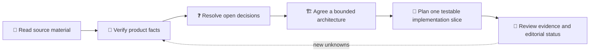

# 🧠 Pensieve

**Status:** 🟡 Planning — these materials are not publication-ready.

Pensieve is the first product topic being explored in VICHARA. The current
materials frame an idea for connecting user-visible AI-assistant experiences
with useful product insight. They are **exploration**, not verified facts about
an existing application or a final implementation design.

## 📚 Explore the materials

| Document | What it is | Editorial status |
|---|---|---|
| [`Pensieve.md`](./Pensieve.md) | Source specification and initial exploration | Source material; claims need verification |
| [`ideation-and-implementation-plan.md`](./ideation-and-implementation-plan.md) | Problem framing, proposed direction, phases, open questions, and research gates | Planning draft |

## 🛤️ From exploration to a publishable plan

## 🔐 Before going further

- Identify the real product context, owners, and current architecture.
- Verify event sources, identity assumptions, data retention, and privacy needs.
- Keep prompts, completions, credentials, and sensitive user details out of
  public content, analytics, logs, and test fixtures.
- Treat open decisions in the plan as questions—not settled design choices.

Future research or draft articles can live alongside these documents when
needed. Keep them clearly marked until their facts and publication status have
been reviewed.
