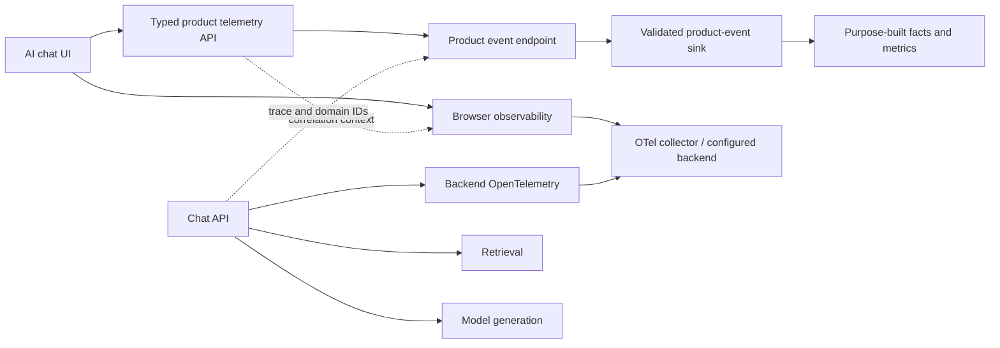

# Pensieve: Ideation and Implementation Plan

- **Status:** Planning draft; not approved for publication as a finished article.
- **Source:** [`Pensieve.md`](./Pensieve.md)
- **Purpose:** Turn a long-form exploration of AI-chat instrumentation into a
  coherent, evidence-backed VICHARA architecture entry and an incremental
  engineering plan.

## 1. Executive summary

Pensieve explores how an AI assistant can connect user-visible product
behavior—questions, answers, citations, feedback, and actions—with the
technical execution behind it—retrieval, model generation, APIs, and
distributed traces. Its strongest architectural idea is a shared correlation
model across two distinct telemetry planes:

1. **Product analytics:** durable, semantically named events used to understand
   user journeys and outcomes.
2. **Technical observability:** OpenTelemetry traces, metrics, and logs used to
   diagnose latency, failures, and service behavior.

The source is a broad design notebook rather than an implementation-ready
specification: it spans 175 numbered sections and roughly 8,200 lines, ranging
from event identity and React instrumentation to MongoDB aggregation,
ClickHouse, retention, and sharding. The first implementation should not build
all of those systems. It should establish the user/problem model, an
implementation-neutral event contract, and a small, testable telemetry slice.
Storage, vendors, and scale-out architecture should be chosen only after
requirements and workload evidence are available.

## 2. Product vision

**Working vision:** Give an AI application a trustworthy behavioral memory:
the ability to explain what a user tried, what the system did, whether the
answer helped, and where the experience or infrastructure failed—without
capturing more personal data than necessary or slowing down the interaction.

**User journey to explain:** A visitor starts a session, asks a question in a
chat, receives an answer grounded in retrieved sources, opens a citation,
provides feedback, and optionally completes a downstream action. The system
must correlate that journey to retrieval and generation work while keeping
product facts distinct from sampled diagnostic telemetry.

### Intended stakeholders

- Product owners: activation, successful outcomes, retention, and answer value.
- Frontend engineers: semantic UI events, reliable delivery, and low client cost.
- Backend/platform engineers: request correlation, service health, and failure
  diagnosis.
- AI/ML engineers: retrieval, model, prompt, quality, and cost evaluation.
- Data/analytics teams: definitions, event quality, metric lineage, and cohorts.
- Security/privacy reviewers: data minimization, access, retention, and deletion.

## 3. Problem framing and desired outcomes

### Problems to solve

- Product teams count requests but cannot reliably determine whether answers
  were useful or led to an outcome.
- UI, API, retrieval, and generation telemetry use different identifiers and
  naming conventions.
- A sampled trace stream cannot serve as the complete source for product
  analytics.
- Uncontrolled event capture can leak prompts, answers, identifiers, or
  sensitive context.
- Metrics can become ambiguous when their event source, denominator, time
  window, or entity grain is not explicit.

### Jobs to be done

1. Reconstruct a single AI interaction from session through answer and follow-up.
2. Measure meaningful product outcomes without relying on arbitrary click counts.
3. Diagnose technical failures and latency across service boundaries.
4. Evolve event contracts without silently breaking deployed clients or reports.
5. Audit which data is collected, retained, sampled, and exposed to each team.

## 4. Core design principles

1. **One correlation vocabulary, separate lifecycles.** Share identifiers and
   trace context where appropriate; do not merge analytics storage and
   observability storage by default.
2. **Semantic events over blanket autocapture.** Instrument domain actions such
   as `question.submitted`, `response.completed`, `citation.clicked`, and
   `feedback.submitted`; do not treat every render or component click as a
   product event.
3. **Product events are not trace samples.** Define reliability and retention
   independently for each telemetry plane.
4. **Instrumentation is non-blocking.** Telemetry failure must not prevent a
   question, answer, feedback action, or navigation from completing.
5. **Minimize data at the source.** Do not collect raw message bodies, prompts,
   completions, credentials, or sensitive profile values by default.
6. **Contracts precede dashboards.** Specify event names, versions, required
   fields, allowed properties, and metric definitions before broad rollout.
7. **Start small and measure.** Add queues, specialized stores, sharding, and
   advanced processing only when reliability or workload evidence requires them.
8. **Make every metric traceable.** A metric must have a documented definition,
   grain, source events, exclusions, and known limitations.

### Proposed article spine

1. Start with the end-to-end user journey and the questions each team needs to
   answer.
2. Explain why product analytics and technical observability have separate
   delivery, sampling, and retention rules.
3. Define the identity hierarchy, correlation contract, and versioned event
   envelope.
4. Show where semantic events belong in the AI-chat, retrieval, and generation
   journey.
5. Present the logical dual-plane architecture and a deliberately small first
   implementation.
6. Define privacy controls, metric semantics, tests, and operational failure
   behavior before vendor comparisons.
7. Close with measurable decision gates for queues, analytical stores, and
   other scale-up options.

## 5. Proposed conceptual architecture



This is a logical design, not a vendor or deployment decision. The first
technical slice should prove event contracts, correlation, privacy controls,
and non-blocking behavior before choosing a durable queue, database, analytics
vendor, or dashboard product.

### Identity and correlation model to specify

The source proposes identifiers including `visitor_id`, `session_id`,
`tab_id`, `chat_id`, `turn_id`, `request_id`, `response_id`, and `trace_id`.
The implementation plan should define:

- Which identifiers are generated by the browser, application backend, or
  tracing SDK.
- Scope, lifetime, uniqueness, reset behavior, and parent/child relationships.
- How logged-in account identity (if any) relates to pseudonymous visitor
  identity.
- Which IDs may be persisted, exposed to analysts, or used as metric labels.
- Whether the product actually needs cross-session user-level analytics.

No identity scheme is considered approved until privacy, consent, retention,
and account requirements are reviewed.

### Initial event envelope

Design a versioned, typed envelope before selecting the transport:

| Field group | Candidate fields | Contract questions |
|---|---|---|
| Event | `event_id`, `event_name`, `event_version`, `occurred_at` | Naming, schema evolution, idempotency |
| Context | `application_version`, `environment`, `locale` | Allowlist and cardinality |
| Journey IDs | visitor/session/chat/turn/request/response IDs | Ownership, lifetime, privacy |
| Trace | `trace_id`, optional span context | Propagation and sampling semantics |
| Properties | event-specific, allowlisted values | Validation, size caps, redaction |
| Delivery | `received_at`, schema outcome | Server-generated receipt and diagnostics |

Event timestamps should distinguish client occurrence time from server receipt
time. Server-derived fields should not be trusted from the browser. Raw
conversation text and unbounded arbitrary property maps are excluded by
default.

## 6. MVP scope and explicit exclusions

### MVP proof

- A reviewed event taxonomy for the core AI-chat journey.
- A documented envelope and identifier ownership/correlation rules.
- A thin typed application-facing telemetry interface.
- Semantic instrumentation for a small end-to-end journey:
  session start, question submitted, response completed/failed, citation
  clicked, and feedback submitted.
- Backend trace correlation for request, retrieval, and generation.
- Input validation, property allowlists, redaction, delivery failure handling,
  and instrumentation tests.
- A small initial metric catalog with exact definitions and source lineage.
- A local or existing approved sink, selected after the product and privacy
  decisions in section 10 are resolved.

### Not in the first implementation

- MongoDB as a mandatory event store or as an operational source of truth.
- ClickHouse, a multi-sink platform, sharding, or a custom queue before measured
  need.
- Capturing every DOM event, session replay, or storing raw prompts/answers.
- A broad BI dashboard before event quality and metric definitions are proven.
- User-level identity stitching without explicit consent and retention policy.
- Automatic retries that can create unbounded client buffers or duplicate
  product outcomes without idempotency.

## 7. First-pass event taxonomy

The final catalog must be reviewed against actual Pensieve UI/API behavior. The
following is a discovery set, not a promise that every event will ship.

| Journey stage | Candidate events | Required interpretation |
|---|---|---|
| Session | `session.started`, `session.ended` | Define session boundary and inactivity rules |
| Chat | `chat.created`, `question.submitted` | Do not include message text by default |
| Answer | `response.started`, `response.completed`, `response.failed`, `response.cancelled` | Clarify streaming and cancellation semantics |
| Retrieval | `retrieval.completed`, `retrieval.failed` | Prefer backend spans for technical detail |
| Citations | `citation.impression`, `citation.clicked` | Define impression visibility and eligible denominator |
| Feedback | `feedback.submitted`, `feedback.updated` | Link feedback to a response; avoid inferred sentiment |
| Actions | `form_link.clicked`, `action.completed` | Separate click intent from verified completion |
| Reliability | delivery/schema diagnostics | Keep product events and diagnostic logs distinct |

Events should be emitted from domain actions or approved wrappers, not inferred
from component render frequency. Avoid duplicate semantic events when both
client and server observe the same action; designate an authoritative producer
for each event.

## 8. Initial metric catalog

Before implementation, agree on definitions and distinguish product metrics
from system-health measures.

| Metric | Candidate definition | Important guardrail |
|---|---|---|
| Question-to-answer completion | Eligible turns with a completed response / eligible submitted turns | Define cancellation, errors, and retries |
| Positive feedback rate | Positively rated responses / rated responses | Do not use all responses as denominator |
| Citation click-through | Eligible citation clicks / citation impressions | Define impression visibility and deduplication |
| Time to first token | Time from accepted request to first generated token | Use trace/span timing, not client wall-clock alone |
| End-to-end answer latency | Accepted request to terminal response state | Segment by model/retrieval only with safe dimensions |
| Telemetry delivery rate | Accepted product events / valid events attempted | Exclude retries consistently; monitor dropped events |
| Cost per completed answer | Attributed model cost / completed responses | State attribution and missing-cost treatment |
| Return usage | Returning eligible visitors / eligible cohort | Requires reviewed identity, consent, and retention policy |

The source's proposed **Weekly Successful Answer Users (WSAU)** north star must
remain a hypothesis until validated against product goals and user outcomes.
Avoid labeling a metric "successful answer" unless its measurable proxy and
limitations are explicit.

## 9. Incremental implementation roadmap

| Phase | Deliverable | Exit evidence |
|---|---|---|
| P0 — Source and product discovery | Glossary, current-system map, stakeholder questions, source inventory | Every major claim labeled as requirement, hypothesis, example, or option |
| P1 — Decisions and privacy | Decisions on identity, consent, data classes, event retention, sink, and ownership | Reviewed decision record; no unresolved privacy blocker |
| P2 — Event contract | Versioned schema, event catalog, producer ownership, compatibility policy | Positive/negative schema tests; unknown fields and sensitive fields rejected |
| P3 — Frontend slice | Typed telemetry facade and semantic events for one chat journey | Unit/component tests; chat works during endpoint failure; bounded batching |
| P4 — Backend correlation | Trace propagation across chat API, retrieval, and generation | Integration test links turn/request IDs to trace; no high-cardinality metric labels |
| P5 — Ingestion and persistence | Validated endpoint and approved durable sink; idempotent writes and failure policy | Load/error tests; duplicates bounded; invalid payloads visible and actionable |
| P6 — Facts and metrics | One or two derived facts and a small metric output | Reproducible fixtures; lineage and grain documented |
| P7 — Production readiness | Privacy/security review, performance budget, retention/deletion, rollout plan | Approved release checklist, dashboards for telemetry health, rollback tested |
| V1+ — Scale evolution | Queue, specialized analytical store, richer cohorts/funnels, experiments | Evidence-based trigger and ADR for each added operational component |

Phases P0–P2 should be completed before implementation-specific provider or
storage choices are locked. P3 and P4 can proceed in parallel only after the
event and trace correlation contracts are frozen. A central integrator should
own shared schema, SDK interfaces, and ingestion contracts.

## 10. Decisions required before implementation

| Decision | Options to evaluate | Blocking work |
|---|---|---|
| Application context | Existing Pensieve stack and services; greenfield prototype | All integration work |
| Identity | Session-only anonymous; pseudonymous visitor; authenticated user linkage | User-level analytics and retention |
| Consent and legal basis | Product/privacy requirements by deployment and jurisdiction | Browser identity and analytics collection |
| Data policy | Explicit property allowlist, redaction, deletion workflow | Event schema and persistence |
| Delivery guarantee | Best-effort client plus server authority; durable queue; retry/idempotency model | Ingestion and reliability claims |
| Product event sink | Existing approved analytics platform; managed event API; self-hosted storage | P3/P5 implementation |
| Observability backend | Existing OTel-compatible platform; local development collector | Trace export and operations |
| Retention and access | Per-event-class retention, analyst access, deletion obligations | Storage design and release |
| First business outcome | Answer utility, citation use, form completion, another user outcome | Metric prioritization |
| Scale trigger | Event volume, query latency, availability, or cost threshold | Queue/database/ClickHouse evolution |

Do not resolve these from examples in the source document. Record material
choices as ADRs after current product, regulatory, and operational context is
known.

## 11. Quality, privacy, and reliability gates

- No prompt, completion, authorization token, credential, raw account profile,
  or sensitive content appears in event properties, logs, test fixtures, or
  dashboards by default.
- Schema validation is enforced at producers and ingestion; invalid events
  have an explicit observable outcome, not silent success-shaped fallback.
- Trace sampling never silently changes product-event counts or outcome
  metrics.
- Analytics transport cannot block or fail the primary chat interaction.
- Client queues, event sizes, retries, and flush time are bounded.
- Events are deduplicable, with explicit server/client producer ownership and
  idempotency keys where needed.
- Metric definitions document grain, time zone/window, numerator, denominator,
  exclusions, and source lineage.
- Tests cover missing/invalid IDs, schema-version compatibility, duplicate
  delivery, offline/slow endpoint, redaction, cancellation, and late events.
- Access controls, retention, deletion, and incident response are documented
  for the selected sink before production data is collected.

## 12. Editorial and research plan for the source document

### Source-to-article map

| Source sections | Main material | Treatment |
|---|---|---|
| 1–18 | Product problem, analytics vs observability, identities, event envelope, taxonomy, architecture | Core narrative; reconcile contracts before publication |
| 19–37 | Browser/backend packages, UI instrumentation, event storage, queues, OpenTelemetry, privacy, sampling | Keep implementation patterns that survive stack discovery; move provider-specific setup to examples |
| 38–63 | Funnel and quality metrics, retention, cost, metric lineage, instrumentation health, tests, anti-patterns, initial roadmap | Condense into a metric catalog and quality gates |
| 64–86 | Tool selection, SDK abstraction, schema validation, vendor comparisons, autocapture, component instrumentation | Keep decision criteria; date-stamp and verify vendor claims |
| 87–115 | Collection choices, analytics pyramid, facts, schedules, MongoDB/ClickHouse alternatives and evolution | Reframe as staged options with explicit scale triggers |
| 116–175 | MongoDB behavioral data model, event/fact collections, processing, watermarks, operations, retention, sharding | Treat as an optional implementation appendix, not the default architecture |

Before publishing an article derived from `Pensieve.md`:

1. Preserve the original file unchanged as source material while the plan is
   reviewed.
2. Reorganize the narrative into problem, event/identity contracts, dual-plane
   architecture, implementation slices, metrics, privacy, testing, and
   scale-up decisions.
3. Collapse repeated material and move detailed schema examples, metric
   definitions, and storage alternatives into focused appendices or linked
   entries if they remain useful.
4. Replace recommendations that assume MongoDB, ClickHouse, `analytics`, or
   a specific queue with decision criteria unless current Pensieve requirements
   justify a choice.
5. Verify time-sensitive claims and APIs against current official vendor
   documentation; cite claims and record verification dates.
6. Normalize the repeated misspelling “Pencieve” to “Pensieve” in any edited
   publication copy, without silently rewriting the source file.
7. Label examples, hypotheses, and decisions distinctly; avoid presenting
   illustrative IDs, user journeys, dates, retention windows, or thresholds as
   production facts.
8. Keep the resulting VICHARA entry in draft status until factual review,
   privacy review, and publication approval are complete.

### Proposed VICHARA metadata (not yet committed as a content entry)

```yaml
id: ent_pensieve_ai_telemetry_001
slug: pensieve-ai-telemetry
kind: architecture
publication: draft
status: exploring
lenses: [conceptualization, hypothesis, analysis, research, architecture]
domains: [ai, software-engineering, data-engineering]
```

The ID, slug, taxonomy values, and metadata must be validated against the
implemented content schema before creating a publishable entry. Do not add
personal, client, or otherwise sensitive product details without authorization.

## 13. Definition of ready and done

### Ready to implement

- Existing Pensieve application architecture and owners are known.
- Event producers and core journey events are agreed.
- Identity, consent, raw-data, retention, access, and deletion policies are
  reviewed.
- A provider-neutral event schema and metric definitions are approved.
- An initial sink and local test strategy are selected with an ADR where
  required.

### Done for the first production slice

- The defined chat journey emits valid, semantically correct events.
- A response can be correlated to request, turn, retrieval/generation spans,
  and its user-visible outcome without exposing message text by default.
- Chat behavior remains correct with telemetry offline, slow, malformed, or
  unavailable.
- Duplicate, sampled, delayed, and invalid telemetry behave according to the
  documented contract.
- At least one product metric and one technical service metric are reproducible
  from tested source data and have clear lineage.
- Privacy, access, retention, operational alerting, and rollback checks pass.
- The published VICHARA article accurately distinguishes shipped behavior from
  future architecture.

## 14. Immediate next steps

1. Confirm this scope and keep the first delivery to contracts plus one journey.
2. Inventory Pensieve's actual frontend, backend, retrieval, model, identity,
   hosting, and observability systems.
3. Resolve the blocking questions in section 10 with product, engineering,
   privacy, and operations owners.
4. Create the first ADRs and an event-catalog/schema proposal.
5. Prototype the end-to-end event and trace correlation with synthetic,
   non-sensitive test data before collecting production telemetry.
