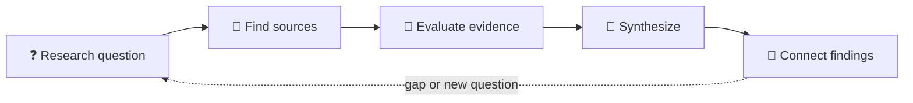

# 📚 Research

Research gathers sources and evidence to help answer a question. Preserve the
trail from source to interpretation so readers can inspect how a conclusion
was reached.

## 🔬 A practical research path

| Step | Record |
|---|---|
| ❓ Question | Scope, context, and what is not being asked |
| 🔎 Search | Where and how sources were found |
| 🧾 Evaluate | Source reliability, recency, and limitations |
| 🧩 Synthesize | Patterns, disagreements, and gaps |
| 🔗 Connect | Related concepts, hypotheses, analyses, and products |

## ✅ Research hygiene

- Keep references with the notes they support.
- Distinguish direct evidence, interpretation, and speculation.
- Record dates for claims that can become stale.
- Respect licenses, privacy, and source attribution.
