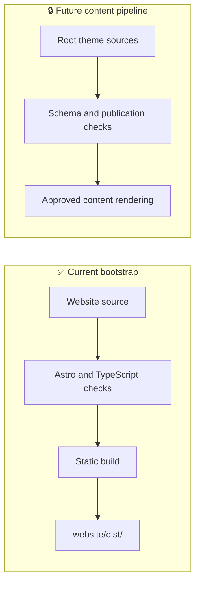

# 🌐 VICHARA Website

The `website/` folder contains the Astro and TypeScript application, build
configuration, dependencies, and presentation code. It is the **view onto**
VICHARA's knowledge—not the canonical home for product research or drafts.

## ⚙️ Run it locally

Requirements: **Node.js 22.22+** and **npm**.

```bash
npm ci
npm run dev
```

## ✅ Validate a change

```bash
npm run check
npm run lint
npm test
npm run build
```

| Command | Checks |
|---|---|
| `npm run check` | Astro and TypeScript diagnostics |
| `npm run lint` | ESLint rules |
| `npm test` | Vitest unit tests |
| `npm run build` | Type check and static Astro build |

## 🏗️ Current build boundary

The present application is a bootstrap site. Content collections,
schema-validation, privacy-safe publication, and hosting deployment are future
work; do not assume the site already renders the root theme content.



## 🔐 Guard the publishing boundary

- Canonical source material stays in the root theme folders.
- Draft and private content must not enter public output, search, feeds, or
  generated assets.
- Add collection loading only with validation and publication filtering in
  place.
- Deployment remains deferred until the release criteria are met.
